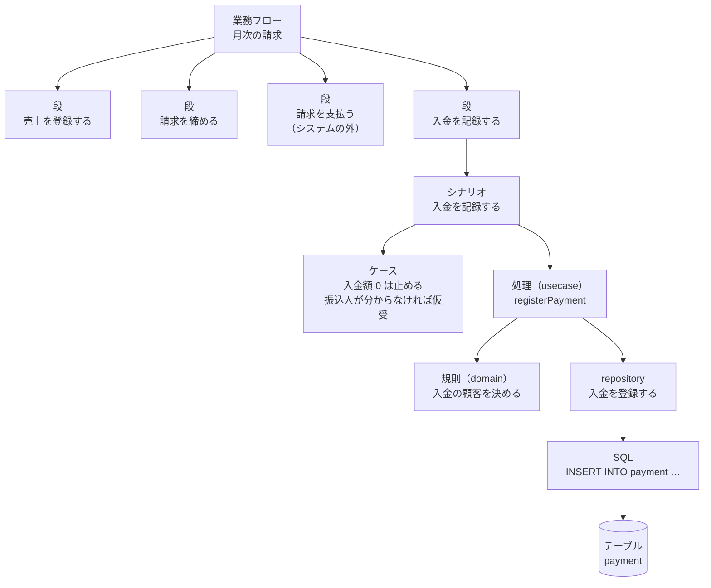
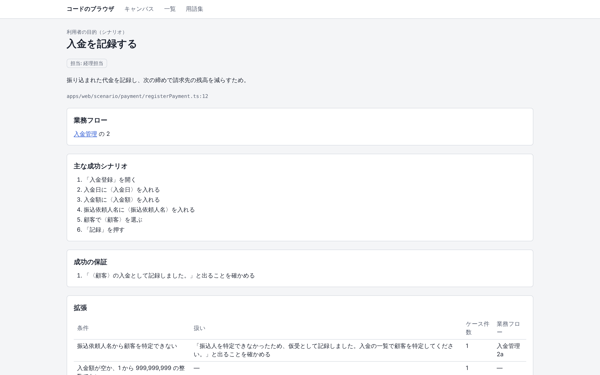
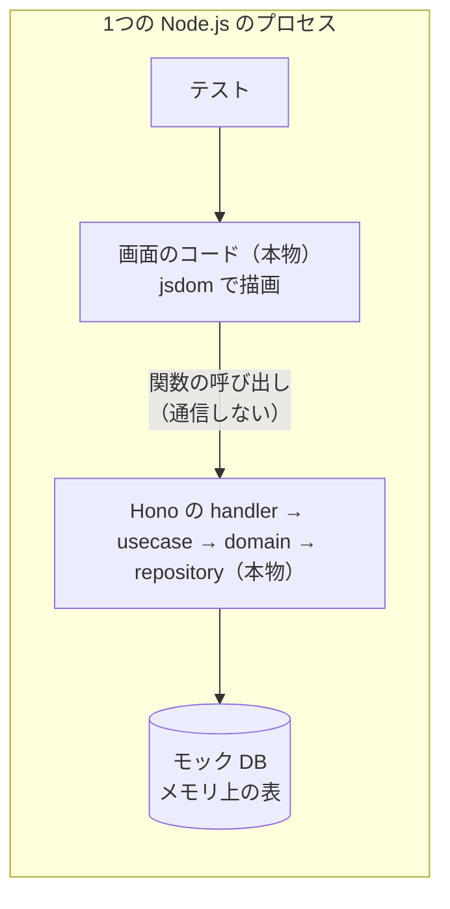
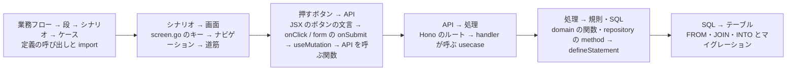
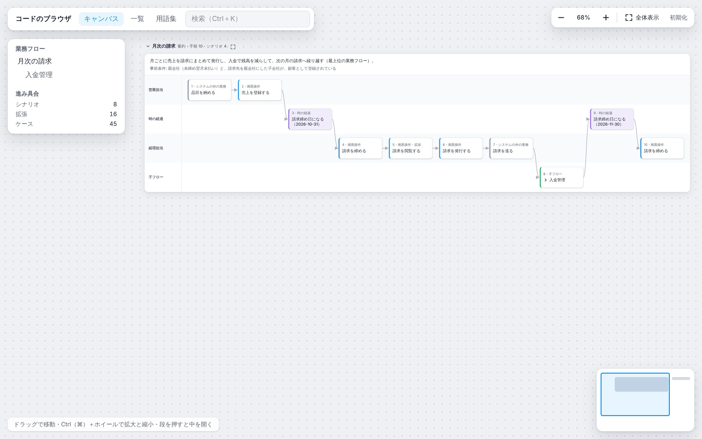
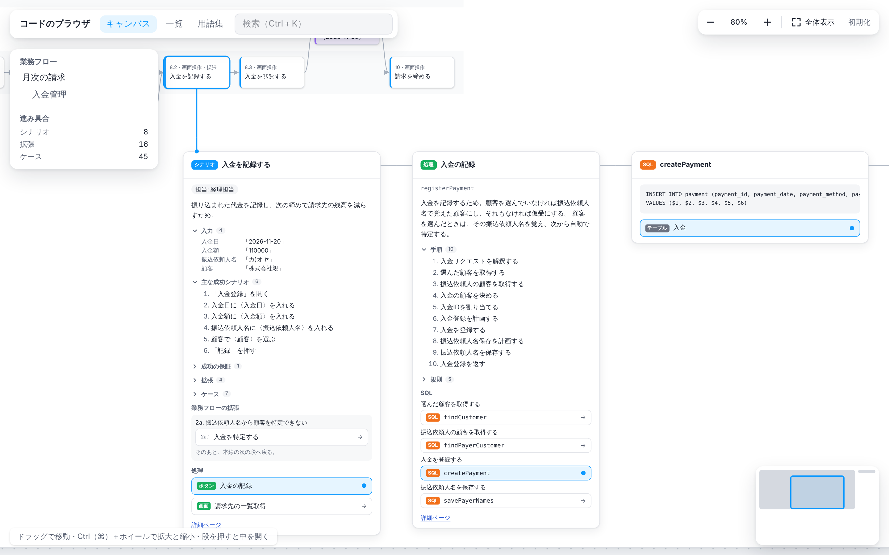
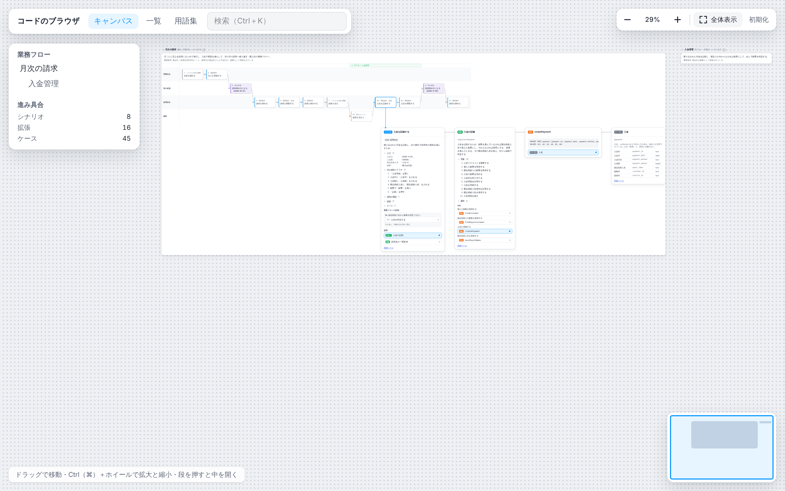
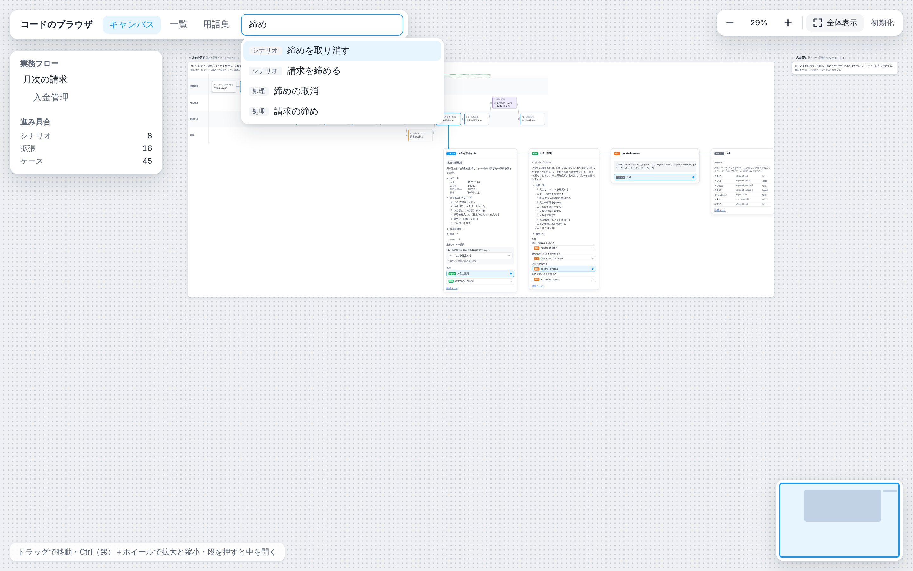

業務システムを作っていると、ほぼ必ず「要件定義書・設計書・テスト・コードがずれていく」問題にぶつかります。この記事では、その問題に対して次の2つの主張をし、TypeScript（React + Hono）の業務 Web アプリの土台を実例として、考え方からアーキテクチャまで全部書きます。

> **"型"が要件定義を解決する。**
> **要件定義が解決されたら、システムは完成する。**

ここでいう「型」は、TypeScript の型だけでなく、**書き方を絞った構造**全体を指します。言葉（語彙と文法）、業務フロー、シナリオ、テストケース、処理の書き方、SQL の持ち方。それらを決まった形で書くと、機械が読めるようになり、ずれを型エラーや検査で止められるようになります。

:::message
この記事で扱うリポジトリは、業務 Web アプリを作るための土台（フレームワーク兼サンプル実装）です。サンプルの業務は「売上の登録 → 残高を繰り越す請求書の締め・発行 → 入金の管理」です。

リポジトリ: https://github.com/Soiya-kun/web-app-framework
:::

## 1. 要件定義はなぜずれるのか

ふつうは、次の順に成果物が増えていきます。

1. 業務のヒアリングをして、業務フローを描く
2. 基本設計で、画面・機能・データを決める
3. 詳細設計で、処理の手順・規則・テーブルを決める
4. コードとテストを書く

そして、上の成果物と下の成果物がずれていきます。業務フローの図は最初の打合せのまま、設計書はコードを直すたびに古くなり、テストは「何の業務を確かめているのか」が誰にも分からなくなります。

ずれる理由は単純で、**同じことを別々の場所に、別々の形で書いている**からです。

- 業務フローは図（drawio や Excel）で、設計書は文章で、テストはコードで書く
- 同じものを場所ごとに違う言葉で呼ぶ（打合せでは「請求」、画面では「請求書」、コードでは `billing` と `invoice` が混ざる）
- それぞれの間に機械で確かめられるつながりがないので、ずれても何も止まらない

「設計書を後から直す運用」で防ごうとしても、直す手間が積み上がり、どこかで追いつかなくなります。コードやテストに後からコメントで意味を足し、それを集めて設計ビューアに出す方式もありますが、こちらも「コメントとコードのずれを防ぐ規則」が増えていきます。

## 2. 主張：「型」が要件定義を解決する

### 2.1 一本の木

このリポジトリでは、要件から実装までを**一本の木**として扱います。上ほど業務に近く、下ほど実装に近い。どの階層も同じ言葉（単語帳）で書きます。



| 階層 | 何を表すか | 正本（どこに書くか） |
| --- | --- | --- |
| 業務フロー | 業務のひと続き（月次の請求） | `apps/web/flow/*.ts`（TypeScript） |
| 段 | フローの1ステップ（画面の操作・システムの外の業務・時の経過など） | 同上 |
| シナリオ | 1人が1回の操作で目的を果たす手順 | `apps/web/scenario/**/*.ts` |
| ケース | 同じシナリオの入力や条件の違い | `apps/web/scenario/**/*.test.tsx`（画面の結合テスト） |
| 処理 | 業務処理の手順 | `packages/backend/src/usecase` |
| 規則 | 判断・計算 | `packages/backend/src/domain` |
| SQL・テーブル | 保存と読み出し | `packages/backend/src/repository`・マイグレーション |

### 2.2 4つの原則

1. **正本は1つにする。** 業務フローもシナリオも処理も、正本はコード。読み物（日本語の訳・SQL の台帳・ブラウザの表示）はコードから生成し、手で書かない。
2. **書き方を絞ると、機械で読める。** 名前に使う言葉、業務フローの段の種類、処理の書き方、SQL の持ち方を絞る。
3. **機械で読めるから、日本語に訳せて、つながりをたどれる。**
4. **機械で読めるから、半強制できる。** 決まった形で書かれていなければ、型・lint・検査で止める。人の注意に頼らない。

「型が要件定義を解決する」とは、**要件を「決まった形の構造」として書くことで、要件のずれ・抜け・未着手を、型エラー・検査・数で見えるようにすること**だと定義します。

## 3. 言葉の型 — 単語帳

木をたどるには、同じものが同じ名前で呼ばれていなければなりません。そこで最初に、言葉を1つのマスタ（単語帳）に集めました。目指したのは次の4つです。

1. コードは英語で書く
2. コードに使う英単語と文法を固定し、日本語への翻訳の仕組みを持つ（仕様を日本語で読めるようにする）
3. 画面でも同じ専門用語を使う
4. 多言語にするときも、同じマスタから言葉を出す

### 3.1 概念＋語形＋文法

単語帳は「言語に依らない概念」と「言語ごとの語形」と「文法」に分かれています。考え方は Grammatical Framework（抽象構文と具象構文）や、制御自然言語（決まった語彙と文法だけで書く言語）と同じです。

```yaml
- { id: amount, ja: { form: 金額, attach: direct } }                 # 前の名詞へ「の」なしでつなぐ（売上金額）
- { id: customer, en: { plural: customers }, ja: { form: 顧客 } }    # 前の名詞へは「の」でつなぐ（振込依頼人の顧客）
- { id: issue, en: { noun: issuance }, ja: { stem: 発行, class: suru } }
- { id: cancel, en: { past: canceled, gerund: canceling, noun: cancellation }, ja: { dictionary: 取り消す, class: godan, noun: 取消 } }
- { id: billingCustomer, en: { tokens: billing customer }, ja: { form: 請求先 }, description: 請求書を受け取り、入金する顧客。… }
```

- 英語は原形から複数形・過去分詞・-able・un- などを作り、不規則なものだけ書きます。
- 日本語の動詞は活用の型（サ変・一段・五段）から、「発行する・発行済み・未発行」などを作ります。
- `unissued` は「issue の未完了」として文法が「未発行」を作るので、訳の文字列を持ちません。
- 部分の組合せで訳が決まらない言い回し（`billingCustomer` ＝「請求先」）だけ、複合語として1つの概念にします。

### 3.2 英日を1対1にする（全単射）

生成のときに、英語でも日本語でも同じ語形を2つの概念に当てていたら止めます（「請求」を invoice と billing の両方に当てない）。さらに、生成した日本語の見出しを日本語の文法で読み戻し、すべて元の英語の名前に1通りに戻ることをテスト（往復のテスト）で確かめています。

1対1なので、日本語から英語の名前を引けます。

```sh
pnpm vocabulary:find 振込依頼人の顧客       # → payerCustomer
pnpm vocabulary:find 請求に載せていない入金   # → unbilledPayment
```

ヒアリングで日本語で書いた業務の名前から、コードの名前が決まります。

### 3.3 コード・翻訳・画面が同じマスタを使う

- **コード:** lint（`app/known-words`）が、単語帳にない英単語を名前に使うと止めます。`add`・`get`・`parse` のような「同じ意味の別の語」も止めます。関数名は動詞で始める（`app/verb-first`）。DB のテーブル名・列名も同じ単語帳で検査します。
- **翻訳:** 語彙と文法が決まっているので、関数名を体言止めに、処理を「〜する」の手順に機械で訳せます。
- **画面:** 画面のコードは文言を直接書かず、`text.label('paymentDate')` のようにキーで引きます。生成器が画面のコードからキーを集め、`locale/ja.json`・`locale/en.json` とキーの型を作ります。文言ファイルにないキーは型エラーになります。

ふつうの i18n では、キーごとに言語別の文字列を人が書くので、言語のあいだで用語がずれても気づけません。ここでは人が文字列を書かず、概念と文法から生成するので、同じ概念はどの画面・どの言語でも同じ語になります。単語帳を足すと、そのまま用語集にもなります（業務の言葉は説明が必須）。

:::message
厳しい単語帳は、最初は窮屈に感じます。実際、この記事のもとになった開発でも、新しい画面を書くたびに lint が「単語帳にない単語」を数十件出しました。ただ、そのたびに「この概念はすでにあるか」「この名前で業務の人に通じるか」を考えることになり、言葉の重複（同じ語を2つの意味で使う、2つの語で同じ意味を表す）がその場で止まります。
:::

## 4. 要件の型 — 業務フロー・シナリオ・ケース

ここが本題です。要件（業務フロー・シナリオ・テストケース）を TypeScript で書きます。

### 4.1 業務フロー

```ts
/** 月ごとに売上を請求にまとめて発行し、入金で残高を減らして、次の月の請求へ繰り越す（最上位の業務フロー）。 */
export const monthlyInvoice = defineFlow<Partial<MemoryDatabase>>('monthlyInvoice', {
  precondition: { summary: '親会社（末締め翌月末払い）と、請求先を親会社にした子会社が、顧客として登録されている', seed: { customer: customers } },
  steps: [
    outside('salesperson', 'deliverItem'),
    operate(createSales, { customer: '株式会社子', salesDate: '2026-10-15', salesKind: '通常', itemName: '運賃', salesAmount: '100000', taxRate: '10%' }),
    elapse('closingDate', '2026-10-31'),
    operate(closeInvoice, { ...october, breakdown: { currentSalesAmount: 100_000, taxAmount: 10_000, currentInvoiceAmount: 110_000 } }),
    operate(browseInvoice, october, {
      mistakenInvoice: {
        input: october,
        then: [operate(cancelClosing, october), /* 漏れた売上を登録 → 締め直す → 発行する */],
        resume: false,
      },
    }),
    operate(issueInvoice, { ...october, issueDate: '2026-11-02' }),
    outside('accountant', 'sendInvoice'),
    nest(paymentManagement),
    elapse('closingDate', '2026-11-30'),
    operate(closeInvoice, { /* … */ breakdown: { previousInvoiceAmount: 110_000, currentPaymentAmount: 110_000, carriedAmount: 0, currentInvoiceAmount: 0 } }),
  ],
})
```

段は5種類だけです。

| 段 | 書き方 | 意味 | テストで流すとき |
| --- | --- | --- | --- |
| 画面の操作 | `operate(シナリオ, 値, 拡張)` | 1人が画面で目的を果たす | シナリオの手順と成功の保証を流す |
| システムの外の業務 | `outside(担当, 名前)` | 品目を納める・請求書を送る | 何もしない（流れ図に出す） |
| 外のイベント | `occur(担当, 名前)` | 顧客が請求を支払う | 何もしない |
| 時の経過 | `elapse(名詞, 'YYYY-MM-DD')` | 締め日になる | テストの今日の日付をその日にする |
| 子フロー | `nest(業務フロー)` | 別の業務フローをひとまとまりで入れる | 子フローの段をその場で流す |

分岐は「拡張」だけにしました。拡張は画面の操作の段に付け、その段の代わりに拡張の段を流して、本線の次の段へ戻ります（戻すと後の段の金額が合わなくなるときは `resume: false` でその経路を終える）。BPMN のような汎用の記法は作っていません。表せることを絞ったほうが、ヒアリングで迷わず、機械でも読みやすいからです。

名前はすべて単語帳の言葉です。`deliverItem` は「品目を納める」、`monthlyInvoice` は「月次の請求」と訳されます。

### 4.2 シナリオ

シナリオは、主アクター・主成功シナリオの手順・成功の保証・拡張を持ちます。

```ts
/** 振り込まれた代金を記録し、次の締めで請求先の残高を減らすため。 */
export const registerPayment = defineScenario('registerPayment', {
  actor: 'accountant',
  operate: async (screen, payment: PaymentInput) => {
    await screen.go('paymentCreate')
    await screen.fill('paymentDate', payment.paymentDate)
    await screen.fill('paymentAmount', payment.paymentAmount)
    await screen.fill('payerName', payment.payerName)
    await screen.choose('customer', payment.customer)
    await screen.press('register')
  },
  confirm: async (screen, payment) => {
    await screen.expectMessage('paymentIdentified', { customer: payment.customer })
  },
  extensions: {
    unidentifiedPayer: {
      condition: '振込依頼人名から顧客を特定できない',
      confirm: async (screen) => {
        await screen.expectMessage('unidentifiedPayment')
      },
    },
    invalidPaymentAmount: { condition: '入金額が空か、1 から 999,999,999 の整数でない' },
  },
})
```

`screen` の操作（`go`・`fill`・`choose`・`press`・`row`・`expect…`）は、利用者と同じくラベル・ボタンの名前で画面の要素を指します。名前は単語帳のキーで書くので、**画面にない文言のキーは型エラー**になります。

キーが単語帳の言葉なので、静的解析でこう訳せます。

> **入金を記録する**（主アクター: 経理担当）
> 1. 「入金登録」を開く
> 2. 入金日に〈入金日〉を入れる
> 3. 入金額に〈入金額〉を入れる
> 4. 振込依頼人名に〈振込依頼人名〉を入れる
> 5. 顧客で〈顧客〉を選ぶ
> 6. 「記録」を押す
>
> 成功の保証: 「〈顧客〉の入金として記録しました。」と出ることを確かめる

この訳は、後で出てくる「コードのブラウザ」のシナリオのページにそのまま出ます。


*シナリオのページ。主アクター・目的・使う業務フロー・主な成功シナリオ・成功の保証・拡張が、コードから生成されて並ぶ*

### 4.3 ケース

画面のテストは、すべてシナリオのケースとして書きます。

```tsx
describeScenario(registerPayment, (cases) => {
  cases.main('顧客を選んで記録すると、その顧客の入金にし、振込依頼人名を半角・全角の違いをそろえて覚える', async () => {
    const app = await registerOnScreen(validPayment)

    await confirmScenario(registerPayment, app.screen, validPayment)
    expect(app.database.payerName).toEqual([{ payerName: 'カ)オヤ', customerId: 'customer-0001' }])
  })

  cases.vary('顧客を選ばなければ、覚えた振込依頼人名から顧客を特定する', async () => { /* … */ })

  cases.extendEach(
    'invalidPaymentAmount',
    [{ paymentAmount: '0', messageKey: 'invalidRange' }, /* … */] as const,
    '入金額「$paymentAmount」は「$messageKey」で止める',
    async ({ paymentAmount, messageKey }) => {
      const app = await registerOnScreen({ ...validPayment, paymentAmount })

      await app.screen.expectProblem('paymentAmount', messageKey, { minimum: 1, maximum: 999_999_999 })
      expect(app.database.payment).toEqual([])   // 止めたときは、何も保存していない
    },
  )
})
```

| 書き方 | 種類 | 書くもの |
| --- | --- | --- |
| `cases.main` | 主成功シナリオ | シナリオに1つだけ |
| `cases.vary`・`varyEach` | 技術とデータのバリエーション | うまくいく範囲での入力の違い |
| `cases.extend`・`extendEach` | 拡張 | シナリオに書いた拡張の条件のときの扱い |

`extend` の第1引数は、シナリオの `extensions` のキーです。ない拡張を指すと型エラーになります。中身（関数）を書かなければ vitest の todo（未着手）になります。

### 4.4 コーバーン『ユースケース実践ガイド』との対応

この形は、アリスター・コーバーンの『ユースケース実践ガイド』（*Writing Effective Use Cases*）にかなり近いと気づき、言葉と構造を合わせました。

| コーバーン | この仕組み |
| --- | --- |
| 要約レベル（雲・凧） | 業務フロー |
| 利用者の目的レベル（海面。「済んだらコーヒーを飲みに行ける」大きさ） | シナリオ |
| 下位機能レベル（魚） | 処理（usecase）・規則（domain） |
| 組織の業務のユースケース | システムの外の業務を含む業務フロー |
| 主アクター | シナリオの `actor` |
| 事前条件 | 業務フローの `precondition`・ケースで入れておく行 |
| 主成功シナリオ | シナリオの `operate` |
| 成功の保証 | シナリオの `confirm` |
| 最低限の保証 | 止めたときに「何も保存していない」ことを確かめるケース |
| 拡張 | シナリオの `extensions` と、そのケース |
| 技術とデータのバリエーション | `cases.vary` |

違うところもあります。コーバーンはユースケースの手順に画面の細部を書かず、利用者の意図で書くよう勧めます。この仕組みのシナリオはテストとして動かすので、画面の操作まで具体的に書きます。

### 4.5 型が要件を前へ進める

ここが「型が要件定義を解決する」の一番具体的なところです。

```ts
type OperateRest<Input, ExtensionName extends string> = [Input] extends [undefined]
  ? []
  : [input: Input, extensions?: Readonly<Partial<Record<ExtensionName, ExtensionFlow<Input>>>>]

/** 段: 画面の操作（シナリオ）。未着手のシナリオには値を渡さない。手順を書くと、値が要るようになる。 */
export function operate<Input, ExtensionName extends string>(
  scenario: Scenario<Input, ExtensionName>,
  ...rest: OperateRest<Input, ExtensionName>
): FlowStep
```

1. ヒアリング直後、シナリオは名前と担当だけ（`defineScenario('createSales', { actor: 'salesperson' })`）。業務フローには `operate(createSales)` と値なしで書きます。
2. シナリオに手順（`operate`）を書くと、入力の型が決まり、**業務フローの段が型エラー**になります（値が足りない）。
3. 業務フローに値を書くと型エラーが消え、業務フローの E2E がその段まで進みます。
4. 拡張のキーは型なので、業務フローの拡張・ケースの拡張がシナリオとずれると型エラーになります。

型エラーが「次に何を決めるべきか」を教えてくれる、という感覚です。

## 5. 実装の型 — 機械で読めるコード

### 5.1 usecase は「呼んで渡すだけ」

バックエンドは Hono で、domain・usecase・repository・handler の層に分けます。usecase には `if`・`for`・`let`・`try`・`throw`・メソッドチェーンを書かず、lint（`app/flat-steps`）が止めます。

```ts
/** 入金を記録するため。顧客を選んでいなければ振込依頼人名で覚えた顧客にし、それもなければ仮受にする。… */
export async function registerPayment(repositories: RepositorySet, idGenerator: IdGenerator, paymentRequest: PaymentRequest) {
  const paymentInput = interpretPaymentRequest(paymentRequest)
  const selectedCustomer = await repositories.customerRepository.findSelectedCustomer(paymentInput.customerId)
  const payerCustomer = await repositories.payerNameRepository.findPayerCustomer(paymentInput.payerName)
  const customerId = decidePaymentCustomer(selectedCustomer, payerCustomer)
  const paymentId = assignPaymentId(idGenerator)
  const paymentCreate = planPaymentCreate(paymentId, paymentInput, customerId)
  await repositories.paymentRepository.createPayment(paymentCreate)
  const payerNameSaves = planPayerNameSaves(paymentInput.payerName, selectedCustomer)
  await repositories.payerNameRepository.savePayerNames(payerNameSaves)
  return paymentCreate
}
```

こう絞ると、1行が1つの手順になり、そのまま日本語に訳せます。

> **入金の記録**
> 1. 入金リクエストを解釈する
> 2. 選んだ顧客を取得する
> 3. 振込依頼人の顧客を取得する
> 4. 入金の顧客を決める
> …

コメントに書くのは目的だけです。手順は名前から訳せるので書きません（書くと古くなる）。

### 5.2 判断は domain、値はブランド型

判断・計算は domain に置き、名前の形で役割を表します（`interpret…Request`・`ensure…`・`decide…`・`plan…`）。値はブランド型で区別し、`PaymentAmount` と `SalesAmount` を取り違えられないようにしています。業務エラーは例外で投げ、Hono の `onError` で HTTP の応答に変えます。

### 5.3 SQL は手で書き、固定する

```ts
export const lockCustomerStatement = defineStatement<[customerId: string], Stored<Customer>>(
  'lockCustomer',
  `
SELECT customer_id AS "customerId", …
FROM customer
WHERE customer_id = $1
FOR UPDATE
`,
)
```

SQL を実行する部品は、型で `defineStatement` の結果しか受け付けません。文字列を組み立てて実行できないので、全 SQL を台帳として生成でき（いま 40）、「この画面のこの操作で、どの SQL が流れるか」をコードからたどれます。

### 5.4 画面

React は `useEffect`・`useLayoutEffect`・`useInsertionEffect` を lint で禁止しています。データの取得はルーターの loader、外部の状態は `useSyncExternalStore`、DOM の初期化は ref コールバックで行います。

## 6. テストの型 — インプロセスで最上位まで流す

### 6.1 インプロセスとは

テストは、**1つの Node.js のプロセスの中で、画面からバックエンドまでを全部動かします。**



- ブラウザは起動しない（jsdom の上で本物の画面のコードを描画する）
- サーバーは起動しない（`fetch` だけ差し替えて、Hono のアプリを `app.request(…)` で直接呼ぶ）
- DB はメモリ上の表（モック DB）

差し替えるのは「通信」と「DB」だけです。モック DB と本物の PostgreSQL がずれないように、repository には同じ契約のテストを書き、両方に流します（PostgreSQL は Docker で起動）。

### 6.2 境界値は画面で厚く

境界値（入金額 0・1・999,999,999・1,000,000,000 など）は、画面のケースで厚く確かめます。利用者が実際に入れる値で、画面に出る文まで確かめられます。単体テストは狭い範囲の計算だけにしています。画面のケースは、この環境で1件 約 50ms でした。

### 6.3 最上位の業務フローがそのまま E2E

業務フローの定義が、そのまま E2E になります。

```ts
const flowFiles = import.meta.glob<Readonly<Record<string, unknown>>>(['./*.ts', '!./*.test.ts'], { eager: true })

for (const flowFile of Object.values(flowFiles)) {
  for (const flow of Object.values(flowFile).filter(isFlow)) {
    describeFlow(flow, (seed) => launchApp(seed))
  }
}
```

業務フローは「本線」と「拡張ごとの経路」に展開されて流れます。1つのモック DB と1つの今日の日付を、段から段へ引き継ぎます。

| 経路 | 時間（インプロセス） |
| --- | --- |
| 月次の請求・本線（売上登録 → 締め → 閲覧 → 発行 → 入金管理 → 次の締め） | 約 0.45 秒 |
| 5a. 請求の内容に誤りがある（締めの取消 → 売上の追加 → 締め直し → 発行） | 約 0.3 秒 |
| 8.2a. 振込依頼人名から顧客を特定できない（仮受 → 特定 → 本線へ戻る） | 約 0.3 秒 |

最後の締めの繰越額の期待をわざと 0 から 1 に変えると、本線と 8.2a が失敗することを確かめています。未着手のシナリオに来た経路は、そこまで流して skip になります。

## 7. 検査と静的解析 — 半強制のしくみ

### 7.1 書き方の規則

`pnpm flow:check`（CI の `pnpm check` に含む）が、静的解析で次を止めます。

| 規則 | 内容 |
| --- | --- |
| `flow-name` | 業務フローの名前は、変数と同じ・単語帳の言葉・名詞句 |
| `flow-step` | 段は5種類の呼び出しで、シナリオ・業務フローを import で渡す |
| `flow-cycle` | 子フローをたどって、自分を含まない |
| `scenario-name` | シナリオの名前は単語帳の言葉で、動詞で始める |
| `scenario-start` | シナリオの手順は、画面を開くところから始める |
| `scenario-flat` | 手順と成功の保証は、画面の操作を並べるだけ |
| `scenario-orphan` | シナリオは、どれかの業務フローの段になっている |
| `case-place` | ケースはシナリオの隣の `.test.tsx` に、`describeScenario` だけで書く |
| `case-main` | 主成功シナリオのケースは1つ |
| `test-place` | 画面のテストは `scenario` と `flow` にだけ置く |

**未着手は止めません。数えるだけです。** ヒアリングを0から始めて成果物を作っていく過程なので、中身が空の段が多いのがふつうだからです。未着手が減っていくことが、設計が深まっていくことです。

### 7.2 静的解析でつながりを求める

コードのブラウザで木をたどるために、つながりを静的解析で求めます。



型の解決をせず構文木だけを読むので、リポジトリ全体の解析は約 0.2 秒です。

実は、つながりの取り方には「テストを流したときに通った処理を記録する」案もありました。条件は「軽いこと」と「非同期で保守できること（開発者の作業を止めずに後ろで作り直せること）」で、どちらに決めても静的解析は要るので、静的解析から作りました。結果、いまの書き方なら押すボタンから SQL まで結べたので、実行の記録は足していません。決まった書き方から外れた画面は結べない、という弱点はあります。

## 8. コードのブラウザ — 要件を開いていく

解析の結果（モデル）を読む静的な Web 画面が「コードのブラウザ」です。最初の画面はキャンバスで、Figma のように画面の外まで広がる領域に、業務フローをフレームとして並べます。


*開いた直後。最上位の業務フロー「月次の請求」が、担当ごとのレーン図として出る（子フロー「入金管理」は閉じた段として並ぶ）*

- 背景のドラッグ・ホイールで動かし、Ctrl（⌘）＋ホイールで拡大・縮小する。右下のミニマップを押したところへも動く
- フレームのレーン図（担当ごとの横の帯に段を並べた図）で段を押すと、その下にシナリオのカードが開く
- カードの処理を押すと右に処理のカード、SQL を押すと SQL のカード、テーブルを押すとテーブルのカードと、線でつながって開いていく
- 子フローの段を押すと、その場で中の段がレーンに並ぶ。業務フローの拡張（5a など）の段も、シナリオのカードから右に開ける
- フレームは名前をドラッグして好きな位置に動かせる
- 検索（Ctrl（⌘）＋K）で業務フロー・シナリオ・処理を探すと、その段のカードを開いて、そこへ寄せる
- 視点・フレームの位置・開いたカードはブラウザに保存され、次に開いたときに同じところから続けられる
- 開いている間は、ソースを保存するたびに後ろでモデルを作り直し、開いている画面に反映する


*子フローを開き、段「入金を記録する」を押すと、その下にシナリオのカードが開く。カードの処理「入金の記録」を押すと右に処理のカード、さらに SQL「createPayment」のカードがつながって開く*


*全体表示。業務フローのフレームから、開いたカードが木のように広がっている。右下はミニマップ*


*Ctrl（⌘）＋K で探す。シナリオ・処理・業務フローを選ぶと、その段のカードを開いて、そこへ寄せる*

業務フローの木を、上から下へ「開いていく」ことで読む画面です。一覧・詳細のページ（シナリオ・処理・SQL・テーブル・用語集）もあります。

段を押してカードを開いたとき、開いたカードは「右の段のものほど上」に並べています。こうすると、段からカードへ下りる線が、ほかのカードと重なりません。カードの大きさを測らなくても配置が決まるので、要素が増えても描画が軽いままです。

## 9. ヒアリングから要件を育てる

コーバーンの「精度を段階的に上げる」進め方に合わせて、木はこう育ちます。

**段階1: 担当と目的を並べる。** 業務フローの段を並べ、シナリオは名前と担当だけにします。

```ts
export const createSales = defineScenario('createSales', { actor: 'salesperson' })     // 未着手
export const closeInvoice = defineScenario('closeInvoice', { actor: 'accountant' })    // 未着手

export const monthlyInvoice = defineFlow('monthlyInvoice', {
  steps: [outside('salesperson', 'deliverItem'), operate(createSales), elapse('closingDate', '2026-10-31'), operate(closeInvoice)],
})
```

ブラウザに担当ごとのレーン図が出て、シナリオはすべて「未着手」と出ます。打合せでは、この図を見ながら「抜けている業務はないか」「この順で合っているか」を話します。名前は日本語で決めてから `vocabulary:find` で英語の名前にし、単語帳にない言葉はそこで足します。

**段階2: 主な流れを書く。** シナリオに手順と成功の保証を書きます。業務フローの段が型エラーになり、値を書くと E2E が進みます。画面がまだなければテストは失敗しますが、それは「この業務の画面はまだない」という正しい状態です。

**段階3: うまくいかない場合を並べる。** シナリオの `extensions` に条件だけを並べます。扱いのない拡張は未着手として数えられます。

**段階4: うまくいかない場合の扱いを書く。** 拡張のケースを書き、業務フローで続きの流れがあるもの（仮受にしてあとで特定する）は、業務フローの拡張の経路にします。

## 10. 「要件定義が解決されたら、システムは完成する」とは

段階4まで進み、未着手が0になったとき、次がそろっています。

- 業務フローの全経路が E2E として流れている
- すべてのシナリオに、手順・成功の保証・拡張の扱いがあり、それぞれが画面の結合テストとして動いている
- 画面・処理・SQL・テーブルがつながり、日本語で読める
- 言葉が単語帳で1つに決まっている

つまり **「要件定義が解決された」状態は、そのまま「テストが全部そろい、通っている」状態** になります。テストが通るには画面と処理が実装されていなければならないので、要件が解決されたとき、システムは完成しています。

:::message alert
正直な限界も書いておきます。型が決めてくれるのは「何を作るか」と「作れたかどうか」の枠です。画面のレイアウトや、usecase・domain の中身を書く仕事は残ります。また、業務フローを TypeScript で書くので、業務の人が直接編集する形にはなっていません（当面は開発者が書き、ブラウザで業務の人と見る）。
:::

## 11. サンプルと数字

サンプルの業務は「残高を繰り越す請求書」です。

```text
前回請求額 − 今回入金額 − 調整額 = 繰越額
繰越額 ＋ 今回売上金額 ＋ 消費税額 = 今回請求額
```

入金を個々の請求に充てる消込はせず、入金は請求先の残高を減らして次の締めに載ります。分割入金・一括入金・不足入金・過入金（負の繰越額）・振込手数料（調整）・返金・仮受を、この形で表しています。テーブルは9個（顧客・振込依頼人名・請求・請求の税率ごとの合計・請求番号の採番・売上・入金・返金・調整）です。

この記事を書いた時点の数字です。

| 項目 | 数 |
| --- | --- |
| 業務フロー | 2（段 18） |
| シナリオ / 拡張 / ケース | 8 / 16 / 45 |
| 処理（usecase） / SQL | 11 / 40 |
| 単語帳の概念 | 約 430 |
| テスト（Docker なし） | 497 件（PostgreSQL の契約のテストは別に 22 件） |
| 業務フローの規則の検査・静的解析 | 約 0.2 秒 |

## 12. まだできていないこと

- 最上位の業務フローを、実ブラウザ（Playwright）と実 DB でも流す部品（シナリオの `screen` は差し替えられる形にしてある）
- ブラウザの英語の表示（モデルの英語の訳）
- CI と配備の自動化、Cognito によるログイン、請求書の PDF

## おわりに

要件定義書・設計書・テスト・コードのずれは、「同じことを別々の場所に、別々の形で書く」ことから生まれます。この記事でやったことは、要件をコードの側に寄せ、言葉・要件・実装・テストのすべてに「型」を与えることでした。型があると、機械が読め、日本語に訳せ、つながりをたどれ、ずれを止められます。

"型"が要件定義を解決し、要件定義が解決されたら、システムは完成する。まだ途中ですが、少なくともこのサンプルの範囲では、その手応えがありました。

コードはすべて https://github.com/Soiya-kun/web-app-framework にあります。`pnpm install` のあと `pnpm dev:browser` で、この記事のキャンバスを手元で開けます。
