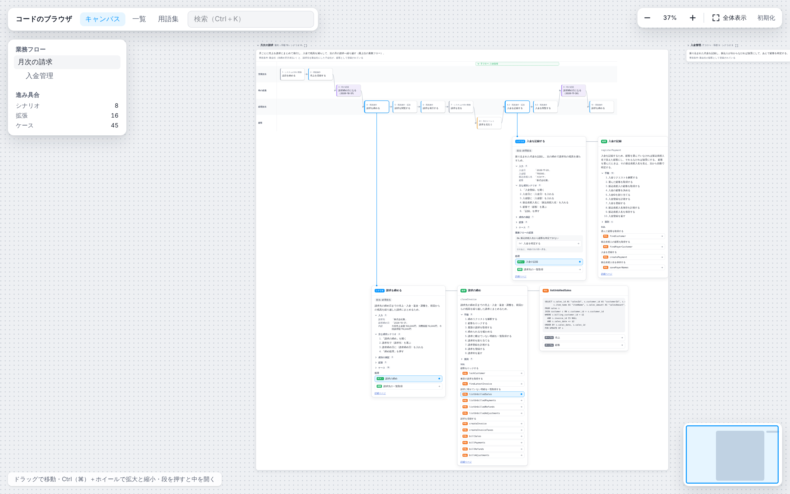
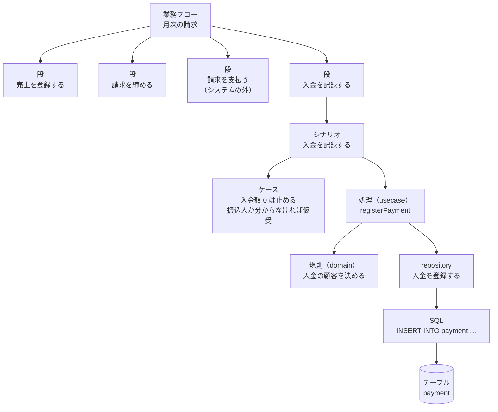
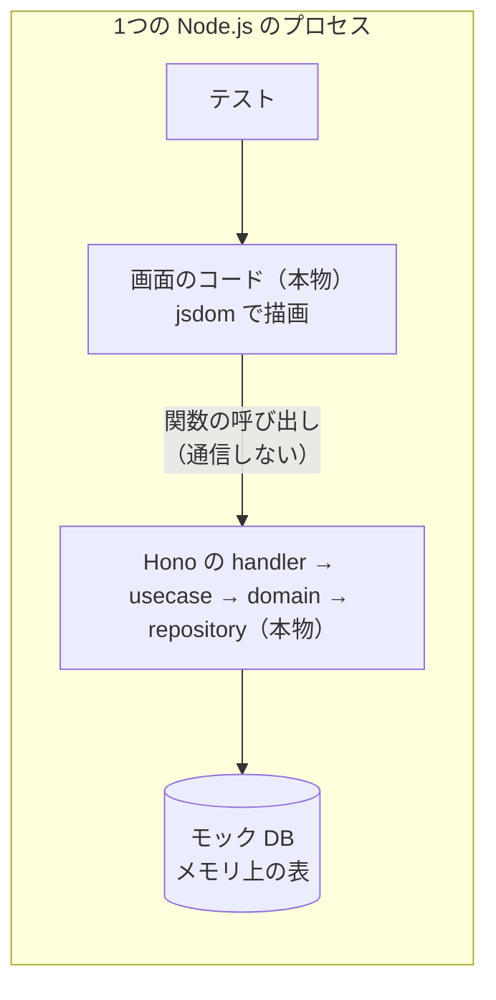
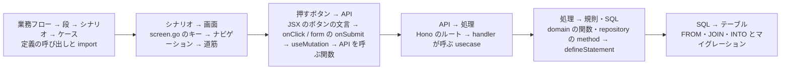

業務システムを作っていると、ほぼ必ず「要件定義書・設計書・テスト・コードがずれていく」問題にぶつかります。この記事では、その問題に対して次の2つの主張をし、TypeScript（React + Hono）の業務 Web アプリの土台を実例として、考え方からアーキテクチャまで全部書きます。

> **"型"が要件定義を解決する。**
> **要件定義が解決されたら、システムは完成する。**


*業務フロー「月次の請求」の担当ごとのレーン図から、段を押して シナリオ → 処理 → SQL と開いていったところ。この図も、カードの中の日本語の手順も、すべて TypeScript のコードから自動で作っている*

**Type Safe は、これまでコードの中だけの考え方でした。** 関数に渡す値の型が合わなければ、動かす前にコンパイラが止めてくれる。ところが要件定義の成果物（業務フロー・ユースケース・業務の言葉）は、Word や Excel や図で書かれ、型の外にありました。だから要件と実装がずれても、誰も止めてくれません。

**要件定義にまで型を適用する**ことで、ドキュメントの完成がシステムの完成を意味し、システムの完成がドキュメントの完成を意味する、**SSoT 100%** を達成します。

:::message
この記事で扱うリポジトリは、業務 Web アプリを作るための土台（フレームワーク兼サンプル実装）です。サンプルの業務は「売上の登録 → 残高を繰り越す請求書の締め・発行 → 入金の管理」です。

リポジトリ: https://github.com/Soiya-kun/web-app-framework
:::

## 1. 要件定義はなぜずれるのか

ふつうは、次の順に成果物が増えていきます。

1. 業務のヒアリングをして、業務フローを描く
2. 基本設計で、画面・機能・データを決める
3. 詳細設計で、処理の手順・規則・テーブルを決める
4. コードとテストを書く

そして、上の成果物と下の成果物がずれていきます。業務フローの図は最初の打合せのまま、設計書はコードを直すたびに古くなり、テストは「何の業務を確かめているのか」が誰にも分からなくなります。

ずれる理由は単純で、**同じことを別々の場所に、別々の形で書いている**からです。

- 業務フローは図（drawio や Excel）で、設計書は文章で、テストはコードで書く
- 同じものを場所ごとに違う言葉で呼ぶ（打合せでは「請求」、画面では「請求書」、コードでは `billing` と `invoice` が混ざる）
- それぞれの間に機械で確かめられるつながりがないので、ずれても何も止まらない

「設計書を後から直す運用」で防ごうとしても、直す手間が積み上がり、どこかで追いつかなくなります。

## 2. 主張：「型」が要件定義を解決する

### 2.1 一本の木

このリポジトリでは、要件から実装までを**一本の木**として扱います。上ほど業務に近く、下ほど実装に近い。どの階層も同じ言葉（単語帳）で書きます。



| 階層 | 何を表すか | 正本（どこに書くか） |
| --- | --- | --- |
| 業務フロー | 業務のひと続き（月次の請求） | `apps/web/flow/*.ts`（TypeScript） |
| 段 | フローの1ステップ（画面の操作・システムの外の業務・時の経過など） | 同上 |
| シナリオ | 1人が1回の操作で目的を果たす手順 | `apps/web/scenario/**/*.ts` |
| ケース | 同じシナリオの入力や条件の違い | `apps/web/scenario/**/*.test.tsx`（画面の結合テスト） |
| 処理 | 業務処理の手順 | `packages/backend/src/usecase` |
| 規則 | 判断・計算 | `packages/backend/src/domain` |
| SQL・テーブル | 保存と読み出し | `packages/backend/src/repository`・マイグレーション |

### 2.2 4つの原則

1. **正本は1つにする。** 業務フローもシナリオも処理も、正本はコード。読み物（日本語の訳・SQL の台帳・ブラウザの表示）はコードから生成し、手で書かない。
2. **書き方を絞ると、機械で読める。** 名前に使う言葉、業務フローの段の種類、処理の書き方、SQL の持ち方を絞る。
3. **機械で読めるから、日本語に訳せて、つながりをたどれる。**
4. **機械で読めるから、半強制できる。** 決まった形で書かれていなければ、型・lint・検査で止める。人の注意に頼らない。

「型が要件定義を解決する」とは、**ユーザーによる実務とシステム操作を含む業務フローと、システムの仕様や振る舞いの全てが、双方に解決される体系**として定義します。

### 2.3 型の外にあったものを、1つずつ型に入れる

3〜7章は、すべて同じ形の話です。**これまで型の外にあったものを1つ取り上げ、それをどう TypeSafe にしたか**を書きます。8章では、そうして TypeSafe になったからこそできることを書きます。

| 型の外にあったもの | どう型に入れたか | 何が止まるか | 章 |
| --- | --- | --- | --- |
| 人間や AI が書く文章（名前・画面の文言・仕様書の日本語） | 語彙と文法を単語帳に固定し、文章をそこからしか作れなくする | 単語帳にない言葉、同じ語の二重の意味、画面にない文言 | 3 |
| 要件（業務フロー・ユースケース・テスト仕様） | TypeScript の業務フロー・シナリオ・ケースとして書く | ないシナリオを指す段、決めていない入力、ない拡張を指すケース | 4 |
| 処理の読み方と SQL | 処理は「呼んで渡すだけ」に絞り、SQL は固定した定義でしか流せなくする | 手順として読めない処理、組み立てた SQL | 5 |
| テストと要件の対応 | 画面のテストをシナリオのケースとして書き、業務フローをそのまま E2E として流す | どの要件にも属さないテスト | 6 |
| 型システムが届かないつながり | 書き方の規則と静的解析で、型の代わりに止める | 規則に合わない業務フロー・シナリオ、どの業務フローにも入っていないシナリオ | 7 |

## 3. 文章を TypeSafe にする — 単語帳

TypeSafe にならない物事の一つに、**人間や AI が書く文章**があります。関数名も画面の文言も仕様書の日本語も、ただの文字列なので、同じものを別の言葉で呼んでも（「請求」と「請求書」、`billing` と `invoice`）何も止まりません。

そこで、語彙と文法を1つのマスタ（単語帳）に固定し、**名前も画面の文言も仕様書の日本語も、そこからしか作れない**ようにしました。

```yaml
- { id: customer, en: { plural: customers }, ja: { form: 顧客 } }
- { id: issue, en: { noun: issuance }, ja: { stem: 発行, class: suru } }
- { id: billingCustomer, en: { tokens: billing customer }, ja: { form: 請求先 }, description: 請求書を受け取り、入金する顧客。… }
```

語形は文法から作ります。たとえば `unissued` は「issue の未完了」として「未発行」になるので、訳の文字列を持ちません。

### 3.1 英日を1対1にする

同じ語形を2つの概念に当てていたら止め、生成した日本語がすべて元の英語の名前に1通りに戻ることをテストで確かめています。1対1なので、日本語から英語の名前を引けます。

```sh
pnpm vocabulary:find 請求に載せていない入金   # → unbilledPayment
```

### 3.2 コード・翻訳・画面が同じ単語帳を使う

- **コード:** 単語帳にない英単語や、同じ意味の別の語（`get`・`add` など）を名前に使うと lint で止まります。
- **翻訳:** 関数名や処理を、機械で日本語の仕様に訳します。
- **画面:** 文言は `text.label('paymentDate')` のようにキーで引き、単語帳から生成した文言ファイルにないキーは型エラーです。

人が文字列を書かないので、同じ概念はどの画面・どの言語でも同じ語になります。この厳しい型を守るのは AI です。lint や型のエラーを見て AI が単語帳に言葉を足し、名前を直すので、人はほとんど関与しません。

## 4. 要件を TypeSafe にする — 業務フロー・シナリオ・ケース

ここが本題です。要件定義の成果物（業務フロー図・ユースケース記述・テスト仕様）は、ふつう図や Excel で書かれ、型の外にあります。図の箱がまだない画面を指していても、ユースケースの手順が実際の画面と違っていても、テスト仕様がどのユースケースのものか分からなくなっても、何も止まりません。

ここでは要件を TypeScript で書き、**要件そのものを型の中に入れます**。

### 4.1 業務フロー

```ts
/** 月ごとに売上を請求にまとめて発行し、入金で残高を減らして、次の月の請求へ繰り越す（最上位の業務フロー）。 */
export const monthlyInvoice = defineFlow<Partial<MemoryDatabase>>('monthlyInvoice', {
  precondition: { summary: '親会社（末締め翌月末払い）と、請求先を親会社にした子会社が、顧客として登録されている', seed: { customer: customers } },
  steps: [
    outside('salesperson', 'deliverItem'),
    operate(createSales, { customer: '株式会社子', salesDate: '2026-10-15', salesKind: '通常', itemName: '運賃', salesAmount: '100000', taxRate: '10%' }),
    elapse('closingDate', '2026-10-31'),
    operate(closeInvoice, { ...october, breakdown: { currentSalesAmount: 100_000, taxAmount: 10_000, currentInvoiceAmount: 110_000 } }),
    operate(browseInvoice, october, {
      mistakenInvoice: {
        input: october,
        then: [operate(cancelClosing, october), /* 漏れた売上を登録 → 締め直す → 発行する */],
        resume: false,
      },
    }),
    operate(issueInvoice, { ...october, issueDate: '2026-11-02' }),
    outside('accountant', 'sendInvoice'),
    nest(paymentManagement),
    elapse('closingDate', '2026-11-30'),
    operate(closeInvoice, { /* … */ breakdown: { previousInvoiceAmount: 110_000, currentPaymentAmount: 110_000, carriedAmount: 0, currentInvoiceAmount: 0 } }),
  ],
})
```

段は5種類だけです。

| 段 | 書き方 | 意味 | テストで流すとき |
| --- | --- | --- | --- |
| 画面の操作 | `operate(シナリオ, 値, 拡張)` | 1人が画面で目的を果たす | シナリオの手順と成功の保証を流す |
| システムの外の業務 | `outside(担当, 名前)` | 品目を納める・請求書を送る | 何もしない（流れ図に出す） |
| 外のイベント | `occur(担当, 名前)` | 顧客が請求を支払う | 何もしない |
| 時の経過 | `elapse(名詞, 'YYYY-MM-DD')` | 締め日になる | テストの今日の日付をその日にする |
| 子フロー | `nest(業務フロー)` | 別の業務フローをひとまとまりで入れる | 子フローの段をその場で流す |

分岐は、画面の操作の段に付ける「拡張」（別の進め方）だけです。BPMN のように何でも書ける記法にはせず、書けることを絞りました。

名前はすべて単語帳の言葉です。`deliverItem` は「品目を納める」、`monthlyInvoice` は「月次の請求」と訳されます。

### 4.2 シナリオ

シナリオは、主アクター・主成功シナリオの手順・成功の保証・拡張を持ちます。

```ts
/** 振り込まれた代金を記録し、次の締めで請求先の残高を減らすため。 */
export const registerPayment = defineScenario('registerPayment', {
  actor: 'accountant',
  operate: async (screen, payment: PaymentInput) => {
    await screen.go('paymentCreate')
    await screen.fill('paymentDate', payment.paymentDate)
    await screen.fill('paymentAmount', payment.paymentAmount)
    await screen.fill('payerName', payment.payerName)
    await screen.choose('customer', payment.customer)
    await screen.press('register')
  },
  confirm: async (screen, payment) => {
    await screen.expectMessage('paymentIdentified', { customer: payment.customer })
  },
  extensions: {
    unidentifiedPayer: {
      condition: '振込依頼人名から顧客を特定できない',
      confirm: async (screen) => {
        await screen.expectMessage('unidentifiedPayment')
      },
    },
    invalidPaymentAmount: { condition: '入金額が空か、1 から 999,999,999 の整数でない' },
  },
})
```

`screen` の操作（`go`・`fill`・`choose`・`press`・`row`・`expect…`）は、利用者と同じくラベル・ボタンの名前で画面の要素を指します。名前は単語帳のキーで書くので、**画面にない文言のキーは型エラー**になります。

キーが単語帳の言葉なので、静的解析でこう訳せます。

> **入金を記録する**（主アクター: 経理担当）
> 1. 「入金登録」を開く
> 2. 入金日に〈入金日〉を入れる
> 3. 入金額に〈入金額〉を入れる
> 4. 振込依頼人名に〈振込依頼人名〉を入れる
> 5. 顧客で〈顧客〉を選ぶ
> 6. 「記録」を押す
>
> 成功の保証: 「〈顧客〉の入金として記録しました。」と出ることを確かめる

この訳は、後で出てくる「コードのブラウザ」のシナリオのページにそのまま出ます。


*シナリオのページ。主アクター・目的・使う業務フロー・主な成功シナリオ・成功の保証・拡張が、コードから生成されて並ぶ*

### 4.3 ケース

画面のテストは、すべてシナリオのケースとして書きます。

```tsx
describeScenario(registerPayment, (cases) => {
  cases.main('顧客を選んで記録すると、その顧客の入金にし、振込依頼人名を半角・全角の違いをそろえて覚える', async () => {
    const app = await registerOnScreen(validPayment)

    await confirmScenario(registerPayment, app.screen, validPayment)
    expect(app.database.payerName).toEqual([{ payerName: 'カ)オヤ', customerId: 'customer-0001' }])
  })

  cases.vary('顧客を選ばなければ、覚えた振込依頼人名から顧客を特定する', async () => { /* … */ })

  cases.extendEach(
    'invalidPaymentAmount',
    [{ paymentAmount: '0', messageKey: 'invalidRange' }, /* … */] as const,
    '入金額「$paymentAmount」は「$messageKey」で止める',
    async ({ paymentAmount, messageKey }) => {
      const app = await registerOnScreen({ ...validPayment, paymentAmount })

      await app.screen.expectProblem('paymentAmount', messageKey, { minimum: 1, maximum: 999_999_999 })
      expect(app.database.payment).toEqual([])   // 止めたときは、何も保存していない
    },
  )
})
```

| 書き方 | 種類 | 書くもの |
| --- | --- | --- |
| `cases.main` | 主成功シナリオ | シナリオに1つだけ |
| `cases.vary`・`varyEach` | 技術とデータのバリエーション | うまくいく範囲での入力の違い |
| `cases.extend`・`extendEach` | 拡張 | シナリオに書いた拡張の条件のときの扱い |

`extend` の第1引数は、シナリオの `extensions` のキーです。ない拡張を指すと型エラーになります。中身（関数）を書かなければ vitest の todo（未着手）になります。

### 4.4 コーバーン『ユースケース実践ガイド』との対応

この形は、アリスター・コーバーンの『ユースケース実践ガイド』（*Writing Effective Use Cases*）にかなり近いと気づき、言葉と構造を合わせました。

| コーバーン | この仕組み |
| --- | --- |
| 要約レベル（雲・凧） | 業務フロー |
| 利用者の目的レベル（海面。「済んだらコーヒーを飲みに行ける」大きさ） | シナリオ |
| 下位機能レベル（魚） | 処理（usecase）・規則（domain） |
| 組織の業務のユースケース | システムの外の業務を含む業務フロー |
| 主アクター | シナリオの `actor` |
| 事前条件 | 業務フローの `precondition`・ケースで入れておく行 |
| 主成功シナリオ | シナリオの `operate` |
| 成功の保証 | シナリオの `confirm` |
| 最低限の保証 | 止めたときに「何も保存していない」ことを確かめるケース |
| 拡張 | シナリオの `extensions` と、そのケース |
| 技術とデータのバリエーション | `cases.vary` |

### 4.5 コーバーンが踏み込まなかった一歩：画面の細部まで書く

コーバーンがあえてやらなかったことを、1つだけ踏み込んでやっています。ユースケースに、画面の細部まで書くことです。

コーバーンは、ユースケースの手順に画面の細部（どの欄に入れ、どのボタンを押すか）を書かず、利用者の意図で書くよう勧めます。理由ははっきりしていて、**文章で書いたユースケースでは、画面の細部はすぐに古くなる**からです。画面が変わるたびに、誰かがユースケースを直さなければなりません。

この仕組みのシナリオは、あえて画面の操作まで具体的に書きます。それができるのは、シナリオが文章ではなく型だからです。

- **画面の細部が古くならない。** 手順に書く項目・ボタンは単語帳のキーで、画面にない文言のキーは型エラーになる。手順はテストとして毎回流れるので、画面が変われば、その場で落ちる。「直し忘れたユースケース」が存在できない。
- **細部でも、利用者の言葉で読める。** `screen.fill('paymentDate', …)` は「入金日に〈入金日〉を入れる」と訳される。CSS のセレクタや画面の部品の名前ではなく、利用者が画面で見る言葉の手順になる。
- **意図の高さは、名前が持つ。** シナリオの名前（`registerPayment` ＝「入金を記録する」）と目的の1行が、利用者の意図そのもの。ブラウザでは、意図（名前）を見てから、開くと具体的な操作が見える。

コーバーンが画面の細部を避けたのは、細部が「腐る」からでした。要件を型にすると、細部は腐らなくなります。だから、意図と細部の両方を1つのシナリオに持てるようになりました。

### 4.6 型が要件を前へ進める

ここが「型が要件定義を解決する」の一番具体的なところです。

```ts
type OperateRest<Input, ExtensionName extends string> = [Input] extends [undefined]
  ? []
  : [input: Input, extensions?: Readonly<Partial<Record<ExtensionName, ExtensionFlow<Input>>>>]

/** 段: 画面の操作（シナリオ）。未着手のシナリオには値を渡さない。手順を書くと、値が要るようになる。 */
export function operate<Input, ExtensionName extends string>(
  scenario: Scenario<Input, ExtensionName>,
  ...rest: OperateRest<Input, ExtensionName>
): FlowStep
```

1. ヒアリング直後、シナリオは名前と担当だけ（`defineScenario('createSales', { actor: 'salesperson' })`）。業務フローには `operate(createSales)` と値なしで書きます。
2. シナリオに手順（`operate`）を書くと、入力の型が決まり、**業務フローの段が型エラー**になります（値が足りない）。
3. 業務フローに値を書くと型エラーが消え、業務フローの E2E がその段まで進みます。
4. 拡張のキーは型なので、業務フローの拡張・ケースの拡張がシナリオとずれると型エラーになります。

型エラーが「次に何を決めるべきか」を教えてくれる、という感覚です。

## 5. 処理と SQL を TypeSafe にする

コードはもともと型の中にあります。それでも型が守っていないものが2つありました。1つは**処理の読み方**です。型が合っていても、その処理が仕様として読めるかどうかは型の外です。もう1つは **SQL** です。SQL は文字列なので、何を書いても型は通ります。

### 5.1 usecase は「呼んで渡すだけ」

バックエンドは Hono で、domain・usecase・repository・handler の層に分けます。usecase には `if`・`for`・`let`・`try`・`throw`・メソッドチェーンを書かず、lint（`app/flat-steps`）が止めます。

```ts
/** 入金を記録するため。顧客を選んでいなければ振込依頼人名で覚えた顧客にし、それもなければ仮受にする。… */
export async function registerPayment(repositories: RepositorySet, idGenerator: IdGenerator, paymentRequest: PaymentRequest) {
  const paymentInput = interpretPaymentRequest(paymentRequest)
  const selectedCustomer = await repositories.customerRepository.findSelectedCustomer(paymentInput.customerId)
  const payerCustomer = await repositories.payerNameRepository.findPayerCustomer(paymentInput.payerName)
  const customerId = decidePaymentCustomer(selectedCustomer, payerCustomer)
  const paymentId = assignPaymentId(idGenerator)
  const paymentCreate = planPaymentCreate(paymentId, paymentInput, customerId)
  await repositories.paymentRepository.createPayment(paymentCreate)
  const payerNameSaves = planPayerNameSaves(paymentInput.payerName, selectedCustomer)
  await repositories.payerNameRepository.savePayerNames(payerNameSaves)
  return paymentCreate
}
```

こう絞ると、1行が1つの手順になり、そのまま日本語に訳せます。

> **入金の記録**
> 1. 入金リクエストを解釈する
> 2. 選んだ顧客を取得する
> 3. 振込依頼人の顧客を取得する
> 4. 入金の顧客を決める
> …

コメントに書くのは目的だけです。手順は名前から訳せるので書きません（書くと古くなる）。

### 5.2 判断は domain、値はブランド型

判断・計算は domain に置き、名前の形で役割を表します（`interpret…Request`・`ensure…`・`decide…`・`plan…`）。値はブランド型で区別し、`PaymentAmount` と `SalesAmount` を取り違えられないようにしています。業務エラーは例外で投げ、Hono の `onError` で HTTP の応答に変えます。

### 5.3 SQL は手で書き、固定する

```ts
export const lockCustomerStatement = defineStatement<[customerId: string], Stored<Customer>>(
  'lockCustomer',
  `
SELECT customer_id AS "customerId", …
FROM customer
WHERE customer_id = $1
FOR UPDATE
`,
)
```

SQL の引数と結果の行は、`defineStatement` の型引数で型が付きます。そして SQL を実行する部品は、型で `defineStatement` の結果しか受け付けません。文字列を組み立てて実行できないので、全 SQL を台帳として生成でき（いま 40）、「この画面のこの操作で、どの SQL が流れるか」をコードからたどれます。

### 5.4 画面

React は `useEffect`・`useLayoutEffect`・`useInsertionEffect` を lint で禁止しています。データの取得はルーターの loader、外部の状態は `useSyncExternalStore`、DOM の初期化は ref コールバックで行います。

## 6. テストを TypeSafe にする — インプロセスで最上位まで流す

テストもコードなので型の中にあります。けれど「**そのテストがどの業務の、どの要件を確かめているか**」は型の外です。テスト名の文字列や、後から付けるコメントでしかつながっていません。

ここでは、画面のテストをシナリオのケースとして書き（`describeScenario(シナリオ, …)`）、うまくいかない場合は拡張のキーで結びます（4.3）。業務フローは、それ自体がそのまま E2E として流れます。テストと要件の対応が型になったので、あとは**型で結んだテストを、軽く速く流せること**が大事になります。

### 6.1 インプロセスとは

テストは、**1つの Node.js のプロセスの中で、画面からバックエンドまでを全部動かします。**



- ブラウザは起動しない（jsdom の上で本物の画面のコードを描画する）
- サーバーは起動しない（`fetch` だけ差し替えて、Hono のアプリを `app.request(…)` で直接呼ぶ）
- DB はメモリ上の表（モック DB）

差し替えるのは「通信」と「DB」だけです。モック DB と本物の PostgreSQL がずれないように、repository には同じ契約のテストを書き、両方に流します（PostgreSQL は Docker で起動）。

### 6.2 境界値は画面で厚く

境界値（入金額 0・1・999,999,999・1,000,000,000 など）は、画面のケースで厚く確かめます。利用者が実際に入れる値で、画面に出る文まで確かめられます。単体テストは狭い範囲の計算だけにしています。画面のケースは、この環境で1件 約 50ms でした。

### 6.3 最上位の業務フローがそのまま E2E

業務フローの定義が、そのまま E2E になります。

```ts
const flowFiles = import.meta.glob<Readonly<Record<string, unknown>>>(['./*.ts', '!./*.test.ts'], { eager: true })

for (const flowFile of Object.values(flowFiles)) {
  for (const flow of Object.values(flowFile).filter(isFlow)) {
    describeFlow(flow, (seed) => launchApp(seed))
  }
}
```

業務フローは「本線」と「拡張ごとの経路」に展開されて流れます。1つのモック DB と1つの今日の日付を、段から段へ引き継ぎます。

| 経路 | 時間（インプロセス） |
| --- | --- |
| 月次の請求・本線（売上登録 → 締め → 閲覧 → 発行 → 入金管理 → 次の締め） | 約 0.45 秒 |
| 5a. 請求の内容に誤りがある（締めの取消 → 売上の追加 → 締め直し → 発行） | 約 0.3 秒 |
| 8.2a. 振込依頼人名から顧客を特定できない（仮受 → 特定 → 本線へ戻る） | 約 0.3 秒 |

最後の締めの繰越額の期待をわざと 0 から 1 に変えると、本線と 8.2a が失敗することを確かめています。未着手のシナリオに来た経路は、そこまで流して skip になります。

### 6.4 テストが「要件定義 Safe」になる

要件定義が TypeSafe になると、逆向きのことも起きます。**テストが、要件定義に対して Safe になる**のです。

ふつう、テストは要件と別に書かれます。どの要件を確かめるテストなのかはテスト名の文字列でしか分からず、要件が変わってもテストは黙って通り続け、どの要件にも対応しないテストが増えていきます。

この仕組みでは、テストは要件の型の中でしか書けません。

- **要件に属さないテストは書けない。** 画面のテストは `describeScenario(シナリオ, …)` の中にしか置けず、シナリオはどれかの業務フローに入っていなければならない（検査で止まる）。
- **要件にない場合を確かめるテストは書けない。** うまくいかない場合のケースは、シナリオの拡張のキーで書く。シナリオにない拡張を指せば型エラー。
- **要件が変わると、テストが先に壊れる。** シナリオの入力が変われば、業務フローの段も、ケースも型エラーになる。要件と食い違ったまま通り続けるテストがない。
- **要件の網羅が、テストの網羅になる。** 業務フローの本線と拡張の経路は、すべて E2E として流れる。未着手の拡張やケースは数で見える。

要件がテストを縛り、テストが要件を確かめる。どちらか片方だけが先に進んで、もう片方が置いていかれることがなくなります。

## 7. つながりを TypeSafe にする — 検査と静的解析

TypeScript の型システムが届かないつながりもあります。シナリオの名前が動詞で始まっているか、どの業務フローにも入っていないシナリオがないか、画面のボタンからどの処理・SQL へつながるか。ここは、**書き方の規則と静的解析が型の代わり**をします。

### 7.1 書き方の規則

`pnpm flow:check`（CI の `pnpm check` に含む）が、静的解析で次を止めます。

| 規則 | 内容 |
| --- | --- |
| `flow-name` | 業務フローの名前は、変数と同じ・単語帳の言葉・名詞句 |
| `flow-step` | 段は5種類の呼び出しで、シナリオ・業務フローを import で渡す |
| `flow-cycle` | 子フローをたどって、自分を含まない |
| `scenario-name` | シナリオの名前は単語帳の言葉で、動詞で始める |
| `scenario-start` | シナリオの手順は、画面を開くところから始める |
| `scenario-flat` | 手順と成功の保証は、画面の操作を並べるだけ |
| `scenario-orphan` | シナリオは、どれかの業務フローの段になっている |
| `case-place` | ケースはシナリオの隣の `.test.tsx` に、`describeScenario` だけで書く |
| `case-main` | 主成功シナリオのケースは1つ |
| `test-place` | 画面のテストは `scenario` と `flow` にだけ置く |

**未着手は止めません。数えるだけです。** ヒアリングを0から始めて成果物を作っていく過程なので、中身が空の段が多いのがふつうだからです。未着手が減っていくことが、設計が深まっていくことです。

### 7.2 静的解析でつながりを求める

コードのブラウザで木をたどるために、つながりを静的解析で求めます。



型の解決をせず構文木だけを読むので、リポジトリ全体の解析は約 0.2 秒です。

## 8. TypeSafe だからできること：業務フロー図や設計、詳細仕様をブラウジングする

要件から SQL までが型でつながっていると、そのつながりを、そのままブラウジングできます。

Figma のキャンバスみたいな画面に業務フローが並んでいて、気になる段をポチッと押すと、その下にシナリオが開く。シナリオの中の処理を押すと右に処理が、さらに SQL、テーブルと、どんどん開いていく。業務フロー図から詳細仕様まで、1枚のキャンバスの上で「開いていく」だけで読めます。


*業務フロー図（担当ごとのレーン図）から、段を押して シナリオ → 処理 → SQL と開いていったところ*


*寄ってみると、シナリオの手順も、処理の手順も、日本語で読める。どれも人が書いた文章ではなく、コードから生成したもの*

ここに出ているものは、業務フロー図も、設計も、詳細仕様も、全部コード（型）から生成しています。誰かが描いた図ではないので、コードを直せば図も直り、古くなりようがありません。ソースを保存すれば、開いているキャンバスもその場で新しくなります。

## 9. ヒアリングから要件を育てる

コーバーンの「精度を段階的に上げる」進め方に合わせて、木はこう育ちます。

**段階1: 担当と目的を並べる。** 業務フローの段を並べ、シナリオは名前と担当だけにします。

```ts
export const createSales = defineScenario('createSales', { actor: 'salesperson' })     // 未着手
export const closeInvoice = defineScenario('closeInvoice', { actor: 'accountant' })    // 未着手

export const monthlyInvoice = defineFlow('monthlyInvoice', {
  steps: [outside('salesperson', 'deliverItem'), operate(createSales), elapse('closingDate', '2026-10-31'), operate(closeInvoice)],
})
```

ブラウザに担当ごとのレーン図が出て、シナリオはすべて「未着手」と出ます。打合せでは、この図を見ながら「抜けている業務はないか」「この順で合っているか」を話します。名前は日本語で決めてから `vocabulary:find` で英語の名前にし、単語帳にない言葉はそこで足します。

**段階2: 主な流れを書く。** シナリオに手順と成功の保証を書きます。業務フローの段が型エラーになり、値を書くと E2E が進みます。画面がまだなければテストは失敗しますが、それは「この業務の画面はまだない」という正しい状態です。

**段階3: うまくいかない場合を並べる。** シナリオの `extensions` に条件だけを並べます。扱いのない拡張は未着手として数えられます。

**段階4: うまくいかない場合の扱いを書く。** 拡張のケースを書き、業務フローで続きの流れがあるもの（仮受にしてあとで特定する）は、業務フローの拡張の経路にします。

## 10. 「要件定義が解決されたら、システムは完成する」とは

段階4まで進み、未着手が0になったとき、次がそろっています。

- 業務フローの全経路が E2E として流れている
- すべてのシナリオに、手順・成功の保証・拡張の扱いがあり、それぞれが画面の結合テストとして動いている
- 画面・処理・SQL・テーブルがつながり、日本語で読める
- 言葉が単語帳で1つに決まっている

つまり **「要件定義が解決された」状態は、そのまま「テストが全部そろい、通っている」状態** になります。テストが通るには画面と処理が実装されていなければならないので、要件が解決されたとき、システムは完成しています。

### V字モデルは「＼（バックスラッシュ）モデル」になる

要件の型がそのままテストになるので、開発のかたちそのものも変わります。

V字モデルでは、左の辺で 要件定義 → 基本設計 → 詳細設計 と降りていき、右の辺で 単体テスト → 結合テスト → 受入テスト と、あとから登り直します。左と右は別の時期に、ときには別の人が書くので、ここでずれます。

この仕組みでは、**要件・設計を書くことが、そのままテストを書くこと**になります。右の辺が左の辺に重なって、残るのは左上から右下へ降りる1本の線（＼）だけです。

```text
  V字モデル                                   ＼ モデル

  要件定義 ──────────── 受入テスト            業務フロー  ＝ E2E
     基本設計 ────── 結合テスト                 ＼ シナリオ  ＝ 画面の結合テスト
        詳細設計 ── 単体テスト                     ＼ 処理・規則・SQL ＝ 手順の訳・SQL の台帳・契約のテスト
              実装                                     ＼ 実装（画面・処理の中身）
```

| V字の左の辺 | 右の辺（あとから書くテスト） | ＼ モデルでは |
| --- | --- | --- |
| 要件定義 | 受入テスト | 業務フロー（`defineFlow`）を書くと、それが本線と拡張ごとの E2E として流れる |
| 基本設計 | 結合テスト | シナリオ（`defineScenario`）とそのケースが、そのまま画面の結合テスト |
| 詳細設計 | 単体テスト | 処理（usecase）・規則（domain）・SQL は書き方を絞ったコードそのものが設計で、日本語の手順・SQL の台帳になる。DB の振る舞いは契約のテストで固定する |

## 11. サンプルと数字

サンプルの業務は「残高を繰り越す請求書」です。

```text
前回請求額 − 今回入金額 − 調整額 = 繰越額
繰越額 ＋ 今回売上金額 ＋ 消費税額 = 今回請求額
```

入金を個々の請求に充てる消込はせず、入金は請求先の残高を減らして次の締めに載ります。分割入金・一括入金・不足入金・過入金（負の繰越額）・振込手数料（調整）・返金・仮受を、この形で表しています。テーブルは9個（顧客・振込依頼人名・請求・請求の税率ごとの合計・請求番号の採番・売上・入金・返金・調整）です。

この記事を書いた時点の数字です。

| 項目 | 数 |
| --- | --- |
| 業務フロー | 2（段 18） |
| シナリオ / 拡張 / ケース | 8 / 16 / 45 |
| 処理（usecase） / SQL | 11 / 40 |
| 単語帳の概念 | 約 430 |
| テスト（Docker なし） | 498 件・約 9 秒（PostgreSQL の契約のテストは別に 22 件） |
| 業務フローの規則の検査・静的解析 | 約 0.2 秒 |

## おわりに

要件定義書・設計書・テスト・コードのずれは、「同じことを別々の場所に、別々の形で書く」ことから生まれます。この記事でやったことは、要件をコードの側に寄せ、言葉・要件・実装・テストのすべてに「型」を与えることでした。型があると、機械が読め、日本語に訳せ、つながりをたどれ、ずれを止められます。

"型"が要件定義を解決し、要件定義が解決されたら、システムは完成する。少なくともこのサンプルの範囲では、その手応えがありました。

コードはすべて https://github.com/Soiya-kun/web-app-framework にあります。`pnpm install` のあと `pnpm dev:browser` で、この記事のキャンバスを手元で開けます。

## 付録：副次的に手に入るもの

要件を型で書くと、本題（要件と実装のずれを止める）のほかに、次のものが副次的に手に入りました。

### ユビキタス言語が、勝手にそろう

コードの名前・DB のテーブル名と列名・画面の文言・仕様書が、**1つの単語帳から出ます**。単語帳にない英単語は lint で書けず、同じ語を2つの意味で使うと生成で止まります。打合せの「請求」、画面の「請求」、コードの `invoice` が、構造として同じものになります。

### 業務フロー図が、コードから出る

TypeScript で書いた業務フローから、担当ごとのレーン図が自動で描かれます（記事の冒頭の図）。図を描く手間も、図とコードがずれる心配もありません。子フローはその場で開け、段を押せば中身が開きます。

### 日本語を書かずに、日本語の仕様書が出る

英単語の組み合わせ（名前）から、日本語の手順を機械で作ります。手順・題・画面の文言の日本語は、人が1文字も書いていません（人が日本語で書くのは、目的の1行と、拡張の条件・ケースの見出しだけ）。

| 書いたもの（英語のコード） | 生成される日本語 |
| --- | --- |
| `registerPayment` | 入金を記録する（シナリオ）／入金の記録（処理の題） |
| `repositories.payerNameRepository.findPayerCustomer(…)` | 振込依頼人の顧客を取得する |
| `screen.fill('paymentDate', payment.paymentDate)` | 入金日に〈入金日〉を入れる |
| `elapse('closingDate', '2026-10-31')` | 請求締め日になる（2026-10-31） |
| `monthlyInvoice` | 月次の請求 |

英語と日本語は1対1なので、逆に日本語から英語の名前も引けます（`pnpm vocabulary:find 振込依頼人の顧客` → `payerCustomer`）。

### 画面からバックエンドまで通したテストですら、軽い

ブラウザもサーバーも DB も起動せず、1つの Node.js のプロセスで、画面の操作から Hono の handler・usecase・repository まで本物のコードを流します。

| テスト | 時間（この環境で測った値） |
| --- | --- |
| 業務フロー「月次の請求」の E2E（売上登録 → 締め → 発行 → 入金 → 次の締め） | 約 0.44 秒 |
| 画面の結合テスト1件 | 約 50ms |
| Docker なしのテスト全体（498 件） | 約 9 秒 |

## 付録：そのほかのおもしろいところ

- **型エラーが「次に決めること」を教える。** シナリオに手順を書くと、業務フローの段が値を求めて型エラーになる。値を書くと E2E がその段まで進む。
- **未着手が「数」で見える。** 中身のないシナリオ・拡張・ケースは止めずに数える。設計の進み具合が、そのまま数字になる。
- **段から SQL まで1画面でたどれる。** 業務フローの段 → シナリオ → 処理 → SQL → テーブルを、押して開いていくだけで読める。
- **SQL は全部台帳になる。** 文字列を組み立てて SQL を実行できない作りなので、流れうる SQL がすべて一覧になる。
