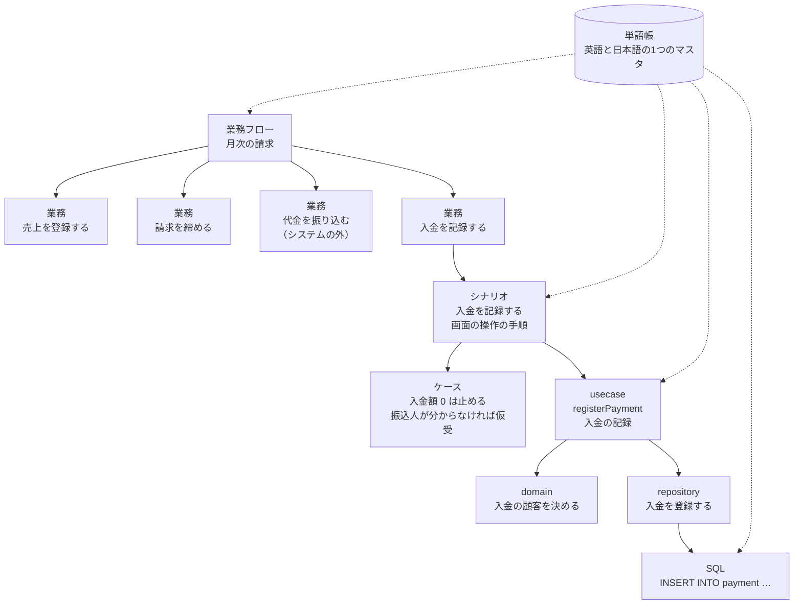
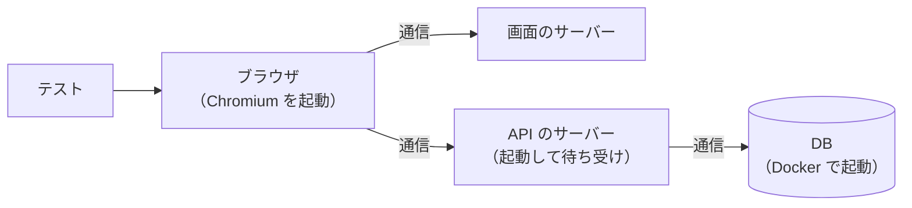
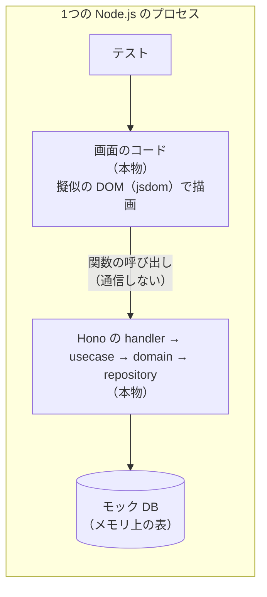
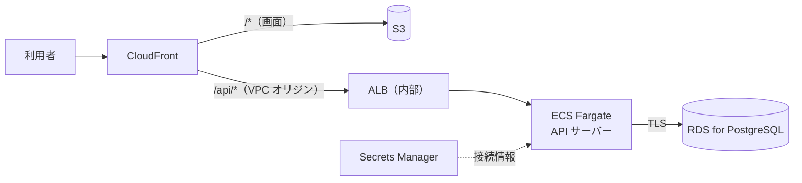

# このリポジトリの考え方 — 業務フローからコードまでを一続きに読む

この文書は、このリポジトリが何を目指し、なぜこの形にしたのかを、頭から順に読めるようにまとめた読み物である。決めたことを一覧で見るなら [要求と方針](requirements.md)、サンプルの業務は [業務の作り](domain-model.md)、単語帳の仕組みの詳細は [単語帳の設計](vocabulary-design.md) にある。ここでは、それらがどうつながっているかを話す。

書いた時点: 2026-11-19。言葉・コード・テストの土台、業務フロー・シナリオの書き方、コードのブラウザ（6章）までできている。

## 目次

1. [何を示したいか](#1-何を示したいか)
2. [一本の木 — 全体の形](#2-一本の木--全体の形)
3. [言葉をそろえる — 単語帳](#3-言葉をそろえる--単語帳)
4. [コードの書き方 — 機械で読める形に絞る](#4-コードの書き方--機械で読める形に絞る)
5. [テストの考え方 — 画面から厚く、軽く](#5-テストの考え方--画面から厚く軽く)
6. [業務フローとコードのブラウザ](#6-業務フローとコードのブラウザ)
7. [サンプルの業務 — 売上・請求・入金](#7-サンプルの業務--売上請求入金)
8. [本番の構成](#8-本番の構成)
9. [道具と検査](#9-道具と検査)
10. [決めたことの経緯](#10-決めたことの経緯)
11. [これから](#11-これから)

---

## 1. 何を示したいか

業務システムを作るとき、ふつうは次の順に成果物が増えていく。

1. 業務のヒアリングをして、業務フローを描く。
2. 基本設計で、画面・機能・データを決める。
3. 詳細設計で、処理の手順・規則・テーブルを決める。
4. コードとテストを書く。

そして、ほぼ必ず、上の成果物と下の成果物がずれていく。業務フローの図は最初の打合せのまま、設計書はコードを直すたびに古くなり、テストは何の業務を確かめているのか誰にも分からなくなる。設計書を後から直す運用で防ごうとしても、直す手間が積み上がり、どこかで追いつかなくなる。

このリポジトリが示したいのは、その逆向きの世界である。

> **業務フローのヒアリングをしたら、テストの枠組みがそろう。基本設計・詳細設計を深めたら、それが半強制的にコードとして書かれていく。**

ヒアリングの成果物が、そのままテストの骨組みになる。設計を深めることは、骨組みに中身を書くことになる。中身はコードなので、動かせて、検査でき、古くならない。設計書は別に持たず、コードから日本語の読み物を生成する。

その先にあるのが「コードのブラウザ」である。業務フローから入り、業務の一つをたどると画面の操作の手順が出て、さらにたどると処理の手順・業務の規則・実行する SQL まで行き着く。HTML の設計書を人が書くのではなく、TypeScript のテストとコードを解析すると、それが業務フローとして見える。

この形を成り立たせるために、言葉（3章）・コードの書き方（4章）・テスト（5章）を先に固めた。業務フローとブラウザ（6章）は、その上に乗せる。

## 2. 一本の木 — 全体の形

全体は一本の木になる。上ほど業務に近く、下ほど実装に近い。どの階層も同じ言葉（単語帳）で書く。



| 階層 | 何を表すか | 正本（どこに書くか） | 日本語の読み物 |
| --- | --- | --- | --- |
| 業務フロー | 業務のひと続き（月次の請求など） | 業務フローの定義（TypeScript。`apps/web/flow`） | 担当ごとのレーン図 |
| 業務 | フローの1段。画面の操作・システムの外の業務・時の経過など | 同上 | 流れ図の箱 |
| シナリオ | 1人が1回の操作で目的を果たす手順 | 画面の結合テスト | 「入金日に〜を入れる」「『記録』を押す」 |
| ケース | 同じシナリオの入力や条件の違い（境界値・うまくいかない場合） | 同上 | ケースの表 |
| usecase | 業務処理の手順 | `packages/backend/src/usecase` | [処理の日本語訳](generated/backend-process.md) |
| domain | 業務の規則・判断・計算 | `packages/backend/src/domain` | 同上 |
| repository・SQL | 保存と読み出し、実行する SQL | `packages/backend/src/repository` | [SQL の台帳](generated/sql-ledger.md) |

この木で大事なのは、次の3つである。

- **正本は1つにする。** 業務フローもシナリオも処理も、正本はコードである。読み物（日本語の訳・台帳・ブラウザの表示）はコードから生成し、手で書かない。
- **書き方を絞ると、機械で読める。** 名前に使う言葉、usecase の書き方、SQL の持ち方を絞っているのは、コードを機械で読んで、日本語に訳し、つながりをたどれるようにするためである。
- **機械で読めるから、半強制できる。** 決まった形で書かれていなければ、検査（lint・型・生成物の照合）で止める。人の注意に頼らず、ずれが入る前に止まる。

## 3. 言葉をそろえる — 単語帳

### 3.1 なぜ言葉から始めるか

業務の言葉は、気づくと場所ごとにずれる。打合せでは「請求」、画面では「請求書」、コードでは `billing` と `invoice` が混ざり、DB では `bill` になる。人は文脈で読み替えられるが、機械は読み替えられない。木をたどるには、同じものが同じ名前で呼ばれていなければならない。

そこで、言葉を1つのマスタ（単語帳）に集めた。目指したのは次の4つである。

1. コードは英語で書く。
2. コードに使う英単語と文法を固定し、日本語への翻訳の仕組みを持つ。それで仕様を日本語で読めるようにする。
3. 画面でも同じ専門用語を使う。
4. 多言語にするときも、同じマスタから言葉を出す。

### 3.2 コードは「制御された英語」で書く

名前に使える英単語は、単語帳にあるものだけである。lint（`app/known-words`）が、単語帳にない単語を CI で止める。同じ意味の別の単語も止める。

| 使わせない単語 | 代わりに使う単語 | 理由 |
| --- | --- | --- |
| `add`・`insert` | `create`（登録） | 「登録」を1つの語に決める |
| `get` | `find`（取得） | 同上 |
| `parse` | `interpret`（解釈） | 同上 |
| `setup`・`init` | `prepare`（準備） | 同上 |
| `issue`（問題の意味で） | `problem` | `issue` は請求の「発行」に使うので、1つの語に2つの意味を持たせない |

関数名は動詞で始める（`app/verb-first`）。DB のテーブル名・列名・区分値も、同じ単語帳で検査する。こうして、コードの名前は「決まった語彙と文法だけで書く英語」になる。言語学でいう制御自然言語と同じ考え方である。

### 3.3 日本語に訳す

語彙と文法が決まっているので、名前は機械で日本語に訳せる。関数名は体言止め、処理の手順は「〜する」にする。翻訳ツール（`pnpm translate`）が、usecase と domain の全関数を訳して [処理の日本語訳](generated/backend-process.md) を作る。

たとえば入金を記録する usecase はこう書いてある。

```ts
/**
 * 入金を記録するため。顧客を選んでいなければ振込依頼人名で覚えた顧客にし、それもなければ仮受にする。
 * 顧客を選んだときは、その振込依頼人名を覚え、次から自動で特定する。
 */
export async function registerPayment(repositories: RepositorySet, idGenerator: IdGenerator, paymentRequest: PaymentRequest) {
  const paymentInput = interpretPaymentRequest(paymentRequest)
  const selectedCustomer = await repositories.customerRepository.findSelectedCustomer(paymentInput.customerId)
  const payerCustomer = await repositories.payerNameRepository.findPayerCustomer(paymentInput.payerName)
  const customerId = decidePaymentCustomer(selectedCustomer, payerCustomer)
  const paymentId = assignPaymentId(idGenerator)
  const paymentCreate = planPaymentCreate(paymentId, paymentInput, customerId)
  await repositories.paymentRepository.createPayment(paymentCreate)
  const payerNameSaves = planPayerNameSaves(paymentInput.payerName, selectedCustomer)
  await repositories.payerNameRepository.savePayerNames(payerNameSaves)
  return paymentCreate
}
```

翻訳ツールの出力はこうなる。

> **入金の記録**
>
> 1. 入金リクエストを解釈する
> 2. 選んだ顧客を取得する
> 3. 振込依頼人の顧客を取得する
> 4. 入金の顧客を決める
> 5. 入金IDを割り当てる
> 6. 入金登録を計画する
> 7. 入金を登録する
> 8. 振込依頼人名保存を計画する
> 9. 振込依頼人名を保存する
> 10. 入金登録を返す

コメントに書くのは目的（なぜこの処理があるか）だけである。手順は名前から訳せるので、コメントに書かない。書くと、コードを直したときにコメントが古くなる。

### 3.4 画面でも同じ言葉を使う

画面の文言も単語帳から作る。画面のコードは、文言を直接書かずにキーで引く。

```tsx
text.label('paymentDate')            // 入金日
text.action('register')              // 記録
text.message('paymentIdentified', { customer })   // {customer}の入金として記録しました。
```

`pnpm vocabulary:generate` が、画面のコードに書かれたキーを集め、言語ごとの文言ファイル（`locale/ja.json`・`locale/en.json`）とキーの型を生成する。文言ファイルにないキーを書くと型のエラーになる。こうして、画面の「入金日」と、処理の訳の「入金日」と、コードの `paymentDate` は、同じ1つの概念から出てくる。

### 3.5 多言語も同じマスタから — 独自の定義から i18n へ

ふつうの i18n では、キーごとに言語別の文字列を人が書く。

```json
{ "paymentDate": "入金日" }
{ "paymentDate": "Payment Date" }
```

この形だと、言語のあいだで用語がずれても気づけない。ある画面では "Payment Date"、別の画面では "Deposit Date" と書いてしまっても、どこも止まらない。

そこで、文字列を人が書かない形にした。単語帳は「言語に依らない概念」と「言語ごとの語形と文法」に分かれている。

```yaml
- { id: amount, ja: { form: 金額, attach: direct } }                       # 名詞。前の名詞へ「の」なしでつなぐ
- { id: issue, en: { noun: issuance }, ja: { stem: 発行, class: suru } }    # 動詞。サ変の活用
- { id: cancel, en: { past: canceled, noun: cancellation }, ja: { dictionary: 取り消す, class: godan, noun: 取消 } }
- { id: billingCustomer, en: { tokens: billing customer }, ja: { form: 請求先 }, description: 請求書を受け取り、入金する顧客。 }
```

日本語の「発行する・発行済み・未発行」や、英語の "issued・unissued" は、活用の型から文法が作る。`salesAmount` という名前は、文法が「売上」＋「金額」を「売上金額」に、"Sales Amount" に組み立てる。言語ごとの文言ファイルは、この組み立ての結果として生成される。言語を足すときは、その言語の語形の欄と文法を足せばよく、画面のコードは変えない。

ヒアリングで出た「独自の定義から i18n 向けに変換するものを作らないと叶わないのでは」という見立ては、そのとおりだった。独自の定義（概念＋語形＋文法）を正本にし、i18n の文言ファイルはそこからの生成物にした。

### 3.6 英語と日本語を1対1にする

木をたどるには、日本語から英語へも1通りに戻れなければならない。そのため、生成のときに次を検査して止める。

- 英語でも日本語でも、同じ語形を2つの概念に当てない（「請求」を invoice と billing の両方に当てない）。
- 別の見出しが同じ文字列にならない。
- 生成した日本語の見出し 237 件を、日本語の文法で読み戻し、すべて元の名前に1通りに戻ること（往復のテスト）。

1対1なので、日本語の用語から英語の名前を引ける。

```sh
pnpm vocabulary:find 振込依頼人の顧客       # → payerCustomer
pnpm vocabulary:find 請求に載せていない入金   # → unbilledPayment
```

これは6章でも効いてくる。ヒアリングで日本語で書いた業務の名前から、コードの名前が決まる。

### 3.7 単語帳を編集するのは開発者だけ

単語帳は YAML で、開発者だけが編集する。業務の人とは、生成した画面・処理の訳・`vocabulary:find` で言葉を合わせる。ヒアリングで新しい業務の言葉が出たら、開発者が `description`（業務の説明）を付けて単語帳に足す。業務の言葉は `description` が必須なので、単語帳はそのまま用語集になる。

## 4. コードの書き方 — 機械で読める形に絞る

### 4.1 層

バックエンドは Hono で、domain・usecase・repository・handler の層に分ける。フォルダは層を先に分ける（`domain/sales`・`usecase/sales`・`repository/postgres`…）。層の向きに逆らう import は lint で止める。

| 層 | 役割 |
| --- | --- |
| handler | HTTP の入口。リクエストを usecase に渡し、結果を返す。業務エラーは共通の処理（`onError`）で HTTP の応答に変える |
| usecase | 業務処理の手順。関数を呼び、戻り値を次の関数へ渡すだけ |
| domain | 業務の規則・判断・計算・値。外の I/O に触れない |
| repository | 保存と読み出し。PostgreSQL の実装と、テストのためのモック DB の実装を持つ |

### 4.2 usecase は「呼んで渡すだけ」

usecase には次を書かない。lint（`app/flat-steps`）が止める。

- `if`・`for`・`let`（判断と繰り返しは domain に寄せる）
- `try`・`catch`・`throw`（業務エラーは domain が投げ、handler の共通処理が受ける）
- メソッドチェーン（呼び出しの結果をさらに呼ぶこと）。`repositories.paymentRepository.createPayment(…)` のように、プロパティをたどった先のメソッドは呼べる
- 引数に計算やリテラルを書くこと

こう絞ると、usecase は「手順の並び」そのものになる。上の `registerPayment` がそうであるように、1行が1つの手順で、そのまま日本語の手順に訳せる。usecase を読めば業務の流れが分かり、判断の中身が知りたければ domain の関数をたどる。

部品の渡し方（引数で1つずつ渡すか、まとめて渡すか）は縛らない。縛りすぎると、かえって読みにくくなるからである。

### 4.3 判断は domain に

判断・計算・規則は domain に置き、名前で役割を表す。

| 名前の形 | 役割 | 例 |
| --- | --- | --- |
| `interpret…Request` | 画面からの入力を、業務の値に解釈する（検証を含む） | `interpretPaymentRequest` |
| `ensure…` | 業務上できるかを確かめ、できなければ業務エラーを投げる | `ensureClosable`（締められるか） |
| `decide…` | 業務の判断をする | `decidePaymentCustomer`（入金の顧客を決める） |
| `plan…` | 保存する内容を組み立てる | `planInvoiceCreate`（請求の作成を計画する） |
| `is…`・知識の関数 | 業務の知識を答える | `isBillingCustomer` |

値は型で区別する（ブランド型）。`PaymentAmount` と `SalesAmount` は、どちらも数だが取り違えられない。`plan…` が作る「登録の内容」（`PaymentCreate`・`InvoiceCreate` など）も型にして、検証を通ったものしか repository に渡せないようにしている。

### 4.4 SQL は手で書き、固定する

SQL は手で書く。ただし、repository が実行できるのは `defineStatement` で定義した固定の SQL だけである。SQL を実行する部品（Executor）は、型で `defineStatement` の結果しか受け付けない。文字列を組み立てて実行することはできない。

```ts
export const lockCustomerStatement = defineStatement<[customerId: string], Stored<Customer>>(
  'lockCustomer',
  `
SELECT customer_id AS "customerId", …
FROM customer
WHERE customer_id = $1
FOR UPDATE
`,
)
```

全ての SQL は [SQL の台帳](generated/sql-ledger.md) に生成される（いま 40）。条件の多い検索も、1つの固定の SQL に全条件を書く。実行計画が悪いものだけ目的別に分ける。

こうしておくと、「この画面のこの操作で、どの SQL が流れるか」を、コードから確実にたどれる。6章のブラウザで、木のいちばん下に SQL を出せるのはこのためである。

### 4.5 画面

画面は React で、`useEffect`・`useLayoutEffect`・`useInsertionEffect` を禁止している（lint）。データの取得はルーターの loader、計算は描画の中、外部の状態は `useSyncExternalStore` で行う。副作用の置き場所を決めておくと、画面の動きを追いやすく、テストも安定する。

見た目は Tailwind CSS と自前の小さな部品（ボタン・入力欄・表など）で作る。色や角丸は `style.css` のトークン、形は部品のファイルの2か所だけで調整する。

## 5. テストの考え方 — 画面から厚く、軽く

### 5.1 仮説: テストを画面の側に寄せると、総数は減る

ふつうは、関数ごとの単体テストを厚くし、画面からの E2E を薄くする。このリポジトリは逆にした。

- 境界値（入金額 0・1・999,999,999・1,000,000,000 など）は、**画面の結合テスト**で厚く確かめる。利用者が実際に入れる値で、画面に出る文まで確かめられる。
- 単体テストは、狭い範囲の計算（暦の計算・活用など）だけにする。
- 大きな E2E は当面持たない（6章で、最上位の業務フローだけを軽く通す形を考えている）。

画面から確かめれば、画面・handler・usecase・domain を1本のテストで通せる。同じことを層ごとに確かめるより、テストの総数は少なくて済む、という仮説である。ただしこれは、画面のテストが十分に速いときだけ成り立つ。そこで次の「インプロセス」が要る。

### 5.2 インプロセスとは

「インプロセス」は、**1つのプログラム（Node.js のプロセス）の中で、画面からバックエンドまでを全部動かす**ことをいう。

ふつうの E2E はこうなる。



ブラウザ・サーバー・DB という別々のプログラムを起動し、その間を通信でつなぐ。起動に時間がかかり、操作のたびに描画と通信を待つ。

インプロセスでは、こうなる。



- ブラウザは起動しない。画面のコードを、jsdom という「ブラウザの DOM を真似たもの」の上で描画する。
- サーバーは起動しない。画面が API を呼ぶ部分（`fetch`）だけを差し替えて、Hono のアプリを関数として直接呼ぶ（`app.request(…)`）。ポートも通信もない。
- DB はメモリ上の表（モック DB）にする。Docker は要らない。

差し替えるのは「通信」と「DB」だけで、画面のコードとバックエンドのコードは本番と同じものが動く。テストの準備は `apps/web/test/renderScreen.tsx` の 30 行ほどである。

| | ふつうの E2E | インプロセス |
| --- | --- | --- |
| 画面のコード | 本物（ブラウザ） | 本物（jsdom） |
| 通信 | 本物 | なし（関数の呼び出し） |
| バックエンドのコード | 本物 | 本物 |
| DB | 本物（Docker など） | モック DB（メモリ） |
| 起動するもの | ブラウザ・サーバー・DB | なし |
| 速さ（このリポジトリで測った値） | — | 画面のテスト1件 約 50ms（画面をナビゲーションから開く分を含む）。業務フロー「月次の請求」の本線（売上登録 → 締め → 閲覧 → 発行 → 入金 → 次の締め）を画面の操作で流して 約 0.45 秒 |

どれも 2026-11-19 に、この環境で測った値である。Docker なしのテスト全体（441 件。うち単語帳の往復のテスト 300 件ほど）は約 8 秒で終わる。

一つだけ注意がある。React 19 は、データの読み込みの待ち（Suspense）を画面に出すまでに約 300ms 待つ。画面を開いてからデータを取ると、テスト1件ごとにこの待ちが入る（最初は1件 約 330ms だった）。データの取得をルーターの loader に寄せ、画面を出す前に取り終える形にして、この待ちをなくした。本番の画面も同じ形で作る。

### 5.3 画面のテストの書き方

画面のテストは、シナリオのケースとして書く（6章）。利用者と同じように、ラベルとボタンの名前で要素を指す。名前は単語帳のキーで書く。

```tsx
const app = await registerOnScreen({ ...validPayment, paymentAmount: '0' })   // 画面を開き、入金登録の手順を流す

await app.screen.expectProblem('paymentAmount', 'invalidRange', { minimum: 1, maximum: 999_999_999 })
expect(app.database.payment).toEqual([])   // 止めたときは、何も保存していない
```

結果は、画面に出たもの（文・表）と、モック DB の行の両方で確かめる。うまくいかなかったときに「何も保存していない」ことまで確かめるのが大事で、これはコーバーンのいう「最低限の保証」にあたる。

### 5.4 モック DB と本物の DB をずらさない

モック DB で画面のテストを速くすると、「本物の PostgreSQL では違う動きをする」危険が出る。そこで、repository には**同じ契約のテスト**を書き、モック DB と Docker の PostgreSQL の両方に流す（`pnpm test:database`）。顧客・売上・締めの対象・請求の保存・先に載った行の検出・採番・発行・締めの取消・トランザクションの取り消しを、両方で同じ結果になることを確かめている（PostgreSQL で 22 件）。

同時の操作も PostgreSQL で確かめる。同じ請求先を2つのトランザクションで同時に締めても、請求は1件しかできない（`FOR UPDATE` と、載せる行の件数の照合）。

### 5.5 実行した SQL をテストで固定する

repository のテストでは、「どの SQL が流れたか」を記録して確かめる。SQL は `defineStatement` の名前で記録されるので、テストは「締めの対象を読むと `listUnbilledSales` → `listUnbilledPayments` → `listUnbilledRefunds` → `listUnbilledAdjustments` の順に流れる」と書ける。SQL の本文は台帳に固定されている。

## 6. 業務フローとコードのブラウザ

言葉・コード・テストの上に乗せた、業務フローとブラウザの話である。書き方の規則の詳細は [業務フローの書き方の規則](flow-rules.md) にある。

### 6.1 目指す世界

1. ヒアリングでは、大きい粒度から業務を並べる。「月次の請求は、売上の登録・締め・発行・送付・振込・入金の記録…で全部か」と、列挙できているかを確かめていく。この段階では、中身はほとんど空である。
2. 並べた業務は、そのままテストの骨組みになる。中身が空の業務は「未着手」として見える。
3. 設計を深めると、業務の下に画面の操作の手順（シナリオ）が書かれ、うまくいかない場合（ケース）が並ぶ。それはそのまま画面の結合テストとして動く。
4. シナリオが通る処理（usecase・domain・SQL）は、4章の形で書かれているので、日本語の手順として読める。
5. これらをブラウザで、業務フローから下へたどって読む。

業務フローの構造体を分解していくと、どこかで E2E のテストになり、さらに分解するとコードになって詳細な仕様が分かる。そういう一続きの木を作る。

### 6.2 コーバーンのユースケースとの対応

この形は、アリスター・コーバーンの『ユースケース実践ガイド』（原題 *Writing Effective Use Cases*）の考え方にかなり近い。対応づけておくと、ヒアリングの進め方と構造の決め方に、すでに整理された言葉を借りられる。以下の訳語はこの文書でのもの。

**目的のレベル。** コーバーンは、ユースケースを目的の高さで分ける。

| コーバーンのレベル | 目印 | 意味 | この木での階層 |
| --- | --- | --- | --- |
| 要約（summary） | 雲・凧 | いくつもの利用者の目的をまとめた、長い業務のひと続き | 業務フロー（月次の請求） |
| 利用者の目的（user goal） | 海面 | 1人が1回の作業で果たす目的。「これが済んだらコーヒーを飲みに行ける」 | シナリオ（入金を記録する） |
| 下位機能（subfunction） | 魚 | 利用者の目的を果たすための部品の処理 | usecase・domain（入金の顧客を決める） |

要約のユースケースの各手順は、1つ下のレベルのユースケースへのつながりになっている。コーバーンはユースケースの集まりを「どこまでも展開していく物語」にたとえる。上の段を開くと下の段の物語が出てくる。この木の「業務フロー → シナリオ → usecase」はまさにこれである。

**組織とシステム。** コーバーンは、対象の範囲（scope）で、組織の業務のユースケース（business use case）と、システムのユースケース（system use case）も分ける。最上位の業務フローは組織の業務なので、「商品を納品する」「請求書を送る」「代金を振り込む」のような、システムの外の手順を含む。この木でも、業務フローの段にはシステムの外の業務を置ける（6.4）。

**ユースケースの項目。** コーバーンのユースケースの書式の項目は、この木の要素に対応づけられる。

| コーバーンの項目 | この木での表し方 |
| --- | --- |
| 主アクター（primary actor） | 段の担当（営業・経理・顧客） |
| 範囲（scope）・レベル（level） | 階層（業務フロー・シナリオ・usecase） |
| 事前条件（preconditions） | シナリオを単独で流すときの準備（モック DB に入れておく行） |
| きっかけ（trigger） | 前の段、または外の出来事（「代金が振り込まれる」） |
| 主成功シナリオ（main success scenario） | シナリオの手順 |
| 拡張（extensions） | ケース（境界値・振込人が分からない場合・締められない場合） |
| 成功の保証（success guarantees） | 成功したときに確かめること（保存した行・画面の文） |
| 最低限の保証（minimal guarantees） | うまくいかなかったときに確かめること（何も保存していない） |
| 技術とデータのバリエーション | 入力の形の違い（振込と現金、半角と全角の振込依頼人名） |
| 利害関係者と関心 | （まだ表していない。業務フローの説明に書く候補） |

**精度を段階的に上げる。** コーバーンは、ユースケースを全部いっぺんに細かく書かず、全体を浅く書いてから深くすることを勧める。

1. 主アクターと目的を並べる
2. 概要か、主成功シナリオを書く
3. 拡張の条件（何がうまくいかないか）を並べる
4. 拡張の扱い（そのとき何をするか）を書く

これは、ヒアリングで「大きい粒度から、これで列挙できているかを確かめていく」進め方と同じである。6.5 で、この段階ごとに木がどう育つかを書く。

**違うところ。** コーバーンは、ユースケースの手順に画面の細部（どのボタンを押すか）を書かず、利用者の意図（「経理が入金の内容を入れる」）で書くよう勧める。この木のシナリオは、テストとして動かすので、画面の操作（「入金日に〜を入れる」「『記録』を押す」）まで具体的に書く。ブラウザでは、シナリオの名前と段の名前で意図の高さを読み、開いたときに具体的な操作が見える、という出し方にする。意図の高さの手順をシナリオの中に区切りとして持つかは、試作で決める。

### 6.3 階層のまとめ

| 階層 | コーバーンのレベル | 正本 | 実行 | ブラウザでの見え方 |
| --- | --- | --- | --- | --- |
| 業務フロー | 要約 | フローの定義（TypeScript） | 全段をつないだ E2E | 担当ごとのレーンの流れ図 |
| 業務（段） | 要約の手順 | 同上 | — | 流れ図の箱。画面の操作・システムの外・時の経過・外の出来事・子フロー |
| シナリオ | 利用者の目的 | シナリオの定義（TypeScript） | 画面の結合テスト | 意図の手順と、画面の操作の手順 |
| ケース | 拡張 | 同上 | 画面の結合テスト | 条件と結果の表 |
| usecase | 下位機能 | usecase の関数 | （シナリオから通る） | 処理の日本語訳 |
| domain・SQL | 下位機能 | domain の関数・`defineStatement` | （同上） | 規則・SQL・テーブル |

### 6.4 業務フローを TypeScript で書く（実装済み）

業務フローの正本は TypeScript にした（2026-11-19 決定）。JSON のような構造体の素直さは保ちつつ、TypeScript にする理由は3つある。

- **参照がずれない。** JSON でテスト名を文字列で並べると、名前を変えたときにずれる。TypeScript なら、シナリオを import で参照するので、ずれは型のエラーになる。
- **言葉の検査が効く。** 段とシナリオの名前は単語帳の言葉で書く。lint と検査がそのまま当たり、日本語は単語帳から生成できる。
- **そのまま動く。** 業務フローの定義が、そのまま最上位の E2E のテストになる。

JSON は、解析して作る生成物として使う。ブラウザは、その JSON（モデル）を読んで表示する。

```ts
// apps/web/flow/monthlyInvoice.ts — 業務フロー「月次の請求」
export const monthlyInvoice = defineFlow<Partial<MemoryDatabase>>('monthlyInvoice', {
  precondition: { summary: '親会社と、請求先を親会社にした子会社が、顧客として登録されている', seed: { customer: customers } },
  steps: [
    outside('salesperson', 'deliverProduct'),                    // システムの外の業務: 商品を納品する
    operate(createSales, { customer: '株式会社子', … }),          // 画面の操作: 売上を登録する
    elapse('closingDate', '2026-10-31'),                         // 時の経過: 請求締め日になる
    operate(closeInvoice, { …october, breakdown: { currentInvoiceAmount: 110_000, … } }),
    operate(browseInvoice, october, {                             // 請求を閲覧する
      mistakenInvoice: { input: october, then: [operate(cancelClosing, october), …], resume: false },
    }),
    operate(issueInvoice, { …october, issueDate: '2026-11-02' }),
    outside('accountant', 'sendInvoice'),                        // 請求を送る
    nest(paymentManagement),                                     // 子フロー: 入金管理
    elapse('closingDate', '2026-11-30'),
    operate(closeInvoice, { …, breakdown: { previousInvoiceAmount: 110_000, currentPaymentAmount: 110_000, carriedAmount: 0 } }),
  ],
})
```

シナリオは、コーバーンのユースケースの書式に合わせて、主アクター・主成功シナリオの手順・成功の保証・拡張を持つ。

```ts
// apps/web/scenario/payment/registerPayment.ts — シナリオ「入金を記録する」
export const registerPayment = defineScenario('registerPayment', {
  actor: 'accountant',
  operate: async (screen, payment: PaymentInput) => {
    await screen.go('paymentCreate')
    await screen.fill('paymentDate', payment.paymentDate)
    …
    await screen.press('register')
  },
  confirm: async (screen, payment) => {
    await screen.expectMessage('paymentIdentified', { customer: payment.customer })
  },
  extensions: {
    unidentifiedPayer: { condition: '振込依頼人名から顧客を特定できない', confirm: … },
    invalidPaymentAmount: { condition: '入金額が空か、1 から 999,999,999 の整数でない' },
  },
})
```

キーが単語帳の言葉なので、ブラウザではこう訳して出せる。

> **入金を記録する**（主アクター: 経理担当）
>
> 1. 「入金登録」を開く
> 2. 入金日に〈入金日〉を入れる
> 3. …
> 6. 「記録」を押す
>
> 成功の保証: 「〈顧客〉の入金として記録しました。」と出ることを確かめる

段の種類・拡張の書き方・ケースの書き方・検査の規則は、[業務フローの書き方の規則](flow-rules.md) にまとめた。

### 6.5 ヒアリングから木を育てる

未着手は許す（2026-11-19 決定）。ヒアリングを0から始めて成果物を作っていく過程なので、中身が空の段が多いのがふつうである。コーバーンの精度の段階に沿って、木はこう育つ。

**段階1: 担当と目的を並べる。** ヒアリングの最初は、業務フローの段を並べ、シナリオは名前と担当だけにする。

```ts
export const createSales = defineScenario('createSales', { actor: 'salesperson' })     // 未着手
export const closeInvoice = defineScenario('closeInvoice', { actor: 'accountant' })    // 未着手

export const monthlyInvoice = defineFlow('monthlyInvoice', {
  steps: [outside('salesperson', 'deliverProduct'), operate(createSales), elapse('closingDate', '2026-10-31'), operate(closeInvoice), …],
})
```

この時点で、ブラウザには担当ごとのレーン図が出て、シナリオはすべて「未着手」と出る。打合せでは、このレーン図を見ながら「抜けている業務はないか」「この順で合っているか」を話す。名前は日本語で決めてから `vocabulary:find` で英語の名前にする。単語帳にない言葉が出たら、そこで単語帳に足す。単語帳がヒアリングとともに育つ。

**段階2: 主な流れを書く。** シナリオに、うまくいく場合の画面の操作（`operate`）と成功の保証（`confirm`）を書く。手順を書くとシナリオに値が要るようになり、業務フローの段が型のエラーになる。業務フローに値を書くと、業務フローの E2E がその段まで進む。画面がまだなければテストは失敗するが、それは「この業務の画面はまだない」という正しい状態である。

**段階3: うまくいかない場合を並べる。** シナリオの `extensions` に、条件（`condition`）だけを並べる。ブラウザには、条件の一覧と、それぞれが未着手であることが出る。

**段階4: うまくいかない場合の扱いを書く。** 拡張のケースに、そのとき画面がどうなり、何を保存しないかを書く。業務フローで続きの流れがあるもの（仮受にしてあとで特定する）は、業務フローの拡張の経路にする。

どの段階でも、木はブラウザで見え、どこが未着手かが数で分かる。設計の進み具合が、そのまま木の埋まり具合になる。

### 6.6 最上位の業務フローを E2E にする（実装済み）

最上位の業務フロー「月次の請求」は、経路ごとの E2E としてインプロセスで流れる（`apps/web/flow/flow.test.tsx`）。1つのモック DB と1つの今日の日付を、段から段へ引き継ぐ。

| 経路 | 流れ | 時間（インプロセス） |
| --- | --- | --- |
| 本線 | 商品を納品する → 売上を登録する → 請求締め日になる → 請求を締める → 請求を閲覧する → 請求を発行する → 請求を送る → 入金管理（請求を支払う → 入金を記録する → 入金を閲覧する）→ 請求締め日になる → 請求を締める（前回請求額・今回入金額・繰越額を確かめる） | 約 0.45 秒（最初のテストの準備を含む） |
| 5a. 請求の内容に誤りがある | 請求を閲覧したあと、締めを取り消す → 漏れた売上を登録する → 締め直す → 発行する（ここで終える） | 約 0.3 秒 |
| 8.2a. 振込依頼人名から顧客を特定できない | 入金を仮受として記録する → 入金を特定する → 本線へ戻り、次の締めで今回入金額に載る | 約 0.3 秒 |

E2E は「段から段へ、結果がちゃんと引き継がれるか」を確かめるためのもので、細かい境界値はシナリオのケースで確かめる。最後の締めの繰越額の期待をわざと変えると、本線と 8.2a が失敗することを確かめた。

実ブラウザと実 DB で流す形は、要るときに足す（同じ業務フローの定義を、Playwright の Screen で流す）。

### 6.7 つながりの取り方（静的解析で作った。未決のまま）

ブラウザで木を下へたどるには、「このシナリオは、どの usecase・どの SQL を通るか」のつながりが要る。条件は「軽いこと（待ち時間が少ない）」と「非同期で保守できること（開発者の作業を止めずに、後ろで作り直せること）」だった。

どちらに決めても静的解析は要るので、静的解析から作った。結果は次のとおりで、いまのところテストの実行の記録は要らなかった。

| つながり | 静的解析での求め方 |
| --- | --- |
| 業務フロー → 段 → シナリオ → ケース | 定義の呼び出しと import |
| シナリオ → 画面 | `screen.go('paymentCreate')` → ナビゲーションのキー → 道筋 → 画面の部品。`follow` は画面のリンクの行き先 |
| 押すボタン → API の入口 | 画面の部品の JSX で、ボタンの文言（`text.action('register')`）→ `onClick` か、囲む `form` の `onSubmit` → `useMutation` → API を呼ぶ関数 → `apiClient.api.payments.$post` |
| API の入口 → 処理 | Hono のルート（`.post('/', …)`）→ handler が呼ぶ usecase |
| 処理 → 規則・SQL | usecase が呼ぶ domain の関数、`repositories.paymentRepository.createPayment` → PostgreSQL の repository の method → `defineStatement` |
| SQL → テーブル | SQL の FROM・JOIN・INTO・UPDATE と、マイグレーションの CREATE TABLE |

- **軽さ:** リポジトリ全体の解析は約 0.2 秒（型の解決をせず、構文木だけを読む）。
- **非同期の保守:** ブラウザを開いている間、ソースを保存するたびに後ろでモデルを作り直し、開いている画面が新しいモデルを表示する。テストの成否に依らない。
- **弱いところ:** 決まった書き方（ボタン → form・onClick → mutation → API を呼ぶ関数）から外れた画面は、ボタンと処理を結べない。通らなかった分岐の SQL も、通る候補として出る。

テストの実行の記録を足すかは、まだ決めていない（静的解析で結べない書き方が増えたら考える）。

### 6.8 半強制の効かせ方（実装済み）

未着手は許す（決定）。そのうえで、`pnpm flow:check`（`pnpm check` に含まれる）が次を止める。規則の一覧は [業務フローの書き方の規則](flow-rules.md) の6章にある。

| 止めるもの | 理由 |
| --- | --- |
| 単語帳にない言葉の業務フロー・段・シナリオ・拡張 | 言葉がずれると、木をたどれなくなる |
| 名詞句でない業務フローの名前・動詞で始まらないシナリオの名前 | 階層（要約・利用者の目的）が名前で分かるようにする |
| 画面を開くところから始まらない・画面の操作の並びでないシナリオ | 1人が1回の操作で果たす目的にし、日本語の手順に訳せるようにする |
| どの業務フローにも入っていないシナリオ | 業務の位置づけが分からないテストを作らせない |
| `describeScenario` 以外を書いたケースのファイル、`scenario`・`flow` の外の画面のテスト | 画面のテストを、必ずどこかのシナリオのケースにする |
| 主成功シナリオのケースが2つ以上 | 主成功シナリオは1つ |

存在しないシナリオを参照する段・未着手のシナリオへの値・ない拡張のキー・画面にない文言のキーは、型のエラーになる。未着手の数は止めずに出す。未着手が減っていくことが、設計が深まっていくことである。

### 6.9 ブラウザ（実装済み）

ブラウザ（`apps/browser`）は、生成したモデル（JSON）を読む静的な画面である。`pnpm dev:browser` で開く。静的なファイルにして、本番と同じ CloudFront・S3 に置くこともできる。

最初の画面はキャンバスである。Figma のように画面の外まで広がる領域に業務フローをフレームとして並べ、ドラッグで動かし、Ctrl（⌘）＋ホイールで拡大・縮小する。段を押すとその下にシナリオのカードが開き、カードの中の処理を押すと右に処理のカード、さらに SQL・テーブルのカードがつながって開く。子フローも、その場で開いて中の段を並べられる。フレームはドラッグで動かせ、名前で探すとその段のカードを開いて寄せる。開いた状態はブラウザに保存し、次に開いたときに戻す。業務フローの木を、上から下へ「開いていく」ことで読む。操作の詳細は [業務フローの書き方の規則](flow-rules.md) の7章にある。

一覧と詳細のページもある。

| 画面 | 出すもの |
| --- | --- |
| キャンバス | 業務フローのフレーム（レーン図）と、段 → シナリオ → 処理 → SQL → テーブルと開いていくカード |
| 一覧 | 進み具合（業務フロー・シナリオ・拡張・ケースと未着手の数）、規則の問題、一覧、名前の検索 |
| 業務フロー | 担当ごとのレーン図（子フローは中を開く）、段の表、拡張、テストの経路 |
| シナリオ | 主アクター・目的・主な成功シナリオ・成功の保証・拡張の表・ケース（値の表と、中身の日本語の手順）・開く画面・通る処理 |
| 処理 | usecase の日本語訳、通る規則（domain の関数の訳）、リポジトリの呼び出しと SQL、API の入口、使うシナリオ |
| SQL・テーブル | SQL の全文、使うテーブル・処理、テーブルの列の日本語 |
| 用語集 | 単語帳の業務の言葉と説明（日本語・英語・名前で探せる） |

ブラウザの文言も、アプリと同じ単語帳から生成した文言の表を引く。

参考にしている kawakin-core-system の設計 Viewer は、既存のコードとテストに、後からコメント（`@test-design` など）で意味を足して表示している。後から足す形だと、コメントとコードのずれを防ぐ規則が増えていく。このリポジトリでは、構造そのもの（業務フロー・シナリオ・ケースの定義）を正本にし、日本語は単語帳から生成するので、意味を足すためのコメントは要らない。

## 7. サンプルの業務 — 売上・請求・入金

土台を確かめるために、売上の登録から入金の管理までを実装した。詳しくは [業務の作り](domain-model.md) にある。

**残高を繰り越す請求書。** 日本の商習慣でよく使われる、残高を繰り越す形にした。

```text
前回請求額 − 今回入金額 − 調整額 = 繰越額
繰越額 ＋ 今回売上金額 ＋ 消費税額 = 今回請求額
```

**消込をしない。** 入金を個々の請求や売上に充てる（消込）ことはしない。入金は請求先の残高を減らし、次の締めで今回入金額に載る。分割入金・一括入金・不足入金・過入金（負の繰越額＝前受）は、この形で自然に表せる。振込手数料や端数は「調整」、過入金や誤入金の返金は「返金」、振込人が分からない入金は「仮受」（顧客なしの入金）で表す。

**テーブルは9個。** 顧客・振込依頼人名・請求・請求の税率ごとの合計・請求番号の採番・売上・入金・返金・調整。状態（未請求・未発行など）は列に持たず、行から求める。ログや監査の列は持たない。

**実装した画面。** 売上登録、請求の締め・一覧・詳細・発行・締めの取消、入金の記録・一覧・仮受の特定。返金・調整の登録や、顧客・残高の画面は作らず、ここで区切った。サンプルを作り込みすぎず、土台の側を詰めることを優先している。

**決めたが作っていないもの。** 請求書の PDF の出力（自社の名前・登録番号など、インボイス制度の記載事項を設定として持つ）と、Amazon Cognito によるログイン。

## 8. 本番の構成

本番は AWS で、インフラは CDK で書く（`infra/`）。



画面と API を同じドメインに置き、CloudFront が `/api/*` を内部の ALB へ振り分ける。ALB はインターネットに出さない。マイグレーションは API と同じイメージを単発のタスクで動かす。詳しくは [要求と方針](requirements.md) の 5.13。

## 9. 道具と検査

| コマンド | 内容 |
| --- | --- |
| `pnpm check` | 単語帳の生成物・lint・型・テスト・処理の日本語訳・SQL の台帳・業務フローの書き方をまとめて確かめる（Docker は要らない） |
| `pnpm test` | テストだけ |
| `pnpm test:database` | Docker の PostgreSQL で repository の契約のテストを流す |
| `pnpm vocabulary:generate` | 単語帳から、辞書・画面の文言ファイル・キーの型を作り直す |
| `pnpm vocabulary:find <日本語>` | 日本語の用語から英語の名前を引く |
| `pnpm translate` | 処理の日本語訳を作り直す |
| `pnpm sql:ledger` | SQL の台帳を作り直す |
| `pnpm flow:check` | 業務フローの書き方の規則を確かめる（`pnpm check` に含まれる） |
| `pnpm dev:browser` | コードのブラウザを開く（ソースを保存するたびにモデルを作り直す） |

生成物（単語帳の生成物・処理の日本語訳・SQL の台帳）は、リポジトリに入れたうえで、`pnpm check` が「ソースから作り直したものと一致するか」を照合する。作り直し忘れは CI で止まる。

## 10. 決めたことの経緯

主な決定を時の順に並べる。全ての決定は [要求と方針](requirements.md) の3章にある。

| 日付 | 決めたこと |
| --- | --- |
| 2026-11-18 | TypeScript（React ＋ Hono）、pnpm のモノレポ、層を先に分けるフォルダ |
| 2026-11-18 | 画面の結合テストは、通信を介さずにバックエンドまで流し、DB だけをモック DB にする。境界値は画面で厚く、単体テストは狭く |
| 2026-11-18 | usecase は関数を呼んで渡すだけ。if・try・throw・メソッドチェーンを書かない。業務エラーは例外で投げ、Hono の共通処理で変換する |
| 2026-11-18 | 部品の渡し方は縛らない |
| 2026-11-18 | SQL は手で書き、固定する。DB が要るテストは Docker の PostgreSQL |
| 2026-11-18 | 単語帳を厳しく当てる。画面は多言語を想定する |
| 2026-11-18 | 残高を繰り越す請求書。消込はしない。請求書は PDF、認証は Cognito |
| 2026-11-18 | 本番は AWS、CDK |
| 2026-11-19 | 単語帳を「概念＋語形＋文法」にし、英語・日本語を1対1にする。画面の文言ファイルも同じマスタから生成する。編集は開発者だけ |
| 2026-11-19 | 業務フローの正本は TypeScript にする |
| 2026-11-19 | 業務フローの未着手の段は許す（ヒアリングから育てるため） |
| 2026-11-19 | 業務フロー・シナリオ・ケースの書き方をコーバーンのユースケースに合わせ、規則を検査で止める（[業務フローの書き方の規則](flow-rules.md)）。画面のテストはシナリオのケースにだけ書く |
| 未決 | つながりの取り方。静的解析で作り、いまはテストの実行の記録は要らなかった（6.7） |

## 11. これから

- 最上位の業務フローを、実ブラウザ（Playwright）と実 DB でも流す（Screen を Playwright で動かす部品を足す）。
- ブラウザの英語の表示（モデルの英語の訳）。
- 土台の側: CI（GitHub Actions で `pnpm check` と `pnpm test:database`）と配備の自動化、Cognito によるログイン、請求書の PDF、翻訳ツールの英語の出力、単語帳のファイル名・API のパスへの適用。
