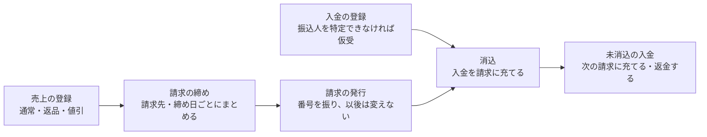
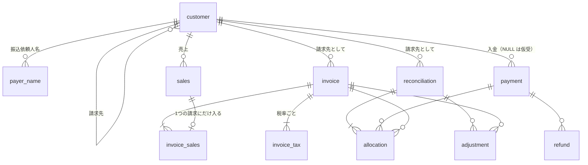

# 業務の作り（売上から入金管理まで）

状態: 案（2026-11-18）。テーブルはマイグレーション（[0001_create_tables.sql](../packages/backend/database/migration/0001_create_tables.sql)）として作成済み。画面と usecase は、売上の登録だけ実装済み。

## 1. 流れ

## 2. テーブル

ログ・作成日時・更新者などの列は持たない。金額は円の整数。業務の場面を表すのに要るテーブルだけを持つ（12個）。

| テーブル | 意味 | 主な列 |
| --- | --- | --- |
| `customer` | 顧客（得意先）。請求先は自分自身か、ほかの顧客（親会社など） | 請求先・締日（31 は月末）・回収月（0 当月〜3）・回収日 |
| `payer_name` | 振込依頼人名と請求先の対応 | 振込依頼人名（主キー）・顧客 |
| `sales` | 売上。返品・値引は負の金額。金額は税抜 | 顧客・売上日・売上区分（通常・返品・値引）・品名・金額・税率（10・8） |
| `invoice` | 請求。請求先ごと・締め日ごとに売上をまとめる | 請求先・請求締め日・入金期日・請求額（税込）・請求番号と発行日（発行前は NULL） |
| `invoice_sales` | 請求に入れた売上 | 売上（主キー。1つの売上は1つの請求にだけ入る）・請求 |
| `invoice_tax` | 請求の税率ごとの合計と消費税額（インボイス制度） | 請求・税率・課税対象額・消費税額 |
| `invoice_counter` | 請求番号の採番（発行年ごとに欠番なく） | 年・最終番号 |
| `payment` | 入金。顧客が NULL の入金は、振込人を特定できていない入金（仮受） | 入金日・入金方法（振込・現金・その他）・金額・振込依頼人名・顧客 |
| `reconciliation` | 消込。1回の作業で、同じ請求先の入金と請求を複数まとめて扱える | 請求先・消込日 |
| `allocation` | 充当。どの入金のいくらを、どの請求へ充てたか（入金と請求の多対多） | 消込・入金・請求・金額 |
| `adjustment` | 差額の調整。入金が足りない分を当社の負担として請求から差し引く | 消込・請求・調整の区分（振込手数料・端数差額）・金額 |
| `refund` | 返金。請求に充てない入金を振込人へ返す | 入金・返金日・金額 |

状態は列に持たず、行から求める（持つと食い違うため）。

| 対象 | 状態 | 求め方 |
| --- | --- | --- |
| 売上 | 未請求 / 締め済み（発行前） / 請求済み | `invoice_sales` の有無と、請求の発行日 |
| 請求 | 未発行 / 未入金 / 一部入金 / 入金済み / 期日超過 | 請求額 −（充当 + 調整）= 残高。入金期日を過ぎて残高があれば期日超過 |
| 入金 | 仮受 / 未消込 / 一部消込 / 消込済み | 顧客の有無と、入金額 −（充当 + 返金）= 未消込額 |

## 3. 業務の場面と表し方

| 場面 | 例 | 表し方 |
| --- | --- | --- |
| 通常の入金 | 請求 110,000 円に 110,000 円の入金 | 消込1回。充当1行 |
| 分割入金 | 請求 330,000 円を3回に分けて入金 | 入金ごとに消込（3回）。請求は一部入金を経て入金済み |
| 一括入金 | 9月・10月・11月の請求3件分を1回で入金 | 消込1回。1件の入金から3件の請求へ充当3行 |
| 親会社の一括入金 | 子会社2社の売上を親会社に請求し、親会社が入金 | 子会社の請求先を親会社にする。請求は親会社あてに1件 |
| 複数の入金をまとめて消込 | 振込2件で請求2件分 | 消込1回。充当は「入金 × 請求」の組ごと |
| 振込手数料の差し引き | 請求 110,000 円、入金 109,560 円（手数料 440 円を差し引き） | 充当 109,560 円 ＋ 調整（振込手数料）440 円 |
| 端数の差額 | 請求 100,003 円、入金 100,000 円 | 充当 100,000 円 ＋ 調整（端数差額）3 円 |
| 不足入金 | 請求 110,000 円、入金 100,000 円（残りは後日） | 充当 100,000 円。請求は一部入金のまま |
| 過入金 | 請求 110,000 円、入金 120,000 円 | 充当 110,000 円。入金に 10,000 円の未消込が残る（前受）。次の請求に充てるか返金する |
| 二重入金 | 同じ請求に2回入金 | 2件目の入金は未消込のまま。次の請求に充てるか返金する |
| 振込人不明 | 振込依頼人名が、どの顧客とも結びつかない | 顧客なし（仮受）で登録し、特定してから消込する。名前を振込依頼人名に登録し、次からは自動で特定する |
| 名義違い | 個人名・略称で振り込まれた | 振込人不明と同じ（振込依頼人名の登録） |
| 他社宛の誤入金 | 当社あてでない振込 | 全額を返金する |
| 早すぎる入金 | 請求の発行前に入金 | 未消込のまま置き、発行後に消込する |
| 入金の登録ミス | 金額・日付・顧客を誤って登録 | 消込・返金がなければ、入金を直すか消す。あれば、先に消込を取り消す |
| 消込のミス | 違う請求に充てた | 消込を取り消して（消込ごと消す）やり直す |
| 請求の誤り（発行前） | 売上の漏れ・誤り | 締めを解除し（請求を消す）、売上を直して締め直す |
| 請求の誤り（発行後） | 発行した請求の売上が誤っていた | 請求は変えない。返品・値引の売上を登録し、次の請求で精算する |
| 締め後に登録した過去日付の売上 | 締めた後に、締め日より前の売上を登録した | 次の締めで「まだ請求に入っていない売上」として入る |
| 軽減税率の混在 | 10% と 8% の売上が混ざる | 請求の税率ごとの合計と消費税額（`invoice_tax`） |
| 締日・回収条件の違い | 20日締め翌月10日払い、末締め翌々月末払い | 請求先の締日・回収月・回収日から入金期日を決める |
| 入金期日の超過 | 期日を過ぎても残高がある | 請求の残高と入金期日から求める |

## 4. 守る規則

| 対象 | 規則 | どこで守るか |
| --- | --- | --- |
| 売上 | 通常は正、返品・値引は負の金額 | domain・DB の制約 |
| 売上 | 請求に入った売上は直さない（直すときは返品・値引で） | domain |
| 請求 | 締め日は、その請求先の前回の締め日より後 | domain |
| 請求 | 締め日までの、まだ請求に入っていない売上をすべて入れる | repository の SQL |
| 請求 | 合計が 0 円以下になるときは締めない（売上は次の締めへ持ち越す） | domain・DB の制約 |
| 請求 | 消費税は税率ごとの税抜の合計から計算し、1円未満は切り捨て | domain |
| 請求 | 発行後は変えない。発行前だけ締めを解除できる | domain |
| 請求 | 請求番号は発行年ごとに欠番なく振る | repository の SQL（行の更新で採番） |
| 消込 | 同じ請求先の、顧客を特定した入金と、発行した請求だけを扱う | domain |
| 消込 | 請求ごとに、充当 + 調整 ≦ 請求額 | domain（対象の行を `SELECT … FOR UPDATE` で押さえてから確かめる） |
| 消込 | 入金ごとに、充当 + 返金 ≦ 入金額 | domain（同上） |
| 消込 | 調整は、その請求の残高の範囲で行う | domain |
| 返金 | 入金の未消込額の範囲で行う | domain（同上） |
| 入金 | 消込・返金のある入金は、直さない・消さない | domain |

同時に操作したとき（2人が同じ入金を別の請求に充てるなど）に食い違わないよう、消込・返金・締めでは、対象の入金・請求・請求先の行を先にロックしてから確かめる。どの SQL でロックするかは [SQL の台帳](generated/sql-ledger.md) で見られるようにする。

## 5. 画面（予定）

| 画面 | 内容 | 状態 |
| --- | --- | --- |
| 顧客 | 一覧・登録（請求先・締日・回収条件）・振込依頼人名の登録 | 未着手 |
| 売上 | 登録・一覧・訂正（未請求のものだけ） | 登録だけ実装済み |
| 請求 | 締め（請求先・締め日を選ぶ）・締めの解除・発行・一覧・詳細（税率ごとの合計） | 未着手 |
| 入金 | 登録（振込依頼人名から顧客を自動で特定）・一覧・仮受の顧客の特定・訂正・取消 | 未着手 |
| 消込 | 請求先の未消込の入金と、残高のある請求を並べ、充当と調整を入れる・取消 | 未着手 |
| 返金 | 未消込の入金からの返金 | 未着手 |
| 売掛金の残高 | 請求先ごとの残高と、期日を過ぎた請求 | 未着手 |
