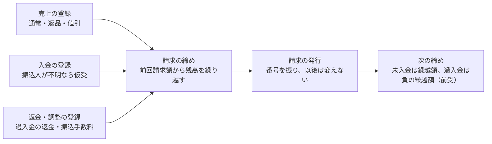
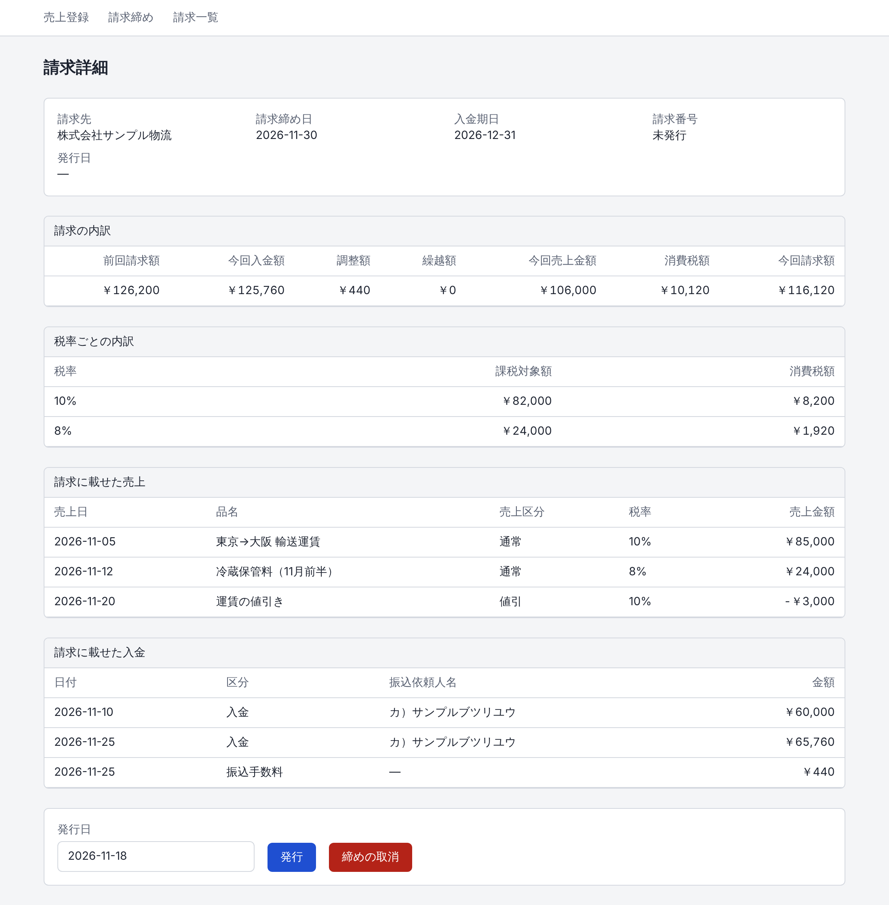
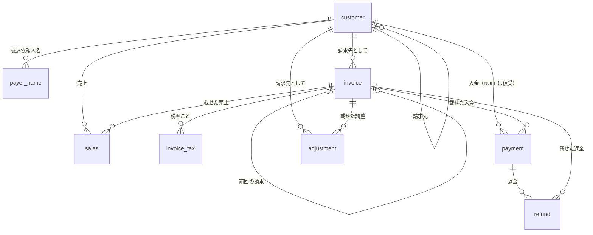

# 業務の作り（売上から入金管理まで）

状態: 2026-11-18 更新。請求書は残高を繰り越す形（日本の商習慣の合計請求書）。テーブルは [0001_create_tables.sql](../packages/backend/database/migration/0001_create_tables.sql)。
画面と処理は、売上の登録と、請求の締め・一覧・詳細・発行・締めの取消まで実装済み。入金・返金・調整の登録は未実装（テストでは行を直接入れて確かめている）。

## 1. 流れ

## 2. 請求書の形（残高を繰り越す請求書）

| 前回請求額 | 今回入金額 | 調整額 | 繰越額 | 今回売上金額 | 消費税額 | 今回請求額 |
| --- | --- | --- | --- | --- | --- | --- |
| 前回の請求の今回請求額（初回は 0） | 入金 − 返金 | 振込手数料・端数・訂正 | 前回請求額 − 今回入金額 − 調整額 | 税抜（返品・値引を含む） | 税率ごとに計算 | 繰越額 ＋ 今回売上金額 ＋ 消費税額 |

- 締めると、請求締め日までの、まだどの請求にも載せていない売上・入金・返金・調整を、その請求に載せる（行の `invoice_id` に請求を入れる）。
- 入金は個々の請求に充てない。請求先の残高を減らし、次の締めで今回入金額に載る。未入金は繰越額として次の請求に載り、過入金は負の繰越額（前受）になる。
- 消費税は、今回の売上を税率ごとに合計して計算する（インボイス制度。1円未満は 0 の方へ切り捨て）。

## 3. テーブル

ログ・作成日時・更新者などの列は持たない。金額は円の整数（負もある）。

| テーブル | 意味 | 主な列 |
| --- | --- | --- |
| `customer` | 顧客（得意先）。請求先は自分自身か、ほかの顧客（親会社など） | 請求先・締日（31 は月末）・回収月（0 当月〜3）・回収日 |
| `payer_name` | 振込依頼人名と請求先の対応 | 振込依頼人名（主キー）・顧客 |
| `invoice` | 請求。請求先ごと・締め日ごとに1件。列がそのまま請求書の見出しになる | 前回の請求・請求締め日・入金期日・前回請求額・今回入金額・調整額・繰越額・今回売上金額・消費税額・今回請求額・請求番号と発行日（発行前は NULL） |
| `invoice_tax` | 請求の税率ごとの合計と消費税額 | 請求・税率・課税対象額・消費税額 |
| `invoice_counter` | 請求番号の採番（発行した年ごとに欠番なく） | 年・最終番号 |
| `sales` | 売上。返品・値引は負の金額。金額は税抜 | 顧客・売上日・売上区分・品名・金額・税率・載せた請求 |
| `payment` | 入金。顧客が NULL の入金は、振込人を特定できていない入金（仮受）で、請求に載せない | 入金日・入金方法・金額・振込依頼人名・顧客・載せた請求 |
| `refund` | 返金。請求先の入金の返金は、今回入金額から差し引く | 入金・返金日・金額・載せた請求 |
| `adjustment` | 調整。請求先の残高を当社の判断で減らす（正）・増やす（負） | 請求先・調整日・調整区分（振込手数料・端数差額・訂正）・金額・もとになった入金・載せた請求 |

状態は列に持たず、行から求める（持つと行と食い違うため）。

| 対象 | 状態 | 求め方 |
| --- | --- | --- |
| 売上・入金・返金・調整 | 未請求 / 請求済み | `invoice_id` が NULL かどうか |
| 請求 | 未発行 / 発行済み | 請求番号・発行日が NULL かどうか |
| 請求の回収 | 回収済み / 未回収 / 期日超過 | 次の請求の繰越額（次の締めの前は、締め後の入金・返金・調整）と、入金期日から求める。入金を個々の請求・売上に充てる消込は持たない（2026-11-18 決定） |
| 入金 | 仮受 / 請求先の入金 | 顧客が NULL かどうか |

## 4. 業務の場面と表し方

画面の結合テスト（[invoiceClosePage.test.tsx](../apps/web/src/invoice/invoiceClosePage.test.tsx)・[invoiceDetailPage.test.tsx](../apps/web/src/invoice/invoiceDetailPage.test.tsx)）で、「確認」に ✓ の付いた場面を確かめている。

| 場面 | 例 | 表し方 | 確認 |
| --- | --- | --- | --- |
| 初回の請求 | 10月の売上を締める | 前回請求額 0。今回の売上と消費税だけの請求 | ✓ |
| 親会社への一括請求 | 子会社の売上を親会社に請求 | 子会社の請求先を親会社にする。請求は親会社あてに1件 | ✓ |
| 軽減税率の混在 | 10% と 8% の売上が混ざる | 税率ごとの合計と消費税額（`invoice_tax`） | ✓ |
| 返品・値引 | 売った品の返品 | 負の金額の売上。今回売上金額から引く | ✓ |
| 分割入金 | 請求 126,200 円を2回に分けて入金 | 2件の入金を今回入金額に合計する | ✓ |
| 振込手数料の差し引き | 入金が手数料 440 円だけ少ない | 調整（振込手数料）440 円。繰越額は 0 | ✓ |
| 不足入金 | 請求より少ない入金 | 足りない分が繰越額として次の請求に載る | ✓ |
| 過入金・二重入金 | 請求より多い入金、同じ請求への2回の入金 | 負の繰越額（前受）として次の請求で差し引く | ✓ |
| 返金 | 過入金を振込人へ返す | 返金を今回入金額から差し引く | ✓ |
| 一括入金 | 2か月分をまとめて1回で入金 | 未入金を繰り越した請求の今回請求額を入金すると、繰越額が 0 になる | ✓ |
| 振込人不明・名義違い | 振込依頼人名が顧客と結びつかない | 顧客なし（仮受）で登録し、請求に載せない。特定したら顧客を入れ、次の締めで載る | ✓（載せない側） |
| 他社宛の誤入金 | 当社あてでない振込 | 仮受のまま全額を返金する（請求に載らない） | — |
| 締め後に登録した過去日付の売上 | 締めた後に、締め日より前の売上を登録した | 次の締めで「まだ載せていない行」として載る | ✓ |
| 締日・回収条件の違い | 20日締め翌月10日払い、末締め翌月末払い | 請求先の締日に合う日だけ締められる。入金期日は回収月・回収日から決める（その月にない日は月末） | ✓ |
| 請求の誤り（発行前） | 売上の漏れ・誤り | 締めを取り消し（請求を消し、行を戻す）、直して締め直す | ✓ |
| 請求の誤り（発行後） | 発行した請求の売上・入金が誤っていた | 請求は変えない。売上は返品・値引、入金などは調整（訂正）で、次の請求で直す | — |
| 入金期日の超過 | 期日を過ぎても入金がない | 次の請求の繰越額と入金期日から求める | — |

## 5. 守る規則

| 対象 | 規則 | どこで守るか |
| --- | --- | --- |
| 売上 | 通常は正、返品・値引は負の金額 | domain・DB の制約 |
| 請求 | 請求先（自分自身が請求先の顧客）だけを締める | domain |
| 請求 | 締め日は請求先の締日に合う日（31 は月末。その月にない日も月末） | domain |
| 請求 | 前回の請求が発行済みで、締め日が前回より後 | domain |
| 請求 | 前回からの残高も載せる行もなければ締めない | domain |
| 請求 | 繰越額 = 前回請求額 − 今回入金額 − 調整額、今回請求額 = 繰越額 ＋ 今回売上金額 ＋ 消費税額 | domain・DB の制約 |
| 請求 | 発行後は変えない。発行前だけ締めを取り消せる | domain・repository の SQL（`issue_date IS NULL` の行だけ更新・削除） |
| 請求 | 発行日は請求締め日以後。請求番号は発行した年ごとに欠番なく振る | domain・repository の SQL（採番の行の更新。取り消せば番号も戻る） |
| 請求 | 1つの行は1つの請求にだけ載る | repository の SQL（`invoice_id IS NULL` の行だけ更新し、数が合わなければ止める） |
| 入金 | 仮受の入金は請求に載せない | repository の SQL・DB の制約 |

同時に操作したときに食い違わないよう、締めと締めの取消では請求先の顧客の行を先にロックし、締めに載せる行も `FOR UPDATE` で読む。同じ請求先を同時に締めても請求が1件だけできることを、PostgreSQL のテストで確かめている。どの SQL がどの行をロックするかは [SQL の台帳](generated/sql-ledger.md) で見られる。

## 6. 画面

| 画面 | 内容 | 状態 |
| --- | --- | --- |
| 売上の登録 | 顧客・売上日・売上区分・品名・金額・税率 | 実装済み |
| 請求の締め | 請求先と請求締め日を選んで締める | 実装済み |
| 請求の一覧 | 締め日・請求先・入金期日・今回請求額・請求番号 | 実装済み |
| 請求の詳細 | 残高を繰り越す請求書の金額・税率ごとの内訳・載せた売上と入金。発行・締めの取消 | 実装済み |
| 入金の登録 | 振込依頼人名から顧客を自動で特定。特定できなければ仮受。仮受の顧客の特定 | 未着手 |
| 返金・調整の登録 | 過入金の返金、振込手数料・端数・訂正の調整 | 未着手 |
| 顧客 | 一覧・登録（請求先・締日・回収条件）・振込依頼人名の登録 | 未着手 |
| 売掛金の残高と回収状況 | 請求先ごとの残高と、期日を過ぎた請求 | 未着手 |
