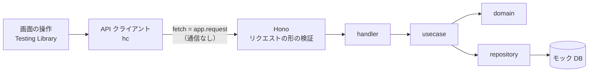
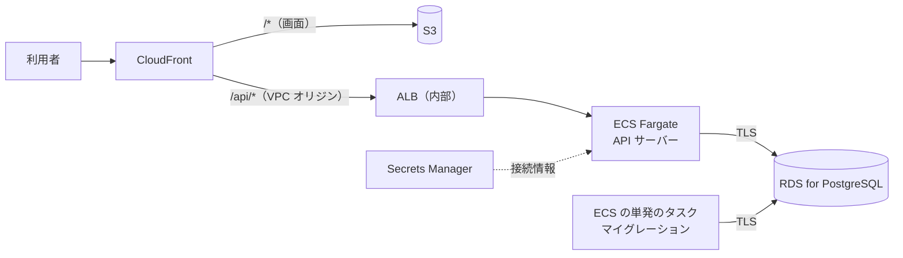

# 要求と方針

状態: 方針を確定（2026-11-18）。売上の登録、請求の締め・一覧・詳細・発行・締めの取消、手書き SQL の repository と DB のテスト、本番の API サーバーと AWS の CDK まで実装済み。業務の作りは [業務の作り](domain-model.md)。次に作るものは [8. 次の作業](#8-次の作業)。
kawakin-core-system は参考資料として扱う。domain の作りは強く参考にし、それ以外は引き継ぐ前提にしない。

## 1. 狙い

TypeScript で業務 Web アプリを作るための土台（フレームワーク兼サンプル実装）を作る。次の3つを両立させる。

1. 画面の操作から、API 通信を介さずにバックエンドの業務処理までを同じプロセスで結合テストできる。差し替えるのは DB だけにする。
2. 識別子に使う英単語を単語帳で絞り、関数名と処理の並びを日本語に機械翻訳して、処理を日本語で読めるようにする。
3. 単語帳の単語を画面の文言にも使い、画面・コード・設計の言葉をそろえる。

## 2. 要求一覧

| ID | 分類 | 要求 |
| --- | --- | --- |
| R-01 | 基盤 | フロントエンド・バックエンドとも TypeScript で書く |
| R-02 | 基盤 | pnpm のモノレポにする |
| R-03 | 基盤 | フロントエンドは React |
| R-04 | 基盤 | バックエンドは Hono を候補とし、テストの要求から判断する（→ Hono に決定） |
| R-05 | 基盤 | フレームワーク兼サンプル実装にする。サンプルの業務は売上登録から入金管理まで |
| R-06 | 基盤 | DB の構造は最小限にする。ログ・監査の列などは持たない。ただし業務の場面を表すのに要るテーブルは持つ |
| R-07 | 業務 | 請求（売上をまとめるもの）の概念を持つ |
| R-08 | 業務 | 分割入金・一括入金・間違い入金など、普段ありうる場面を反映する |
| R-09 | 基盤 | 本番は AWS。インフラは CDK で書く |
| R-10 | 設計 | バックエンドは domain・usecase・repository の3層を基本にし、フォルダは層を先に分ける |
| R-11 | 設計 | usecase は関数を呼び、戻り値を次の関数の引数へ渡すだけにする |
| R-12 | 設計 | usecase ではメソッドチェーンを禁止する |
| R-13 | 設計 | エラー処理はシンプルにする。業務エラーは例外で投げ、try/catch で受ける |
| R-14 | 設計 | usecase に if を書かない。判定は domain へ寄せる |
| R-15 | 設計 | 部品の渡し方は縛らない（縛りすぎると分かりにくくなる） |
| R-16 | 設計 | domain は kawakin を参考にし、値の型を決め、それがそのまま永続化されるなど、見て物理的に何が起こるか分かる形にする。repository のインターフェースを受け取る domain のサービスは最小限にする |
| R-17 | 設計 | SQL は手で書く |
| R-20 | 画面 | useEffect は一切禁止 |
| R-30 | テスト | 画面のボタン押下などの操作から、API 通信を介さずに usecase（またはそれを含む API handler）を呼び出して結合テストする |
| R-31 | テスト | その結合テストでモックにするのは DB だけ |
| R-32 | テスト | 画面の操作からバックエンドの処理までを、可能な限り軽く流す。DB が本物に近いとボトルネックになるので、そうならない方式にする |
| R-33 | テスト | 画面からの結合テストで、境界値などを厚く確かめる。それより細かい単体テストは、狭い範囲のロジックだけに使う（仮説: 画面からの結合テストを厚くすると、全体のテストの量が減る） |
| R-34 | テスト | 本物の DB を使う結合テストは一部だけ行う。DB が要るテストは Docker で動かす |
| R-35 | テスト | repository のテストで、実行される SQL を構造的に固定し、明確にする（極端な状況の調査に活きる） |
| R-36 | テスト | 本番向けの大きなテスト（E2E など）は当面持たない |
| R-40 | 語彙 | 関数などに使う英単語を単語帳で管理し、単語帳にある単語だけを使う。まずは厳しく当てる |
| R-41 | 語彙 | 単語はシステム向けの単語とドメインの単語に分ける |
| R-42 | 語彙 | 単語帳の単語を画面でも使う。画面は多言語になることを想定する |
| R-50 | コメント | 業務の関数（業務フロー・シナリオ・usecase・domain）には目的のコメントを書かない。目的は、型でつながる業務フロー・シナリオから分かる |
| R-60 | 翻訳 | コードの処理を日本語に翻訳するツールを自作し、処理を明確に読めるようにする |
| R-61 | 翻訳 | 関数名は体言止めで訳す（`createNewTransportSales` →「新輸送売上の登録」） |
| R-62 | 翻訳 | 関数の中の処理は番号付きで「〜する」の文体で訳す（`validateSalesRequest` →「1. 売上リクエストをバリデーションする」） |
| R-70 | 要件定義 | 受託開発を前提にする。GitHub を使うのは開発チームだけで、先方にはブラウザをそのまま全部見せる |
| R-71 | 要件定義 | 大きい粒度から業務を並べ、打合せで会話しながら細かい粒度へ育てる |
| R-72 | 要件定義 | 課題は、関係する業務の場所に、適切な粒度で残す。課題には担当と期限を持たせる |
| R-73 | 要件定義 | 議事録を型で書き、先方がレビューできる成果物にする。新しいシステムの業務フローの粒度も、先方がレビューできるようにする |
| R-74 | 要件定義 | 人の名前は書かず、役割で書く。役割も型で定義し、開発チーム（PM・エンジニア）と業務部門（経理担当など）を分ける |
| R-75 | 要件定義 | 議事録は、文字起こしや手元のメモから AI が作って PR にし、開発チームと先方でレビューしてマージする。一度書いた議事録の修正はいとわない |
| R-76 | 要件定義 | 議事録 → 課題・決定事項、決定事項 → 業務フロー・画面・テスト・関数など、の紐づけを型で持つ。課題がなくなれば要件定義は済み、人は課題を解決するための会話をすればよい |
| R-77 | 要件定義 | AI に向けた指示は、文字起こしから議事録を作る Skill の1つだけにする。ほかはすべて CI で止め、Skill がその1つだけであることも CI で固定する |

## 3. 決定事項

| 項目 | 決定 | 決めた日 |
| --- | --- | --- |
| リポジトリの位置づけ | フレームワーク兼サンプル実装（売上登録〜入金管理） | 2026-11-18 |
| 業務の範囲 | 顧客・売上・請求・入金・返金・調整（[業務の作り](domain-model.md)） | 2026-11-18 |
| 請求書の形 | 残高を繰り越す請求書（前回請求額・今回入金額・調整額・繰越額・今回売上金額・消費税額・今回請求額）。日本の商習慣に合わせる | 2026-11-18 |
| 発行後の訂正 | 発行した請求は変えず、次の請求で精算する（売上は返品・値引、入金などは調整の訂正） | 2026-11-18 |
| バックエンド | Hono。画面の結合テストは API クライアントの `fetch` を `app.request` に差し替える | 2026-11-18 |
| DB | PostgreSQL。SQL は手で書く。画面の結合テストはインメモリのモック DB | 2026-11-18 |
| DB が要るテスト | Docker の PostgreSQL（`docker compose`） | 2026-11-18 |
| 本番 | AWS。インフラは CDK。ECS Fargate ＋ 内部の ALB、RDS for PostgreSQL、S3 ＋ CloudFront（`/api/*` は VPC オリジンで ALB へ）、Secrets Manager（5.13） | 2026-11-18 |
| 任意の条件が多い検索 | 1つの固定の SQL に全条件を書く。実行計画が悪い検索だけ目的別の SQL に分ける | 2026-11-18 |
| 画面の見た目 | Tailwind CSS ＋ 自前の部品。見た目の調整は `style.css` のトークンと `shared/component` の2か所だけで行う（5.12） | 2026-11-18 |
| バックエンドの分け方 | 層が先（`domain/sales`・`usecase/sales`・`repository/…`） | 2026-11-18 |
| 業務エラー | 例外で投げ、Hono の共通処理で HTTP の応答に変換する | 2026-11-18 |
| usecase の if | 書かない。domain に寄せる | 2026-11-18 |
| 部品の渡し方 | 縛らない。引数で1つずつ渡しても、まとめて渡してもよい | 2026-11-18 |
| usecase での呼び出し | 関数と、プロパティをたどった先のメソッド（`a.b.c()`）は呼べる。メソッドチェーン（呼び出しの結果をさらに呼ぶ）は禁止 | 2026-11-18 |
| 単語帳 | 厳しく当てる（CI でエラー）。DB のテーブル名・列名・区分値にも当てる | 2026-11-18 |
| 画面の言語 | 多言語を想定（日本語・英語） | 2026-11-18 |
| 単語帳の形 | 言語に依らない概念 ＋ 言語ごとの語形（活用の型）と文法。英語・日本語とも1対1にし、画面の文言（i18n の文言ファイル）も同じマスタから生成する。編集は開発者だけ（[単語帳の設計](vocabulary-design.md)） | 2026-11-19 |
| 業務フローの正本 | TypeScript で書く（参照は import、名前は単語帳の言葉）。JSON は解析して作るブラウザ向けの生成物にする（[このリポジトリの考え方](concept.md) の6章） | 2026-11-19 |
| 業務フローの未着手 | 中身が空の段・シナリオ・ケースを許し、数を出す（ヒアリングから育てるため） | 2026-11-19 |
| 業務フローの書き方 | 業務フロー（要約）・シナリオ（利用者の目的）・ケース（主成功シナリオ・バリエーション・拡張）をコーバーンのユースケースに合わせて書き、規則を `pnpm flow:check` で止める。画面のテストはシナリオのケースにだけ書く（[業務フローの書き方の規則](flow-rules.md)） | 2026-11-19 |
| コードのブラウザ | 静的解析で作ったモデルを読む静的な画面（`apps/browser`）。開いている間はソースの保存ごとに後ろでモデルを作り直す | 2026-11-19 |
| 翻訳ツール | usecase・domain を対象に、制御構文も訳し、CLI で Markdown を作る | 2026-11-18 |
| コメント | 業務の関数には目的を書かない（型で業務フローにつながるため） | 2026-11-19 |
| 大きなテスト | 当面持たない（2026-11-20 に、業務フローを実ブラウザで流す E2E を足した） | 2026-11-18 |
| 役割 | `apps/web/role` に `defineRole(名前, { side })` で書く。立場は開発チーム（`vendor`）・業務部門（`business`）・業務の相手（`external`）。業務フローの担当・議事録の出席者・課題の担当は役割の値で指す（[業務フローの書き方の規則](flow-rules.md) の7章） | 2026-11-21 |
| 議事録 | `apps/web/meeting` に1回1ファイルで `defineMeeting` で書く。話したことは決めたこと（`decide`）か課題（`raise`）にし、業務フロー・シナリオ・拡張・関数（画面の部品・処理・規則など）を値で指す。課題は担当の役割と期限を持ち、後の回の決めたことが `question` で指すと解決する。状態（解決済み・未解決・期日超過）は書かずに求める。先方の承認は記録しない（返事は次の議事録に載る） | 2026-11-21 |
| 要件定義の進め方 | 開発チームがヒアリング・提案し、先方が返事をし、文字起こしやメモから AI が議事録を作って PR にし、開発チームと先方でレビューしてマージする。このサイクルで会話する（[業務フローの書き方の規則](flow-rules.md) の 7.3） | 2026-11-21 |
| AI に向けた指示 | Skill は `.claude/skills/minutes`（文字起こしから議事録を作る）の1つだけ。ほかの Skill・`CLAUDE.md`・`AGENTS.md` などは置かず、`pnpm flow:check` の規則 `skill` で止める | 2026-11-21 |
| 消込 | 入金を個々の請求・売上に充てる消込は持たない。回収状況は請求先の残高と、期日を過ぎた繰越額で見る | 2026-11-18 |
| 請求書の出力 | PDF で出力する。インボイス制度の記載事項のため、自社の情報（名前・登録番号 T＋13桁など）を1行の設定として持つ | 2026-11-18 |
| 認証 | Amazon Cognito（ユーザープール）でログインし、API は ID トークンを検証する。権限は当面「ログインできる人は全操作できる」から始める | 2026-11-18 |

## 4. 実装したもの

### 4.1 構成

```text
web-app-framework/
├─ apps/web/                  # React の画面（Vite・TanStack Router・TanStack Query）
│  ├─ src/                    # 画面（sales・invoice・payment）と、API クライアント・ルーター・文言・画面の土台（shared）
│  ├─ scenario/               # シナリオ（*.ts）と、そのケース＝画面の結合テスト（*.test.tsx）
│  ├─ flow/                   # 業務フロー（領域ごとのフォルダ: invoice・payment・sales・customer）と、その E2E（flow.test.tsx）
│  ├─ e2e/                    # 業務フローを実ブラウザ・API サーバー・PostgreSQL で流す E2E（pnpm test:e2e）
│  └─ test/launchApp.tsx      # 画面をインプロセスで開く道具
├─ apps/browser/              # コードのブラウザ（モデルを読む静的な画面）
├─ apps/server/               # 本番の API サーバー（Node で Hono を常駐）とマイグレーションの実行。Dockerfile
├─ packages/backend/          # Hono の API
│  ├─ database/migration/     # スキーマ（手書きの SQL のマイグレーション）
│  ├─ src/
│  │  ├─ domain/              # 値の型・エンティティ・入力境界・repository のインターフェース
│  │  ├─ usecase/             # 業務の手順（関数呼び出しの並びだけ）
│  │  ├─ repository/memory/   # モック DB の repository（画面の結合テスト用）
│  │  ├─ repository/postgres/ # PostgreSQL の repository と、手書きの SQL（*Statement.ts）
│  │  ├─ handler/             # Hono のルート・エラーの共通処理
│  │  ├─ testing.ts           # 画面の結合テスト用の部品（モック DB で組み立てる）
│  │  └─ production.ts        # 本番の部品（PostgreSQL で組み立てる）
│  └─ test/repository/        # repository の契約のテスト（モック DB と PostgreSQL に同じテストを流す）
├─ packages/vocabulary/       # 単語帳（YAML）と、そこから作る辞書・文法・画面の文言ファイル
├─ packages/flow/             # 業務フロー・シナリオ・ケースの書き方と、画面の操作の部品
├─ packages/eslint-plugin/    # 単語帳・関数名の文法・usecase の書き方の lint
├─ packages/translator/       # 日本語翻訳ツール・SQL の台帳の生成・コードのブラウザのモデル（静的解析）
├─ infra/                     # AWS の CDK
├─ docs/generated/            # 翻訳ツールの出力・SQL の台帳
└─ docker-compose.yaml        # テスト用の PostgreSQL
```

コマンド（ルートで実行）:

| コマンド | 内容 |
| --- | --- |
| `pnpm install` | 依存を入れる |
| `pnpm check` | 単語帳の生成物・lint・型・テスト・翻訳と SQL の台帳の生成物・業務フローの書き方をまとめて確かめる（Docker は要らない） |
| `pnpm test` | テストだけ（Docker は要らない） |
| `pnpm test:database` | Docker の PostgreSQL を起動し、repository のテストを流す |
| `pnpm test:e2e` | Docker の PostgreSQL を起動し、業務フローを実ブラウザ（Chromium）・API サーバーで流す |
| `pnpm database:down` | テスト用の PostgreSQL を止める |
| `pnpm vocabulary:generate` | 単語帳（YAML）を変えたあとに、辞書と画面の文言ファイル（`locale/ja.json`・`en.json`）を作り直す |
| `pnpm vocabulary:find <日本語>` | 日本語の用語から英語の名前を引く |
| `pnpm translate` | 処理の訳（日本語・英語）を作り直す |
| `pnpm sql:ledger` | SQL の台帳を作り直す（DB の名前の単語帳の検査も行う） |
| `pnpm flow:check` | 業務フローの書き方の規則を確かめる（`pnpm check` に含まれる） |
| `pnpm model` | コードのブラウザのモデル（日本語と英語。`apps/browser/generated/model.ja.json`・`model.en.json`）を作る |
| `pnpm dev:browser` | コードのブラウザを開く（ソースを保存するたびにモデルを作り直す） |
| `pnpm dev:api` / `pnpm dev:web` | 手元で API サーバー（`DATABASE_URL` が要る）と画面を動かす。画面の `/api` は API サーバーへ中継する |
| `pnpm --filter @app/infra synth` | AWS の CloudFormation のテンプレートを作る（`-c stage=dev` などで環境を選ぶ） |

### 4.2 確かめたこと

| 確かめたこと | 結果 |
| --- | --- |
| 画面の操作から usecase まで、通信なしで流せるか | 流せる。画面のコードは本番と同じで、テストでは `fetch` だけを差し替える |
| 画面の結合テストの速さ | 1件 約 50ms（画面をナビゲーションから開く分を含む。2026-11-19 の環境）。業務フロー「月次の請求」の本線の E2E は約 0.45 秒。Docker なしのテスト全体（441件）は約 8 秒 |
| バックエンドの処理の速さ | `app.request` 1回あたり約 0.05ms（モック DB）。画面のテストの時間はほぼ画面側 |
| 境界値を画面から厚く確かめられるか | 売上金額・売上日・品名の境界、返品・値引の符号、軽減税率、顧客の未選択、複数の項目の同時の誤りを、画面の結合テストだけで確かめた |
| 業務の場面を画面から確かめられるか | 請求の締めで、初回・親会社への一括請求・分割入金・振込手数料・不足入金・過入金（前受）・返金・一括入金・仮受・締め後の過去日付の売上・締日と入金期日・前回の請求との関係を、画面の操作から確かめた（[業務の作り](domain-model.md) の4章）。発行（年ごとの請求番号）・締めの取消も同じ |
| 計算をテストが見ているか | 繰越額の計算から調整額をわざと外すと、手数料を含む締めのテストが失敗することを確かめた |
| 同時の操作 | 同じ請求先を2つのトランザクションで同時に締めても、請求は1件だけできる（PostgreSQL のテスト） |
| 本番の API サーバー | まとめたサーバー（`apps/server`）を node:22-alpine のイメージで動かし、PostgreSQL に対してマイグレーション・締め・入力の検証・一覧が応答することを確かめた |
| AWS の CDK | `cdk synth` でテンプレート（64 リソース）を作れる。DB の暗号化と非公開、内部の ALB、/api/* の振り分け、マイグレーションのタスク、prod の Multi-AZ と削除保護をテストで確かめる |
| モック DB と PostgreSQL の振る舞いがずれないか | 同じ契約のテストを両方に流して確かめる（顧客・売上・締めの対象・請求の保存・先に載った行の検出・採番・発行・締めの取消・トランザクションの取り消し）。PostgreSQL のテストは22件 |
| 実行される SQL | repository が実行できるのは `defineStatement` で定義した固定の SQL だけ（型で縛る）。全文は [SQL の台帳](generated/sql-ledger.md) に出し、テストで「どの SQL が流れたか」を確かめる |
| 単語帳の lint | 単語帳にない単語・使わせない単語（`add`・`init`・`parse`・`insert`・`setup` など）・動詞で始まらない関数名を検出する。DB のテーブル名・列名・索引名・区分値も単語帳で検査する |
| 単語帳の統一 | 英語・日本語とも同じ語形を2つの概念に当てない（生成で止める）。生成した日本語の見出し 237 件がすべて元の名前に1通りに戻る（往復のテスト）。画面は生成した文言ファイルだけを読み、キーは型で検査する。文 31 のうち文の型で作る文 10・自由文 21 |
| usecase の lint | if・for・throw・try・let・メソッドチェーン・リテラルや計算を渡す引数・層の逆向きの import を検出する |
| useEffect の禁止 | `useEffect`・`useLayoutEffect`・`useInsertionEffect` の import を検出する |
| 翻訳ツール | usecase は手順の並びとしてそのまま読める（4.3）。domain は訳せない式がコードのまま残る |
| 画面の本番ビルド | バックエンドのコードは入らない（画面は API の型だけを参照する） |

途中で分かったこと: React 19 は Suspense の待ちを表示に反映するまで約 300ms 待つ。画面を開いてからデータを取ると、テスト1件ごとにこの待ちが入る（最初は1件 約 330ms だった）。画面を開く前にルーターの loader でデータを取っておく形にして、この待ちをなくした。本番の画面でも、データの取得は loader で行う。

### 4.3 翻訳ツールの出力（抜粋）

```ts
export async function createSales(
  salesRepository: SalesRepository,
  customerRepository: CustomerRepository,
  idGenerator: IdGenerator,
  salesRequest: SalesRequest,
): Promise<SalesId> {
  const salesInput = interpretSalesRequest(salesRequest)
  const customer = await customerRepository.findCustomer(salesInput.customerId)
  const salesId = assignSalesId(idGenerator)
  const salesCreate = planSalesCreate(salesId, customer, salesInput)
  await salesRepository.createSales(salesCreate)
  return salesId
}
```

```text
### 売上の登録

- 関数: `createSales`
- 引数: 売上リポジトリ、顧客リポジトリ、ID生成器、売上リクエスト
- 処理:
   1. 売上リクエストを解釈する
   2. 顧客を取得する
   3. 売上IDを割り当てる
   4. 売上登録を計画する
   5. 売上を登録する
   6. 売上IDを返す
```

請求の締めは次のように訳される（判定はすべて domain の関数の中にある）。

```text
### 請求の締め処理

- 関数: `closeInvoice`
- 引数: リポジトリ、ID生成器、締めリクエスト
- 処理:
   1. 締めリクエストを解釈する
   2. 顧客をロックする
   3. 最新の請求を取得する
   4. 締められることを確かめる
   5. 請求に載せていない明細を一覧取得する
   6. 請求IDを割り当てる
   7. 請求登録を計画する
   8. 請求を登録する
   9. 請求IDを返す
```

全体は [docs/generated/backend-process.md](generated/backend-process.md)。

## 5. 方針

### 5.1 バックエンドの層

| 層 | 役割 | 依存してよい先 |
| --- | --- | --- |
| domain | 値の型・エンティティ・入力境界・業務ルール・repository のインターフェース。I/O なし | なし |
| usecase | 業務の手順。domain の関数と、受け取った部品のメソッドを呼ぶだけ | domain |
| repository | domain の repository のインターフェースを、DB（本番は PostgreSQL、テストはモック DB）で実装する | domain |
| handler（3層の外の薄い層） | Hono のルート。リクエストの形の検証 → トランザクションを張って usecase を呼ぶ → 応答の変換だけ | usecase・domain |

- 部品は `AppDependency`（`runTransaction`・`idGenerator`）に集め、`prepareApp(dependency)` で API を組み立てる。本番は `prepareProductionDependency`（PostgreSQL）、画面の結合テストは `prepareMemoryDependency`（モック DB）で組み立てる。
- handler は `dependency.runTransaction((repositories) => usecase(…))` で、1リクエストを1トランザクションで行う。repository はトランザクションの中で受け取る。
- 層の依存の向きは lint（`no-restricted-imports`）で検査する。

### 5.2 usecase の書き方

usecase のファイルでは次の形だけを書ける。外れたものは lint（`app/flat-steps`）でエラーにする。

| 書けるもの | 書けないもの（domain の関数へ出す） |
| --- | --- |
| `const 変数 = 関数(引数…)`（`await` 可） | `if`・`switch`・`for`・`while`・`throw`・`try`/`catch` |
| `const { a, b } = 関数(引数…)`（分割代入は名前だけ） | メソッドチェーン（`list.filter().map()`、`repository.listSales().all()`、`.then()`） |
| `a.b.c(引数…)`（プロパティをたどった先のメソッド） | 演算子・リテラル・三項演算子・関数の中での関数定義・`let` |
| `関数(引数…)` だけの文 | 式を返す `return`（`return { a }` など） |
| `return 変数`・`return a.b` | |

- 引数には変数かプロパティ（`salesInput.customerId`）だけを渡せる。値の組み立てや計算は、名前の付いた domain の関数で行う。
- 部品の渡し方は縛らない。サンプルは引数で1つずつ受けている（何に触る処理かが引数で分かるため）が、まとめて受けてもよい。

### 5.3 domain の書き方（kawakin を参考）

| kawakin（Go） | このリポジトリ（TypeScript） | 例 |
| --- | --- | --- |
| `value/` の値オブジェクト（`New*` で制約を検証） | `value/` の値の型（`Brand<string, 'SalesDate'>`）と `interpret*`（画面の入力を検証して値にする） | `interpretSalesAmount` |
| エンティティの末端はすべて値オブジェクト | エンティティの項目はすべて値の型。項目はテーブルの列と同じ | `Sales` |
| `create/` の作成の入力境界（そのまま INSERT される） | `SalesCreate`。この型の項目が、そのまま1行になる | `planSalesCreate` |
| model の `Entity()` で DB の行から復元 | `Stored<Sales>`（値の印を外した保存の形）から `restoreSales` で組み立てる | `restoreSales` |
| repository のインターフェースは入力境界の型だけを受ける | 同じ。`createSales(salesCreate: SalesCreate)` | `SalesRepository` |
| policy・knowledge | 判定の関数（`ensure*`・`is*`）と計算の関数。usecase の if を引き受ける | `ensureClosable`・`calculateInvoiceTaxes` |
| `update/` の入力境界と選択子 | 目的ごとの入力境界の型（項目が更新する列になる） | `InvoiceIssue`（番号と発行日）・`ClosingCancel` |

- repository のインターフェースを受け取る domain のサービスは最小限にする。いまは `assignSalesId(idGenerator)` だけ。
- 画面の入力は、まだ検証していない文字列のまま受け取り（`SalesRequest`）、domain の `interpret*` で値の型にする。項目ごとの問題は `interpretFields` がまとめ、画面に一度に返す。
- 値の型は、型の上では別物になる（`SalesId` に `CustomerId` を渡すと型エラー）。
- 保存の形（`Stored<Entity>`）はエンティティから機械的に作るので、エンティティ・モック DB の行・SQL の結果の列名（`AS "salesAmount"`）が同じ形にそろう。

### 5.4 エラー処理

- 業務エラーは domain の関数が throw する。usecase は throw も try/catch も書かない。
- 業務エラーの種類は4つ。どれも `AppError` を継承し、画面に出す文はメッセージ帳のキーで持つ。

  | エラー | 使う場面 | HTTP |
  | --- | --- | --- |
  | `ValidationError` | 入力の不正（項目ごとの問題を持つ） | 400 |
  | `ForbiddenError` | 権限がない | 403 |
  | `NotFoundError` | 対象がない | 404 |
  | `ConflictError` | 重複・状態による拒否など、業務上の拒否。DB の一意制約の違反もこれにする | 409 |
  | それ以外 | 想定外 | 500 |

- try/catch を書くのは3か所だけ。Hono の `app.onError` に渡す `respondError`（HTTP の応答への変換とログ）、domain の `interpretFields`（項目ごとの問題をまとめる）、トランザクションの境界（例外なら ROLLBACK）。

### 5.5 画面の結合テスト



- `renderScreen(path, database)` が、モック DB で組み立てた Hono アプリに `fetch` をつなぎ、画面の loader を済ませてから描画する。
- テストは、画面の文言を単語帳から引いて要素を探し（`text.label('salesAmount')`）、モック DB の行（`database.sales`）で保存の結果を確かめる。
- 項目の問題は、入力欄の説明（`aria-describedby`）として確かめる。画面の使いやすさも同時に確かめられる。
- 速さのための決まり: 画面のデータは loader で先に取る（Suspense の約 300ms の待ちを入れない）。入力操作は待ち時間なし（`userEvent.setup({ delay: null })`）。
- モック DB も、本物の DB と同じく処理が例外で終わったら書いた内容を取り消す。

### 5.6 テストの層

| 種類 | 対象 | DB | 量 |
| --- | --- | --- | --- |
| 画面の結合（主役） | 画面〜repository。境界値もここで確かめる | モック DB | 多 |
| 単体 | 狭い範囲のロジック（計算・判定）と、道具（lint・翻訳） | なし | 必要なだけ |
| repository の契約 | モック DB と PostgreSQL が同じ振る舞いか。実行された SQL | モック DB・Docker の PostgreSQL | 中 |
| E2E | — | — | 当面なし |

### 5.7 SQL の固定

- SQL は `*Statement.ts` に `defineStatement('名前', '本文')` で1文ずつ書く。本文は式を埋め込まない固定の文字列にし、値は `$1`・`$2`… で渡す。条件によって SQL を組み立てない。
- repository が DB を触る口（`Executor`）は、`defineStatement` で定義した SQL しか受け付けない。組み立てた文字列の SQL は型の上で実行できない。
- `pnpm sql:ledger` が全文を [SQL の台帳](generated/sql-ledger.md) に出す。本文に式を埋め込んでいたら止める。SQL の変化は台帳の差分で見る。
- PostgreSQL の repository のテストは、実行した SQL の名前を記録し、「この操作はこの SQL だけを流す」を確かめる。
- DB の値の読み方をそろえる: bigint は number、date は `YYYY-MM-DD` の文字列のまま（タイムゾーンでずらさない）。
- 任意の条件が多い検索は、1つの固定の SQL に `($1::text IS NULL OR customer_id = $1)` の形で全条件を書く。実行計画が悪い検索だけ、目的別の SQL に分ける。
- 締めでは、請求先の顧客の行と、締めに載せる行を `FOR UPDATE` でロックする。行を請求に載せる SQL は `invoice_id IS NULL` の行だけを更新し、更新した数が合わなければ止める（ほかの操作が先に載せていた）。

### 5.8 フロントエンド

- React 19 + Vite の SPA。ルーターは TanStack Router、サーバーの状態は TanStack Query。
- 画面を開いたときのデータ取得は、ルーターの loader（`ensureQueryData`）で行い、画面は `useSuspenseQuery` でキャッシュから読む。
- `useEffect`・`useLayoutEffect`・`useInsertionEffect` は lint でエラーにする。ライブラリ内部での利用は対象外。

| useEffect を使いがちな場面 | 代わりの書き方 |
| --- | --- |
| 画面を開いたときのデータ取得 | ルーターの loader + `useSuspenseQuery` |
| props から値を計算する | 描画中に計算する（必要なら `useMemo`） |
| props が変わったら状態を初期化する | `key` を変えて作り直す |
| ボタン押下などに反応する | イベントハンドラに書く |
| 外部の状態の購読 | `useSyncExternalStore` |
| DOM の初期化（フォーカス・計測・外部ウィジェット） | ref コールバック（React 19 で後始末を返せる） |
| ページタイトル | React 19 の `<title>` |

### 5.9 単語帳

仕組みの全体は [単語帳の設計](vocabulary-design.md)。

- 1つのマスタから、コードの名前の検査・処理の日本語訳・DB の名前の検査・画面の文言（言語ごとの i18n の文言ファイル）を作る。編集するのは開発者だけ。
- 置き場所: `packages/vocabulary/words/system/*.yaml`（システム向けの名詞・動詞・形容詞・前置詞・複合語）、`words/domain/*.yaml`（業務）、`messages.yaml`（画面の文）。
- 1つの概念の項目: `id`（英語の原形。複合語は camelCase）・`en`（不規則な語形・見出しの上書き・複合語の `tokens`）・`ja`（名詞は `form` と `attach`、動詞は活用の型 `class` と `stem` か `dictionary`、形容詞は `class` と `stem`、前置詞は並べ替えの型）・`avoid`（同じ意味で使わせない単語）・`role`（repository など受け手の役割の語）・`description`（業務の概念は必須）。
- 派生（-able・過去分詞・un-・名詞形）は書かず、活用の型から作る。部分の組合せで訳が決まらない言い回しだけ複合語にする。
- 1つの概念は1つの意味だけにする（例: `issue` は請求の「発行」に使うので、入力の「問題」は `problem` にした）。英語・日本語とも、同じ語形を2つの概念に当てると生成で止まる。
- 単語帳を変えたら `pnpm vocabulary:generate` で生成物（`src/generated/`）を作り直す。CI は作り直し忘れを検出する。日本語の用語から名前を引くときは `pnpm vocabulary:find 振込依頼人の顧客`（→ `payerCustomer`）。
- 検査の範囲: アプリのコード（`apps/**`・`packages/backend/**`）で自分で宣言した名前（関数・変数・引数・型・型の項目・クラス・import の別名）、ファイル名（`app/known-file-name`。点で区切った部分ごと）、API と画面のパス（`app/known-path`。Hono の道筋と画面の道筋の `/…`。`:invoiceId`・`$invoiceId` は引数の名前を読む）と、DB のテーブル名・列名・索引名・区分値。ライブラリの名前を参照するだけの箇所と、道具（lint・翻訳・単語帳の生成）は対象外。ファイル名のうち、道具が決める名前（Vite の入口 `main`、テストの `setup`・`test`・`e2e`、`testing`）と設定ファイル（`*.config.ts`）は読まない。フォルダの名前（`src`・`domain` などの層）は対象外（業務フローの領域のフォルダだけ `flow-place` で検査する）。
- 関数名は動詞で始める（PascalCase のコンポーネント・型は名詞として扱う）。
- 画面の文言: `@app/vocabulary/text` の `text.label('salesAmount')`（見出し）・`text.action('issue')`（ボタン）・`text.message('invalidRange', { … })`（文）で、生成した文言ファイルから引く。項目の対応表などでキーだけを持つときは `labelKey('…')`。キーは生成した型で検査する。言語は `TextProvider` の `locale` で切り替える。
- 画面の文は文の型（依頼・完了など）で書き、型に収まらない文だけ自由文として両方の言語で書く（数を見張る）。

### 5.10 日本語翻訳ツール

| 対象 | 規則 | 例 |
| --- | --- | --- |
| 関数名 | `動詞 + 残り` →「残りの訳」+「の」+「動詞の体言止めの形」 | `createNewTransportSales` →「新輸送売上の登録」 |
| 手順 | 呼び出し先の名前 →「残りの訳」+「を」+「動詞のする形」 | `validateSalesRequest(…)` →「売上リクエストをバリデーションする」 |
| メソッドの呼び出し | メソッド名で訳す。動詞だけのときは、受け手の名前から役割の語を除いて目的語にする | `salesRepository.create(x)` →「売上を登録する」 |
| 前置詞 | 単語帳の前置詞の型で並べ替える | `findCustomerById` →「IDで顧客を取得する」 |
| `return` | 「〜を返す」 | `return salesId` →「売上IDを返す」 |
| `if` | 「〜場合」の下に入れ子にする | `if (text === '')` →「テキストが空である場合」 |
| `throw` | メッセージ帳の文で「エラー「…」で止める」 | `throw rejectValue('inputRequired')` |
| 訳せない式 | コードのまま `…` で示す | `` `Number(trimmedText)` `` |

### 5.11 コメント

- 業務フロー・シナリオ・usecase・domain の関数には、目的（なぜこの処理があるか）を書かない。何のための処理かは、型でつながる業務フロー・シナリオから分かる。
- 処理の手順・引数の説明も書かない（名前と型で表し、翻訳ツールが作る）。
- 名前と型で表せない事情（確かめなくてよい理由などの不変条件）だけを、関数の中に短く書く。

### 5.12 画面の見た目

- Tailwind CSS と、自前の小さな部品（`apps/web/src/shared/component`: ボタン・入力欄・表・区画・知らせ）で作る。
- 見た目の調整は2か所だけで行う。色・角丸・書体は `apps/web/src/style.css` のトークン（`--color-primary` など）、形は部品のファイル。画面のファイルは部品を並べるだけにし、色や余白を直接書かない。
- 部品はリポジトリの中のコードなので、ライブラリの都合に縛られずに直せる。useEffect の禁止と単語帳も、部品にそのまま当たる。

### 5.13 AWS の構成



- 画面と API を同じドメインにする（CloudFront が `/api/*` を ALB へ振り分ける）。ALB はインターネットに出さず、CloudFront の VPC オリジンからだけ受ける。
- 画面の道筋（`/invoices/…`）は CloudFront Function で `index.html` を返す。`/api/*` には当てない（API の 404 を画面に置き換えない）。
- DB の接続情報は Secrets Manager に置き、ECS が環境変数に入れる。RDS とは証明書を確かめる TLS で接続する（証明書はイメージに入れる）。
- マイグレーションは API と同じイメージを ECS の単発のタスクで動かす（実行のコマンドは CDK の出力に出る）。配備のたびに、API の更新の前に実行する。
- 環境は `-c stage=…` で選ぶ。prod は NAT と API を2つずつ、DB を Multi-AZ にし、削除から守る。それ以外（dev・stg など）は費用を抑えた設定にする。
- まだ入れていないもの: 独自のドメインと証明書、WAF、認証（Cognito。3章で決定）、配備の自動化。

## 6. 業務の作り

[業務の作り](domain-model.md) にまとめた。要点:

- 請求書は残高を繰り越す形（前回請求額 − 今回入金額 − 調整額 = 繰越額、繰越額 ＋ 今回売上金額 ＋ 消費税額 = 今回請求額）。
- テーブルは9個（顧客・振込依頼人名・請求・請求の税率ごとの合計・請求番号の採番・売上・入金・返金・調整）。売上・入金・返金・調整は、締めたときに「どの請求に載せたか」を持つ。
- 入金は個々の請求に充てない（充当のテーブルを持たない）。請求先の残高を減らし、次の締めの今回入金額に載る。分割入金・一括入金・不足入金・過入金（負の繰越額＝前受）は、この形で自然に表せる。
- 振込手数料・端数・発行後の訂正は「調整」、過入金・他社宛の誤入金の返金は「返金」、振込人不明は「顧客なしの入金（仮受）」で表す。
- 状態（未請求・未発行・回収状況など）は列に持たず、行から求める。

## 7. 未決事項

| 点 | 状況 |
| --- | --- |
| 業務フローのブラウザで、シナリオと usecase・SQL のつながりをテストの実行の記録でも取るか | 静的解析で作った（全体で約 0.2 秒、保存のたびに後ろで作り直す）。いまの書き方なら、押すボタンから処理・SQL まで結べるので、実行の記録は足していない。静的解析で結べない書き方が増えたら考える（[このリポジトリの考え方](concept.md) の 6.7） |

## 8. 次の作業

サンプルの業務は、売上の登録・請求の締めと発行・入金の記録と仮受の特定で区切った（返金・調整の登録・顧客・残高の画面は作らない）。次は土台の側を詰める。

配備の自動化（GitHub Actions から CDK とマイグレーション）・認証（Cognito）・請求書の PDF は、当面作らない（2026-11-21）。CI は `.github/workflows/check.yml` で、main への push と Pull Request ごとに `pnpm check`・DB の契約テスト・実ブラウザの E2E を流す。

次は、役割と議事録（R-70〜R-77、[このリポジトリの考え方](concept.md) の 6.10）を、実際の打合せで使いながら直していく。

コードのブラウザと処理の訳は、日本語と英語の両方で出す（ブラウザの上で切り替える）。単語帳は、名前・DB の名前に加えて、ファイル名と API・画面のパスにも当てる。
