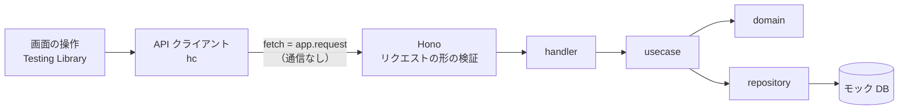

# 要求と方針

状態: 方針の大半を確定（2026-11-18）。最小の縦切り（売上登録）を PoC として実装済み。残りは [7. 未決事項](#7-未決事項)。
kawakin-core-system は参考資料として扱う。domain の作りは強く参考にし、それ以外は引き継ぐ前提にしない。

## 1. 狙い

TypeScript で業務 Web アプリを作るための土台（フレームワーク兼サンプル実装）を作る。次の3つを両立させる。

1. 画面の操作から、API 通信を介さずにバックエンドの業務処理までを同じプロセスで結合テストできる。差し替えるのは DB だけにする。
2. 識別子に使う英単語を単語帳で絞り、関数名と処理の並びを日本語に機械翻訳して、処理を日本語で読めるようにする。
3. 単語帳の単語を画面の文言にも使い、画面・コード・設計の言葉をそろえる。

## 2. 要求一覧

| ID | 分類 | 要求 |
| --- | --- | --- |
| R-01 | 基盤 | フロントエンド・バックエンドとも TypeScript で書く |
| R-02 | 基盤 | pnpm のモノレポにする |
| R-03 | 基盤 | フロントエンドは React |
| R-04 | 基盤 | バックエンドは Hono を候補とし、テストの要求から判断する（→ Hono に決定） |
| R-05 | 基盤 | フレームワーク兼サンプル実装にする。サンプルの業務は売上登録から入金管理まで |
| R-06 | 基盤 | DB の構造は考えうる最小限にする。ログ・監査の列などは持たない（多対多などの関係は必要なら持つ） |
| R-10 | 設計 | バックエンドは domain・usecase・repository の3層を基本にし、フォルダは層を先に分ける |
| R-11 | 設計 | usecase は関数を呼び、戻り値を次の関数の引数へ渡すだけにする |
| R-12 | 設計 | usecase ではメソッドチェーンを禁止する |
| R-13 | 設計 | エラー処理はシンプルにする。業務エラーは例外で投げ、try/catch で受ける |
| R-14 | 設計 | usecase に if を書かない。判定は domain へ寄せる |
| R-15 | 設計 | context（何でも入る部品の袋）は混乱のもとなので禁止する |
| R-16 | 設計 | domain は kawakin を参考にし、値の型を決め、それがそのまま永続化されるなど、見て物理的に何が起こるか分かる形にする。repository のインターフェースを受け取る domain のサービスは最小限にする |
| R-20 | 画面 | useEffect は一切禁止 |
| R-30 | テスト | 画面のボタン押下などの操作から、API 通信を介さずに usecase（またはそれを含む API handler）を呼び出して結合テストする |
| R-31 | テスト | その結合テストでモックにするのは DB だけ |
| R-32 | テスト | 画面の操作からバックエンドの処理までを、可能な限り軽く流す。DB が本物に近いとボトルネックになるので、そうならない方式にする |
| R-33 | テスト | 画面からの結合テストで、境界値などを厚く確かめる。それより細かい単体テストは、狭い範囲のロジックだけに使う（仮説: 画面からの結合テストを厚くすると、全体のテストの量が減る） |
| R-34 | テスト | 本物の DB を使う結合テストは一部だけ行う |
| R-35 | テスト | repository のテストで、実行される SQL を構造的に固定し、明確にする（極端な状況の調査に活きる） |
| R-36 | テスト | 本番向けの大きなテスト（E2E など）は当面持たない |
| R-40 | 語彙 | 関数などに使う英単語を単語帳で管理し、単語帳にある単語だけを使う。まずは厳しく当てる |
| R-41 | 語彙 | 単語はシステム向けの単語とドメインの単語に分ける |
| R-42 | 語彙 | 単語帳の単語を画面でも使う。画面は多言語になることを想定する |
| R-50 | コメント | 関数の直上に最低限のコメントを置く。当面は目的だけにする |
| R-60 | 翻訳 | コードの処理を日本語に翻訳するツールを自作し、処理を明確に読めるようにする |
| R-61 | 翻訳 | 関数名は体言止めで訳す（`createNewTransportSales` →「新輸送売上の登録」） |
| R-62 | 翻訳 | 関数の中の処理は番号付きで「〜する」の文体で訳す（`validateSalesRequest` →「1. 売上リクエストをバリデーションする」） |

## 3. 決定事項

| 項目 | 決定 | 決めた日 |
| --- | --- | --- |
| リポジトリの位置づけ | フレームワーク兼サンプル実装（売上登録〜入金管理） | 2026-11-18 |
| バックエンド | Hono。画面の結合テストは API クライアントの `fetch` を `app.request` に差し替える | 2026-11-18 |
| DB | PostgreSQL。画面の結合テストはインメモリのモック DB | 2026-11-18 |
| バックエンドの分け方 | 層が先（`domain/sales`・`usecase/sales`・`repository/…`） | 2026-11-18 |
| 業務エラー | 例外で投げ、Hono の共通処理で HTTP の応答に変換する | 2026-11-18 |
| usecase の if | 書かない。domain に寄せる | 2026-11-18 |
| 部品の渡し方 | context は禁止。usecase は必要な部品を引数で1つずつ受ける | 2026-11-18 |
| usecase での呼び出し | 関数と、部品（repository など）のメソッド1段は呼べる。メソッドチェーンは禁止 | 2026-11-18 |
| 単語帳 | 厳しく当てる（CI でエラー） | 2026-11-18 |
| 画面の言語 | 多言語を想定（日本語・英語） | 2026-11-18 |
| 翻訳ツール | usecase・domain を対象に、制御構文も訳し、CLI で Markdown を作る | 2026-11-18 |
| コメント | 当面は目的だけ（TSDoc の1行） | 2026-11-18 |
| 大きなテスト | 当面持たない | 2026-11-18 |

## 4. PoC（売上登録）で作ったもの

### 4.1 構成

```text
web-app-framework/
├─ apps/web/                  # React の画面（Vite・TanStack Router・TanStack Query）
│  ├─ src/sales/              # 売上登録の画面と、その画面の結合テスト
│  ├─ src/shared/             # API クライアント・ルーター・文言・画面の土台
│  └─ test/renderScreen.tsx   # 画面の結合テストの道具
├─ packages/backend/          # Hono の API
│  └─ src/
│     ├─ domain/              # 値の型・エンティティ・入力境界・repository のインターフェース
│     ├─ usecase/             # 業務の手順（関数呼び出しの並びだけ）
│     ├─ repository/          # DB の読み書き（いまはモック DB だけ）
│     ├─ handler/             # Hono のルート・エラーの共通処理
│     └─ testing.ts           # 画面の結合テスト用の部品（モック DB で組み立てる）
├─ packages/vocabulary/       # 単語帳（YAML）と、そこから作る辞書・文法・画面の文言
├─ packages/eslint-plugin/    # 単語帳・関数名の文法・usecase の書き方の lint
├─ packages/translator/       # 日本語翻訳ツール
└─ docs/generated/backend-process.md   # 翻訳ツールの出力
```

コマンド（ルートで実行）:

| コマンド | 内容 |
| --- | --- |
| `pnpm install` | 依存を入れる |
| `pnpm check` | 単語帳の生成物・lint・型・テスト・翻訳の生成物をまとめて確かめる |
| `pnpm test` | テストだけ |
| `pnpm vocabulary:generate` | 単語帳（YAML）を変えたあとに辞書を作り直す |
| `pnpm translate` | 処理の日本語訳を作り直す |

### 4.2 確かめたこと

| 確かめたこと | 結果 |
| --- | --- |
| 画面の操作から usecase まで、通信なしで流せるか | 流せる。画面のコードは本番と同じで、テストでは `fetch` だけを差し替える |
| 画面の結合テストの速さ | 18件で約 0.6 秒（1件 約 20ms。最初の1件だけ準備込みで約 120ms）。テスト全体の実行は約 1.3 秒 |
| バックエンドの処理の速さ | `app.request` 1回あたり約 0.05ms（モック DB）。画面のテストの時間はほぼ画面側 |
| 境界値を画面から厚く確かめられるか | 売上金額（1・999999999・0・1000000000・-1・1.5・1,000・abc・空・前後の空白）、売上日（うるう年・存在しない日・形の違い・空）、顧客の未選択、複数の項目の同時の誤りを、画面の結合テストだけで確かめた |
| 単語帳の lint | 単語帳にない単語・使わせない単語（`add`・`init` など）・動詞で始まらない関数名を検出する |
| usecase の lint | if・for・throw・try・let・メソッドチェーン・リテラルや計算を渡す引数・層の逆向きの import を検出する |
| useEffect の禁止 | `useEffect`・`useLayoutEffect`・`useInsertionEffect` の import を検出する |
| 翻訳ツール | usecase は手順の並びとしてそのまま読める（4.3）。domain は訳せない式がコードのまま残る |
| 画面の本番ビルド | バックエンドのコードは入らない（画面は API の型だけを参照する） |

途中で分かったこと: React 19 は Suspense の待ちを表示に反映するまで約 300ms 待つ。画面を開いてからデータを取ると、テスト1件ごとにこの待ちが入る（最初は1件 約 330ms だった）。画面を開く前にルーターの loader でデータを取っておく形にして、この待ちをなくした。本番の画面でも、データの取得は loader で行う。

### 4.3 翻訳ツールの出力（抜粋）

```ts
/** 顧客への売上を計上するため。 */
export async function createSales(
  salesRepository: SalesRepository,
  customerRepository: CustomerRepository,
  idGenerator: IdGenerator,
  salesRequest: SalesRequest,
): Promise<SalesId> {
  const { customerId, salesDate, salesAmount } = interpretSalesRequest(salesRequest)
  const customer = await customerRepository.findCustomer(customerId)
  const salesId = assignSalesId(idGenerator)
  const salesCreate = planSalesCreate(salesId, customer, salesDate, salesAmount)
  await salesRepository.createSales(salesCreate)
  return salesId
}
```

```text
### 売上の登録

- 関数: `createSales`
- 目的: 顧客への売上を計上するため。
- 引数: 売上リポジトリ、顧客リポジトリ、ID生成器、売上リクエスト
- 処理:
   1. 売上リクエストを解釈する
   2. 顧客を取得する
   3. 売上IDを割り当てる
   4. 売上登録を計画する
   5. 売上を登録する
   6. 売上IDを返す
```

全体は [docs/generated/backend-process.md](generated/backend-process.md)。

## 5. 方針

### 5.1 バックエンドの層

| 層 | 役割 | 依存してよい先 |
| --- | --- | --- |
| domain | 値の型・エンティティ・入力境界・業務ルール・repository のインターフェース。I/O なし | なし |
| usecase | 業務の手順。domain の関数と、引数で受けた部品のメソッドを呼ぶだけ | domain |
| repository | domain の repository のインターフェースを、DB（本番は PostgreSQL、テストはモック DB）で実装する | domain |
| handler（3層の外の薄い層） | Hono のルート。リクエストの形の検証 → usecase の呼び出し → 応答の変換だけ | usecase・domain |

- 部品（repository・ID の採番など）は `AppDependency` に集め、`prepareApp(dependency)` で API を組み立てる。本番は実 DB の部品を、画面の結合テストはモック DB の部品を渡す。
- `AppDependency` を見るのは handler と組み立ての場所だけ。handler は usecase に、必要な部品だけを1つずつ渡す。usecase は context を受けない。
- 層の依存の向きは lint（`no-restricted-imports`）で検査する。

### 5.2 usecase の書き方

usecase のファイルでは次の形だけを書ける。外れたものは lint（`app/flat-steps`）でエラーにする。

| 書けるもの | 書けないもの（domain の関数へ出す） |
| --- | --- |
| `const 変数 = 関数(引数…)`（`await` 可） | `if`・`switch`・`for`・`while`・`throw`・`try`/`catch` |
| `const { a, b } = 関数(引数…)`（分割代入は名前だけ） | メソッドチェーン（`list.filter().map()`、`.then()`） |
| `部品.メソッド(引数…)`（1段だけ） | `context.x.y()` のような2段以上の参照 |
| `関数(引数…)` だけの文 | 演算子・リテラル・三項演算子・関数の中での関数定義・`let` |
| `return 変数` | 式を返す `return`（`return { a }` など） |

- 引数には変数だけを渡せる。値の組み立てや計算は、名前の付いた domain の関数で行う。
- 配列を1件ずつ処理したいときは、配列を受け取る関数にする。

### 5.3 domain の書き方（kawakin を参考）

| kawakin（Go） | このリポジトリ（TypeScript） | 例 |
| --- | --- | --- |
| `value/` の値オブジェクト（`New*` で制約を検証） | `value/` の値の型（`Brand<string, 'SalesDate'>`）と `interpret*`（画面の入力を検証して値にする） | `interpretSalesAmount` |
| エンティティの末端はすべて値オブジェクト | エンティティの項目はすべて値の型 | `Sales` |
| `create/` の作成の入力境界（そのまま INSERT される） | `SalesCreate`。この型の項目が、そのまま1行になる | `planSalesCreate` |
| model の `Entity()` で DB の行から復元 | `restore*` で保存済みの値から組み立てる | `restoreSales` |
| repository のインターフェースは入力境界の型だけを受ける | 同じ。`createSales(salesCreate: SalesCreate)` | `SalesRepository` |
| policy・knowledge | 判定の関数。usecase の if を引き受ける | （入金の業務で足す） |
| `find/`・`update/` の目的別の選択子 | 入金の業務で足す（SQL の固定と合わせて決める。5.7） | — |

- repository のインターフェースを受け取る domain のサービスは最小限にする。いまは `assignSalesId(idGenerator)` だけ。
- 画面の入力は、まだ検証していない文字列のまま受け取り（`SalesRequest`）、domain の `interpret*` で値の型にする。項目ごとの問題は `interpretFields` がまとめ、画面に一度に返す。
- 値の型は、型の上では別物になる（`SalesId` に `CustomerId` を渡すと型エラー）。

### 5.4 エラー処理

- 業務エラーは domain の関数が throw する。usecase は throw も try/catch も書かない。
- 業務エラーの種類は4つ。どれも `AppError` を継承し、画面に出す文はメッセージ帳のキーで持つ。

  | エラー | 使う場面 | HTTP |
  | --- | --- | --- |
  | `ValidationError` | 入力の不正（項目ごとの問題を持つ） | 400 |
  | `ForbiddenError` | 権限がない | 403 |
  | `NotFoundError` | 対象がない | 404 |
  | `ConflictError` | 重複・状態による拒否など、業務上の拒否 | 409 |
  | それ以外 | 想定外 | 500 |

- try/catch を書くのは2か所だけ。Hono の `app.onError` に渡す `respondError`（HTTP の応答への変換とログ）と、domain の `interpretFields`（項目ごとの問題をまとめる）。
- トランザクションは、PostgreSQL の repository を作るときに、更新系のルートのミドルウェアで張る（1リクエスト1トランザクション）。usecase はトランザクションを意識しない。

### 5.5 画面の結合テスト



- `renderScreen(path, database)` が、モック DB で組み立てた Hono アプリに `fetch` をつなぎ、画面の loader を済ませてから描画する。
- テストは、画面の文言を単語帳から引いて要素を探し（`text.label('salesAmount')`）、モック DB の行（`database.sales`）で保存の結果を確かめる。
- 項目の問題は、入力欄の説明（`aria-describedby`）として確かめる。画面の使いやすさも同時に確かめられる。
- 速さのための決まり: 画面のデータは loader で先に取る（Suspense の約 300ms の待ちを入れない）。入力操作は待ち時間なし（`userEvent.setup({ delay: null })`）。

### 5.6 テストの層

| 種類 | 対象 | DB | 量 |
| --- | --- | --- | --- |
| 画面の結合（主役） | 画面〜repository。境界値もここで確かめる | モック DB | 多 |
| 単体 | 狭い範囲のロジック（計算・判定）と、道具（lint・翻訳） | なし | 必要なだけ |
| repository | 実行される SQL と DB の制約。モック DB と同じ振る舞いか | 本物の PostgreSQL | 一部（5.7） |
| E2E | — | — | 当面なし |

### 5.7 SQL の固定（案・未実装）

- repository の1つの操作（入力境界の型・選択子の型）ごとに、SQL を1文の固定の文字列で書く。条件によって SQL を組み立てない。
- 全操作の SQL を台帳（生成物）に出し、SQL の変化を差分で見られるようにする。
- repository のテストは本物の PostgreSQL で行い、同じテストをモック DB にも流して、振る舞いがずれていないことを確かめる。
- 任意の条件が多い検索だけは、組み立て方を1か所に閉じ込め、出る SQL の型をすべて台帳に出す（扱いは Q-B で決める）。

### 5.8 フロントエンド

- React 19 + Vite の SPA。ルーターは TanStack Router、サーバーの状態は TanStack Query。
- 画面を開いたときのデータ取得は、ルーターの loader（`ensureQueryData`）で行い、画面は `useSuspenseQuery` でキャッシュから読む。
- `useEffect`・`useLayoutEffect`・`useInsertionEffect` は lint でエラーにする。ライブラリ内部での利用は対象外。

| useEffect を使いがちな場面 | 代わりの書き方 |
| --- | --- |
| 画面を開いたときのデータ取得 | ルーターの loader + `useSuspenseQuery` |
| props から値を計算する | 描画中に計算する（必要なら `useMemo`） |
| props が変わったら状態を初期化する | `key` を変えて作り直す |
| ボタン押下などに反応する | イベントハンドラに書く |
| 外部の状態の購読 | `useSyncExternalStore` |
| DOM の初期化（フォーカス・計測・外部ウィジェット） | ref コールバック（React 19 で後始末を返せる） |
| ページタイトル | React 19 の `<title>` |

### 5.9 単語帳

- 置き場所: `packages/vocabulary/words/system/*.yaml`（システム向け）、`words/domain/*.yaml`（業務）、`phrases.yaml`（組合せで訳が決まらない並び）、`messages.yaml`（画面の文）。
- 1語の項目: `word`（原形）・`pos`（品詞）・`ja`（体言止めの形）・`jaVerb`（「〜する」の形。動詞だけ）・`en`（画面の英語）・`forms`（複数形など）・`avoid`（同じ意味で使わせない単語）・`role`（repository など受け手の役割の語）・`description`（業務の単語は必須）。
- 単語帳を変えたら `pnpm vocabulary:generate` で辞書（`src/generated/vocabularyData.ts`）を作り直す。CI は作り直し忘れを検出する。
- 検査の範囲: アプリのコード（`apps/**`・`packages/backend/**`）で、自分で宣言した名前（関数・変数・引数・型・型の項目・クラス・import の別名）。ライブラリの名前を参照するだけの箇所は対象外。道具（lint・翻訳・単語帳の生成）は対象外。
- 関数名は動詞で始める（PascalCase のコンポーネント・型は名詞として扱う）。
- 画面の文言: 見出しは単語の並びから作る（`text.label('salesAmount')` →「売上金額」/ "Sales Amount"）。文は `text.message('invalidRange', { … })` で引く。言語は `TextProvider` の `locale` で切り替える。
- まだ当てていない範囲: ファイル名・API のパス・DB のテーブル名と列名（次の作業）。

### 5.10 日本語翻訳ツール

| 対象 | 規則 | 例 |
| --- | --- | --- |
| 関数名 | `動詞 + 残り` →「残りの訳」+「の」+「動詞の体言止めの形」 | `createNewTransportSales` →「新輸送売上の登録」 |
| 手順 | 呼び出し先の名前 →「残りの訳」+「を」+「動詞のする形」 | `validateSalesRequest(…)` →「売上リクエストをバリデーションする」 |
| メソッドの呼び出し | メソッド名で訳す。動詞だけのときは、受け手の名前から役割の語を除いて目的語にする | `salesRepository.create(x)` →「売上を登録する」 |
| 前置詞 | 単語帳の型で並べ替える | `findCustomerById` →「IDで顧客を取得する」 |
| `return` | 「〜を返す」 | `return salesId` →「売上IDを返す」 |
| `if` | 「〜場合」の下に入れ子にする | `if (text === '')` →「テキストが空である場合」 |
| `throw` | メッセージ帳の文で「エラー「…」で止める」 | `throw rejectValue('inputRequired')` |
| 訳せない式 | コードのまま `…` で示す | `` `Number(trimmedText)` `` |

### 5.11 コメント

- export する usecase・domain の関数には、目的（なぜこの処理があるか）を TSDoc の1行目に書く。翻訳ツールが「目的」として出す。
- 処理の手順・引数の説明は書かない（名前と型で表し、翻訳ツールが作る）。

## 6. サンプル業務の範囲と DB（案）

売上登録から入金管理までを、次の4つのテーブルで表す案。ログ・作成日時・更新者などの列は持たない。

| テーブル | 列 | 意味 |
| --- | --- | --- |
| `customer` | `customer_id`・`customer_name` | 顧客 |
| `sales` | `sales_id`・`customer_id`・`sales_date`・`sales_amount` | 売上（実装済み） |
| `payment` | `payment_id`・`customer_id`・`payment_date`・`payment_amount` | 入金 |
| `payment_allocation` | `payment_id`・`sales_id`・`allocation_amount` | 消込（入金をどの売上に充てたか。入金と売上の多対多） |

- 売上の入金状況（未入金・一部入金・入金済み）は列に持たず、消込の合計から求める。
- 画面の案: 顧客一覧、売上の登録・一覧、入金の登録・一覧、消込（入金を売上に充てる）、売上ごとの入金状況。

## 7. 未決事項

**Q-A. サンプル業務の範囲**（6章の案でよいか）

- 請求（請求書の発行・締め）を入れるか。入れない案を推奨（最小にするため。売上に直接入金を充てる）。
- 消込の単位: 入金1件を複数の売上に分けて充てられる（多対多）案を推奨。

**Q-B. SQL の固定の方式**

- A. 1操作1文の固定の SQL を手で書き、台帳に出す（推奨。実行される SQL がコードの上でそのまま見える）。ORM は使わず、薄いドライバで実行する。
- B. Drizzle などのクエリビルダで書き、出力される SQL をスナップショットで固定する。
- 推奨: A。以前「DB は Drizzle」を推奨したが、SQL を構造的に固定する要求（R-35）には A が合う。マイグレーションも SQL のファイルで持つ。

**Q-C. 本物の DB を使うテストの DB**

- A. Docker の PostgreSQL（本番と同じ。Docker が要る）
- B. PGlite（WASM の PostgreSQL。Docker が要らない。細かな挙動が本番と違うことがある）
- 推奨: A。SQL の実体を確かめるテストなので、本番と同じ PostgreSQL で動かす。

**Q-D. 部品の渡し方の確認**

- usecase は必要な部品を引数で1つずつ受ける形にした（4.3 の `createSales`）。この具体例で問題ないか。
- 部品が多い usecase では引数が長くなる。その場合も1つずつ受ける（推奨。何に触る処理かが引数で分かる）。

**Q-E. 前回からの残り**

- 画面の UI ライブラリ（shadcn/ui + Tailwind / MUI / Mantine / 未定）
- 本番の実行環境（Node（Cloud Run・ECS など）/ Cloudflare Workers / 未定）

## 8. 次の作業

1. 入金・消込の業務を足す（domain の判定・目的別の選択子もここで作る）。
2. PostgreSQL の repository、SQL の固定と台帳、本物の DB での repository のテスト、トランザクション。
3. 単語帳をファイル名・API のパス・DB のテーブル名と列名にも当てる。
4. CI（GitHub Actions で `pnpm check`）。
5. 画面を手元で動かす口（開発用の API サーバーと Vite の開発サーバー）。
