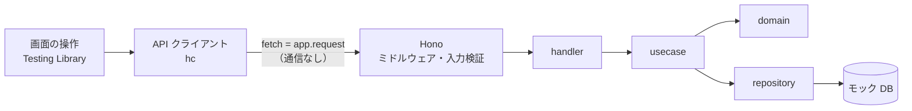

# 要求の整理と方針案（ドラフト）

状態: ドラフト（2026-11-18）。[5. 未決事項](#5-未決事項質問) の回答を受けて方針を確定し、この文書を更新する。
kawakin-core-system は参考資料であり、構成・規約を引き継ぐ前提にしない。

## 1. 狙い

TypeScript で業務 Web アプリを作るための土台を作る。次の3つを両立させる。

1. 画面の操作から、API 通信を介さずにバックエンドの業務処理までを同じプロセスで結合テストできる。差し替えるのは DB だけにする。
2. 識別子に使う英単語を単語帳で絞り、関数名と処理の並びを日本語に機械翻訳して、処理を日本語で読めるようにする。
3. 単語帳の単語を画面の文言にも使い、画面・コード・設計の言葉をそろえる。

## 2. 要求一覧

| ID | 分類 | 要求 |
| --- | --- | --- |
| R-01 | 基盤 | フロントエンド・バックエンドとも TypeScript で書く |
| R-02 | 基盤 | pnpm のモノレポにする |
| R-03 | 基盤 | フロントエンドは React |
| R-04 | 基盤 | バックエンドは Hono を候補とし、テストの要求（R-30〜R-32）から判断する |
| R-10 | 設計 | バックエンドは domain・usecase・repository の3層を基本にする |
| R-20 | 画面 | useEffect は一切禁止 |
| R-30 | テスト | 画面のボタン押下などの操作から、API 通信を介さずに usecase（またはそれを含む API handler）を呼び出して結合テストする |
| R-31 | テスト | その結合テストでモックにするのは DB だけ |
| R-32 | テスト | 画面の操作からバックエンドの処理までを、可能な限り軽く（速く・準備少なく）流す |
| R-40 | 語彙 | 関数などに使う英単語を単語帳で管理し、単語帳にある単語だけを使う |
| R-41 | 語彙 | 単語はシステム向けの単語とドメインの単語に分ける |
| R-42 | 語彙 | 単語帳の単語を画面でも使う（i18n の仕組みを想定） |
| R-50 | コメント | 関数の直上に最低限のコメントを置く。書く内容（目的・概要など）は要検討 |
| R-60 | 翻訳 | コードの処理を日本語に翻訳するツールを自作し、処理を明確に読めるようにする |
| R-61 | 翻訳 | 関数名は体言止めで訳す（`createNewTransportSales` →「新輸送売上の登録」） |
| R-62 | 翻訳 | 関数の中の処理は番号付きで「〜する」の文体で訳す（`validateSalesRequest` →「1. 売上リクエストをバリデーションする」） |

## 3. 要求から読み取った設計の前提

- **翻訳には「名前の文法」が要る（R-40・R-60〜62）**
  英語は「動詞→目的語」、日本語は「目的語→動詞」の順なので、各単語に品詞を持たせて並べ替える。動詞は「体言止めの形（登録）」と「する形（登録する）」の2つの訳を持つ。「関数名は動詞で始める」などの命名の文法を lint で強制する。
- **処理の説明は手書きしない（R-50・R-60）**
  kawakin では処理ごとに `@処理`・`@名称` のコメントを手書きしており、コードとの食い違いを検査で追いかける必要があった。名前から説明を生成すれば、説明とコードはずれない。コメントは名前で表せない「なぜ（目的・根拠）」に絞れる。
- **usecase は「名前の付いた手順の並び」で書く（R-60〜62）**
  翻訳結果が処理説明として読めるよう、usecase の本体は1文1手順の関数呼び出しを基本にし、細かな計算・判定は名前を付けて domain の関数へ出す。
- **バックエンドは画面テストと同じ実行環境で動く必要がある（R-30〜32）**
  Web 標準（Request / Response）だけで動き、DB への依存を外から差し替えられる（依存の注入）こと。
- **useEffect の禁止はデータ取得の方式を決める（R-20）**
  画面を開いたときのデータ取得は、ルーターの loader か Suspense 対応のクエリで行う。

## 4. 方針案（仮決め）

### 4.1 バックエンド: Hono を推奨

画面結合テストでは、フロントエンドの API クライアントが使う `fetch` を、Hono アプリの `app.request` に差し替える。ネットワーク・ソケット・サーバーの起動なしで、ルーティング・ミドルウェア・入力検証・handler・usecase・repository を本番と同じ順に通る。画面側の API 呼び出しのコードは本番とテストで同じになる。

```ts
// 本番: 実際に HTTP で呼ぶ
const client = hc<AppType>('/api')

// 画面結合テスト: 同じクライアントの fetch だけを差し替える（通信なし）
const app = createApp({ database: createMockDatabase() })
const client = hc<AppType>('http://test/api', {
  fetch: (input, init) => app.request(input, init),
})
```

| 候補 | 画面テストからの呼び方 | 通る層 | 評価 |
| --- | --- | --- | --- |
| **Hono** | `fetch` を `app.request` に差し替え | ルーティング・ミドルウェア・入力検証・handler 以降すべて | ◎ 画面のコードは本番と同じ。Web 標準なので jsdom・ブラウザの中でも動く。起動が軽い |
| oRPC / tRPC | サーバー側のクライアントで手続きを直接呼ぶ | handler 以降（HTTP の変換は通らない） | ○ さらに軽いが、状態コード・ヘッダ・HTTP のミドルウェアは検証できない。API が RPC 専用の形になる |
| Fastify | `inject()` | すべて | △ Node 専用で、画面のクライアントと共通にしにくい |
| NestJS | テスト用モジュール + supertest など | すべて | × 起動が重い。デコレータと DI コンテナが前提 |
| Express | supertest | すべて | × 実際のソケットが要る |

- API の定義は `@hono/zod-openapi` で zod のスキーマから書き、OpenAPI も出せるようにする。入力スキーマはフロントのフォーム検証でも使い回す。
- 懸念: Hono RPC（`hc`）の型推論は、ルートが増えると重くなることがある。業務のまとまりごとに子アプリへ分ける、クライアントの型を事前にコンパイルする、で抑える。だめなら OpenAPI からクライアントを生成する方式に切り替える（`fetch` を差し替える方式はそのまま使える）。

### 4.2 画面結合テスト



```ts
test('輸送売上を登録できる', async () => {
  const database = createMockDatabase() // 差し替えるのは DB だけ
  const { user, screen } = renderScreen('/transport-sales/new', { database })

  await user.type(screen.getByLabelText(label('amount')), '1000')
  await user.click(screen.getByRole('button', { name: label('create') }))

  expect(await screen.findByText(message('createCompleted'))).toBeVisible()
  expect(await database.transportSales.findMany()).toHaveLength(1)
})
```

- `renderScreen` は、モック DB を注入した Hono アプリを作り、`fetch` を差し替えた API クライアントをルーターの context に渡して画面を描画する。
- テストの実行は Vitest。軽さを優先して jsdom（または happy-dom）で動かし、ブラウザでしか再現しないものだけ Vitest Browser Mode を使う。jsdom 上で Hono の Request・AbortSignal が問題なく動くかは PoC で確かめる。
- 画面の文言はテストでも単語帳から引く（`label('create')`）。単語帳にない文言は画面にもテストにも書けない。
- 時刻・ID の採番も注入して、テストで固定できるようにする。

| テストの種類 | 対象 | DB | 量 |
| --- | --- | --- | --- |
| domain 単体 | 業務ルール | なし | 多 |
| 画面結合（この基盤の主役） | 画面〜repository | モック | 多 |
| usecase 単体 | 画面のない処理（バッチなど） | モック | 必要なだけ |
| repository | SQL・DB の制約 | 本物の DB（コンテナ） | 中 |
| E2E | 本番と同じ構成 | 本物の DB | 少（要否は Q10） |

### 4.3 バックエンドの層

| 層 | 役割 | 依存してよい先 |
| --- | --- | --- |
| domain | エンティティ・値オブジェクト・業務ルール・repository のインターフェース。I/O なし | なし |
| usecase | 業務の手順。domain の関数と repository のインターフェースを並べる | domain |
| repository | repository のインターフェースを DB で実装する | domain |
| handler（3層の外の薄い層） | Hono のルート。入力検証 → usecase の呼び出し → 応答の変換だけ | usecase・domain |

- 依存は `createApp(dependencies)` に集める。本番は実 DB を、テストはモック DB を渡す。
- usecase は関数で書き、依存（repository・時刻・ID 採番・トランザクション）を第1引数の context で受け取る。クラスや DI コンテナは使わない。
- 層の依存方向は dependency-cruiser（または eslint-plugin-boundaries）で CI 検査する。

### 4.4 フロントエンド

- React 19 + Vite の SPA。ルーターは TanStack Router、サーバーの状態は TanStack Query（`useSuspenseQuery`）を仮置きする（Q9）。
- `useEffect`・`useLayoutEffect`・`useInsertionEffect` をアプリのコードで使うと lint エラーにする。ライブラリ内部での利用は対象外。

| useEffect を使いがちな場面 | 代わりの書き方 |
| --- | --- |
| 画面を開いたときのデータ取得 | ルーターの loader / `useSuspenseQuery` |
| props から値を計算する | 描画中に計算する（必要なら `useMemo`） |
| props が変わったら状態を初期化する | `key` を変えて作り直す |
| ボタン押下などに反応する | イベントハンドラに書く |
| 外部の状態の購読 | `useSyncExternalStore` |
| DOM の初期化（フォーカス・計測・外部ウィジェット） | ref コールバック（React 19 で後始末を返せる） |
| ページタイトル | React 19 の `<title>` |

### 4.5 単語帳

単語を YAML で管理し、そこから lint の辞書・画面の文言・用語集を生成する。

```yaml
# vocabulary/system/verb.yaml
- word: create
  kind: system
  pos: verb
  ja: 登録 # 体言止めで使う形
  jaVerb: 登録する # 「〜する」の形
  avoid: [add, insert, register] # 同じ意味で使わせない単語
- word: validate
  kind: system
  pos: verb
  ja: バリデーション
  jaVerb: バリデーションする
- word: new
  kind: system
  pos: adjective
  ja: 新

# vocabulary/domain/sales.yaml
- word: transport
  kind: domain
  pos: noun
  ja: 輸送
  description: 貨物を運ぶ役務
- word: sales
  kind: domain
  pos: noun
  ja: 売上
  description: 役務の提供で計上する収益
```

- 検査: 自分で宣言した識別子（関数・変数・引数・型・プロパティなど）を camelCase / PascalCase の区切りで単語に分け、単語帳にない単語・`avoid` の単語を lint エラーにする。ライブラリの名前を参照するだけ（`useState`、`onClick` など）は対象外。
- 名前の文法も lint で強制する: 関数は動詞で始める、真偽値は `is`・`has`・`can` で始める、コンポーネントは名詞で終える、など。
- 訳が単語の組合せで決まらない複合語（例: `createdAt` →「登録日時」）は、複数の単語からなる見出しとして登録し、長い見出しを優先して当てる。
- 画面の文言: 単語帳から型付きの文言関数を生成する（`label('transportSales')` →「輸送売上」）。単語の並びから文言を組み立て（`transportSalesList` →「輸送売上一覧」）、不自然なものだけ上書きを登録する。エラーメッセージなどの文はメッセージ帳に登録し、キーにも単語帳の単語だけを使う。
- 単語帳の `description` から用語集（ユビキタス言語の一覧）を生成する。

### 4.6 日本語翻訳ツール

TypeScript Compiler API で関数を読み、名前と本体の文を単語帳で訳す。

```ts
/** 輸送の実績を売上として計上するため。 */
export async function createNewTransportSales(context: Context, salesRequest: SalesRequest) {
  const validatedRequest = validateSalesRequest(salesRequest)
  const transportSales = buildTransportSales(validatedRequest)
  await saveTransportSales(context, transportSales)
  return transportSales
}
```

```text
関数: 新輸送売上の登録
目的: 輸送の実績を売上として計上するため。
処理:
  1. 売上リクエストをバリデーションする
  2. 輸送売上を組み立てる
  3. 輸送売上を保存する
  4. 輸送売上を返す
```

訳し方の規則（たたき台）:

| 対象 | 規則 | 例 |
| --- | --- | --- |
| 関数名 | `動詞 + 残り` →「残りの訳」+「の」+「動詞の体言止めの形」 | `createNewTransportSales` →「新輸送売上の登録」 |
| 処理の1文 | 呼び出し先の名前 →「残りの訳」+「を」+「動詞のする形」 | `validateSalesRequest(...)` →「売上リクエストをバリデーションする」 |
| `return` | 「〜を返す」 | `return transportSales` →「輸送売上を返す」 |
| `if` / `for` | 「〜の場合」「〜ごとに」で入れ子にする | 要否は Q7 |

PoC で決めること: 前置詞（`findSalesByCustomer` →「顧客で売上を検索する」）、真偽値の関数（`isClosed`）、メソッド呼び出し（`salesRepository.save(sales)` を受け手の名前から「売上を保存する」と訳すか、メソッド名を `saveSales` まで書かせるか）。

### 4.7 コメント

「何をするか」は名前から翻訳ツールが作るので、コメントには名前で表せないことだけを書く。たたき台:

- export する usecase・domain の関数には、目的（なぜこの処理があるか）を TSDoc の1行目に日本語で必須にする。
- 業務ルールの根拠（要件 ID など）は任意のタグで書く。
- 処理の手順・引数の説明は書かない（名前と型で表す）。

### 4.8 モノレポ構成案

```text
web-app-framework/
├─ apps/
│  ├─ web/              # React の画面
│  └─ server/           # 本番の起動口（Hono を起動し、実 DB を注入するだけ）
├─ packages/
│  ├─ backend/          # domain / usecase / repository / handler と createApp()
│  ├─ vocabulary/       # 単語帳（YAML）と、そこから生成する辞書・画面の文言・用語集
│  ├─ eslint-plugin/    # 単語帳・命名の文法・useEffect 禁止の lint
│  ├─ translator/       # 日本語翻訳ツール
│  ├─ test-kit/         # 画面結合テストの道具（renderScreen・モック DB）
│  └─ config/           # tsconfig・ESLint などの共有設定
└─ docs/
```

- backend の中の分け方（層が先か、業務のまとまりが先か）は Q3 で決める。
- 道具: pnpm workspaces、TypeScript の project references、ESLint（独自ルールを書くため）、整形は Prettier か Biome、Vitest、dependency-cruiser、GitHub Actions。

## 5. 未決事項（質問）

### 先に決めたいこと

**Q1. このリポジトリの位置づけ**

- A. テンプレート: 案件ごとにコピーして使う（tsumiki と同じ使い方）。サンプル業務を同梱する
- B. フレームワーク: lint・翻訳ツール・テストの道具をパッケージとして公開し、各案件のリポジトリから依存する
- C. 特定の1つのアプリを作るためのリポジトリ
- 推奨: A。ただし道具は `packages/` に分けて置き、後で B のように公開できる形にする。システム単語は土台側、ドメイン単語は案件側で持つ。

**Q2. DB とモックの方式**

- DB 製品: PostgreSQL / MySQL / その他
- モックの方式:
  - A. インメモリの偽 repository（配列で動く repository を別に書く）: 最速で、DB 製品に依存しない。repository が2つの実装になり、検索・集計が複雑になるほど二重実装が重い。本物とのずれは、同じテストを両方に流して防ぐ
  - B. PGlite（WASM の PostgreSQL を同じプロセスで動かす）: 本番と同じ repository・SQL・マイグレーションがそのまま動き、二重実装がない。PostgreSQL 限定で、テストファイルごとに起動の時間がかかる（PoC で計測）
- ORM: Drizzle / Prisma / Kysely
- 推奨: PostgreSQL + B + Drizzle（DB の定義も TypeScript で書けるので、テーブル名・列名にも単語帳の検査が効く）。DB が MySQL なら A。

**Q3. バックエンドの中の分け方**

- A. 層が先: `domain/sales/…`・`usecase/sales/…`・`repository/sales/…`
- B. 業務のまとまりが先: `sales/domain`・`sales/usecase`・`sales/repository`（まとまりの間は公開した usecase だけで呼び合う）
- あわせて確認: handler（Hono のルート）は usecase を呼ぶだけの薄い層として3層の外に置く形でよいか。repository のインターフェースは domain に置く形でよいか。
- 推奨: B。単語帳のドメイン単語・コード・テストが業務のまとまりごとにそろい、大きくなっても境界を保ちやすい。

**Q4. 業務エラーの返し方**

- A. 例外: 業務エラーのクラスを throw し、Hono の共通処理で HTTP の応答に変換する
- B. 戻り値: Result 型（neverthrow など）で返す
- 推奨: A。usecase が手順の並びのまま書け、翻訳結果がエラー判定の分岐で埋まらない。B はエラーの経路が型で見えるが、手順ごとに分岐が増える。

**Q5. 単語帳を当てる範囲と厳しさ**

- 範囲（複数可）: 関数・メソッド名 / 変数・引数 / 型・クラス / プロパティ（API の項目を含む） / DB のテーブル・列名 / API のパス / ファイル・フォルダ名 / テスト名
- 違反の扱い: CI でエラー / 警告だけ
- 活用形（`orders`・`createdAt` など）: 活用形も単語帳に明示して登録 / 規則で原形に戻して照合
- 推奨: 自分で宣言する名前はすべて（テスト名の文章は除く）＋ API のパス・DB 名・ファイル名。CI でエラー。活用形は明示して登録（一番厳密で、翻訳も確実になる）。

### 後で決めてもよいこと（推奨のまま PoC を進められる）

**Q6. 画面の言語**

- A. 日本語だけ（i18n は単語帳から文言を引く仕組みとして使う） / B. 多言語
- 推奨: A。単語帳に英語の表示名を足せば B に広げられる形にする。

**Q7. 翻訳ツールの対象・深さ・出力先**

- 対象: backend の usecase・domain だけ / backend 全体 / 画面も含む全体
- 深さ: 関数呼び出しだけ / `if`・`for`・`return`・`throw` も訳す
- 出力先: CLI で Markdown を生成 / 設計Viewer のような Web 画面 / エディタのホバー表示 / PR に差分をコメント
- 推奨: まず backend の usecase・domain、制御構文も訳す、CLI で Markdown。Web 画面・エディタ表示は後から足す。

**Q8. コメントに書く内容**

- A. 目的だけ1行必須 / B. 目的＋概要 / C. 目的＋入力・出力・エラー（kawakin の `@backend-design` に近い）
- 推奨: A（4.7 の案）。

**Q9. 画面まわりのライブラリ**

- ルーター: TanStack Router / React Router v7
- フォーム: React Hook Form / TanStack Form / React 19 の form action
- UI: shadcn/ui + Tailwind / MUI / Mantine / 未定
- SPA か SSR か
- 推奨: TanStack Router + TanStack Query、フォームは PoC で比較、SPA。

**Q10. 動かす環境と E2E**

- 本番の実行環境: Node（Cloud Run・ECS など） / Cloudflare Workers / 未定
- E2E（本物のサーバー・DB を通す Playwright のテスト）: 少数のスモークだけ持つ / 持たない
- 推奨: Node + 少数のスモーク。

## 6. 次の進め方

1. 未決事項の回答で、この文書の方針を確定する。
2. PoC（最小の縦切り）: 1画面・1 API で「ボタン押下 → usecase → モック DB」の結合テストを1本通す。あわせて単語帳の lint と翻訳ツールの最小版を作り、4.6 の例が訳せることを確かめる。
3. PoC の結果で、lint・CI・テストの道具・ディレクトリを整える。
