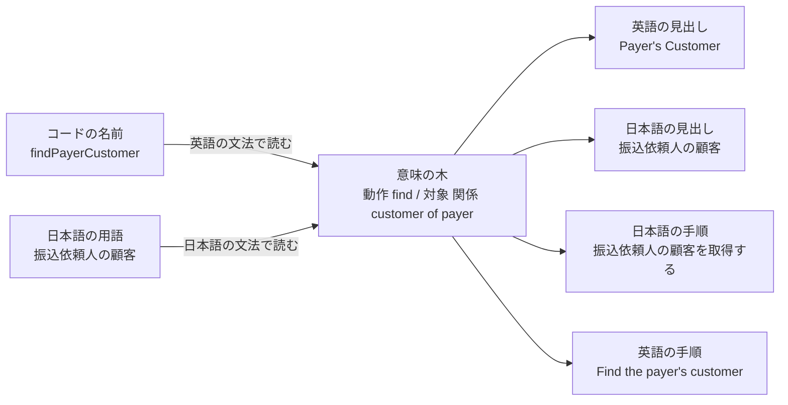

# 単語帳の設計（英語と日本語を構造で統一する）

状態: 案（2026-11-19）。1章はいまの単語帳を調べた結果、2章以降が目指す形と移行の段取り。判断が要る点は6章。

## 1. いまの状態

### 1.1 どこで使えているか

| 使い道 | いまの状態 |
| --- | --- |
| コードの名前（画面・バックエンド） | lint（`app/known-words`・`app/verb-first`）で、単語帳の単語だけ・動詞で始まる関数名に限っている |
| DB のテーブル名・列名・区分値 | SQL の台帳の生成で検査している |
| 画面の見出し | `text.label('salesAmount')` で、単語の並びから日本語・英語を組み立てている |
| 画面の文 | `text.message('invalidRange', …)` で、`messages.yaml` の日本語・英語の文を引いている |
| 処理の日本語訳 | 翻訳ツールが関数名を体言止め、処理を「〜する」にしている（日本語だけ） |

画面でもバックエンドでも同じ単語帳を使えている。ただし、英語と日本語が「構造で」統一されているとは言えない。

### 1.2 足りないところ（2026-11-19 に数えた結果）

| 問題 | 数 | 例 |
| --- | --- | --- |
| 英語 → 日本語 → 英語と戻すと、1通りに戻らない | 画面の見出し 51件のうち 9件 | 「請求番号」→ invoiceNumber / billingNumber。「入金日」→ paymentDate / paymentDay |
| 同じ品詞で日本語の訳がかぶる | 7組 | 請求（invoice・billing）、画面（page・screen）、実行（execute・run）、確認（expect・ensure） |
| 訳を、助詞や活用の断片を含む文字列で持っている | 形容詞 37件 | cancelable →「の取消ができること」、closable →「締められること」、unissued →「未発行の」 |
| 名詞の並びの関係を表せない | — | `findPayerCustomer` →「振込依頼人顧客を取得する」（本来は「振込依頼人**の**顧客」） |
| 英語の見出しが単語の英語を並べるだけ | — | `salesCreate` → "Sales Create"（本来は "Sales Registration" か "Create Sales"） |
| 英語・日本語を別々の文字列で上書きしている | 並び 34件・文 33件 | `paymentCreate` の英語は上書きの "Register Payment"。文は2つの言語で2回書いている |
| 単語帳を通らない文言 | 4種類 | `YYYY-MM-DD`、`—`、`` `${taxRate}%` ``、`8%（軽減）` |

原因は2つにまとまる。

1. **単語帳が「英単語 → 日本語の文字列」の表になっている。** 日本語の側に構造（語形・活用・つなぎ方）がなく、日本語から英語へ戻す手がかりもない。
2. **組み立ての規則が日本語専用で、コードに直書きされている。** YAML の `ja`・`jaVerb`・`jaName` と `grammar.ts`。英語の組み立ては単語を並べるだけで、3つめの言語を足すにはフィールドとコードを足すことになる。

## 2. 目指す形

意味（言語に依らない構造）と、言語ごとの書き方を分ける。考え方は Grammatical Framework（抽象構文と具象構文）や、制御自然言語（決まった語彙と文法だけで書く言語）と同じ。コードの名前は、語彙と文法を絞った「制御された英語」なので、この形に乗せられる。

| 層 | 持つもの | 例 |
| --- | --- | --- |
| 概念 | 言語に依らない概念の ID と品詞 | `invoice: 名詞`、`issue: 動詞`、`draft: 形容詞` |
| 構文（意味の木） | 概念の組み立て | `動作(issue, 対象: invoice)`、`複合(head: amount, 修飾: sales)`、`関係(customer, of, payer)` |
| 言語ごとの書き方 | 語形（活用）と、木を文字列にする規則 | 英語: 名前 `issueInvoice`・見出し "Issue Invoice"。日本語: 題「請求の発行」・手順「請求を発行する」 |

コードの名前・画面の見出し・ボタン・画面の文・処理の訳は、すべて同じ木から作る。言語を足すときは「その言語の語形と書き方の規則」を足すだけにする。



### 2.1 概念（語彙）

- 概念の ID は英語の原形のままにする（コードが英語なので）。1つの概念は1つの意味だけを持つ（いまと同じ）。
- 言語ごとの語形は、最小の情報と「活用の型」から作る。

  ```yaml
  - id: issue
    category: verb
    en: { lemma: issue, noun: issuance }
    ja: { stem: 発行, class: suru }          # 発行・発行する・発行して・発行できる・発行済み を作る
  - id: cancel
    category: verb
    en: { lemma: cancel, past: canceled, noun: cancellation }
    ja: { dictionary: 取り消す, class: godan, noun: 取消 }   # 取り消す・取り消せる・取り消した を作る
  - id: amount
    category: noun
    en: { lemma: amount }
    ja: { form: 金額, attach: direct }       # 前の名詞へ「の」なしでつなぐ（売上金額）
  - id: customer
    category: noun
    en: { lemma: customer, plural: customers }
    ja: { form: 顧客 }                       # 前の名詞へは「の」でつなぐ（振込依頼人の顧客）
  ```

- **言語ごとに一意にする（全単射）。** 1つの言語の中で、同じ品詞の同じ語形は1つの概念にだけ当てる。生成のときに検査し、「請求」を invoice と billing の両方に当てるような重なりを止める。これで日本語から英語へ1通りに戻せる。
- **派生は語彙でなく文法で作る。** -able（cancelable ＝ cancel の可能形 →「取り消せる」）、過去分詞（issued ＝ issue の完了 →「発行済み」）、否定（unissued →「未発行」）。いまの断片の訳（37件）は、ほとんどがこれで消える。
- **決まった言い回し（複合語）は1つの概念として持つ。** `billing customer` ＝「請求先」のように、部分の組合せで訳が決まらないもの。英語の側は単語の並びとして持ち、名前の中で見分ける。

### 2.2 構文（意味の木）

組み立ては決まった種類だけにする。

| 組み立て | 英語 | 日本語 |
| --- | --- | --- |
| 複合（名詞 ＋ 名詞） | sales amount | 売上金額（つなぐ名詞が `attach: direct`）／振込依頼人の顧客（それ以外は「の」） |
| 修飾（形容詞 ＋ 名詞） | draft invoice | 発行前の請求 |
| 関係（名詞 ＋ 前置詞 ＋ 名詞） | customer for sales、customer by id | 売上用の顧客、ID での顧客 |
| 動作（動詞 ＋ 対象 ＋ 関係） | find customer by id | ID で顧客を取得する（手順）／ID での顧客の取得（題） |
| 述語（is・has・can） | is closable | 締められる |
| 文の型 | 下の表 | 下の表 |

画面の文は、文の型に当てはめて作る。型ごとに、各言語の書き方を1回だけ決める。

| 文の型 | 意味の木 | 英語 | 日本語 |
| --- | --- | --- | --- |
| 依頼 | `依頼(動作 enter, 対象 $field)` | Enter {field}. | {field}を入力してください。 |
| 範囲の依頼 | `依頼(動作 enter, 対象 $field, 範囲 $minimum $maximum)` | Enter {field} between {minimum} and {maximum}. | {field}は{minimum}から{maximum}までで入力してください。 |
| 済んだことの報告 | `完了(動作 create)` | Created. | 登録しました。 |
| 状態の報告 | `状態(対象 target, 否定(found))` | The target was not found. | 対象が見つかりません。 |

型に収まらない文（長い説明・法令の文言など）は「自由文」として両方の言語で書くことを認める。ただし数を出し、増えないように見張る。

### 2.3 言語ごとの書き方（文体）

同じ木から、使い道ごとに文体を変えて作る。

| 使い道 | 英語 | 日本語 |
| --- | --- | --- |
| コードの名前 | camelCase（`issueInvoice`） | 作らない |
| 画面の見出し | Title Case の名詞句（Invoice Number） | 名詞句（請求番号） |
| ボタン | 動詞の命令形（Issue） | 動詞の名詞形（発行） |
| 関数の題 | 名詞化した句（Issuance of the invoice） | 体言止め（請求の発行） |
| 処理の手順 | 命令形（Issue the invoice） | する形（請求を発行する） |
| 画面の文 | 文の型ごとの書き方 | 丁寧体 |

### 2.4 両方向に読む

- **英語 → 木**: いまと同じく、コードの名前を単語帳と英語の文法で読む。
- **日本語 → 木**: 語彙が閉じていて語形が一意なので、最長一致で単語に分け、「の・を・で・から・へ」で関係を読み取れる。
- これで次ができる。
  - 日本語の用語から英語の名前を引く（`pnpm vocabulary:find 振込依頼人の顧客` → `payerCustomer`）。設計書の言葉から名前を決められる。
  - 往復の検査を CI に入れる。コードの名前と画面の見出しをすべて「英語 → 日本語 → 英語」と戻し、一致しなければ止める。単語帳が構造で統一されていることを、機械で保証できる。

## 3. 言語の構造上むずかしいところと扱い

| むずかしいところ | 扱い |
| --- | --- |
| 語順・助詞 | 木の役割（対象・手段・起点・到達点・用途）から決める。いまの前置詞の型を役割に置き換える |
| 名詞のつなぎ方（「の」の有無） | つながれる側の名詞に `attach: direct` を持たせる（金額・番号・日・名・区分・一覧など） |
| 活用 | 活用の型（サ変・五段・一段）から作る。業務の動詞の多くはサ変（〜する）で、語幹だけで済む |
| 単数・複数 | 日本語は数を表さないので、日本語から戻すと数は分からない。往復の検査は原形でそろえて比べる（customers と customer を同じとみなす） |
| 冠詞（the・a） | 英語の文体（手順・文）の規則で付ける。見出しには付けない |
| 多義語 | 1つの概念は1つの意味（いまと同じ）。言語ごとの一意の検査で、訳の側の多義も止める |
| 型に収まらない文 | 自由文として認め、数を見張る |

## 4. 移行の段取り

1. **一意の検査を入れ、訳のかぶりを直す。** 請求（invoice）と請求先（billing customer）など、いまのかぶり（同じ品詞 7組・品詞をまたいで 10件）を解消する。往復の検査を入れ、画面の見出しの 51件を 51件とも戻せるようにする。
2. **語形を活用の型で持つ。** 派生（-able・-ed・un-）を文法に移し、断片の訳（37件）を消す。英語の名詞化（creation・issuance）も持ち、"Sales Create" をなくす。
3. **名詞のつなぎ方の規則を入れる。** 「振込依頼人の顧客」を作れるようにする。
4. **文を文の型に移す（33件）。** 型に収まらないものだけ自由文にする。
5. **日本語からの逆引き**（`pnpm vocabulary:find`）と、往復の検査を CI に入れる。
6. **翻訳ツールで英語の訳も作る。** 3つめの言語を足す前の練習台にする。

1〜3 で、いまの YAML の形（`ja`・`jaVerb`・`jaName`）を、言語ごとの欄（`en: {…}`・`ja: {…}`）に変える。文法は言語ごとのファイル（`grammar/en.ts`・`grammar/ja.ts`）に分け、木を作る部分（英語の名前の読み取り）と、木を文字列にする部分を分ける。

## 5. この設計で変わらないもの

- コードは英語で書き、名前は lint で単語帳に限る。
- 画面・バックエンド・DB・翻訳ツールが同じ単語帳を使う。
- 単語帳は YAML で持ち、生成物（`vocabularyData.ts`）を CI で照合する。

## 6. 判断が要る点

| 点 | 推奨 |
| --- | --- |
| 概念の ID を英語の原形のままにするか | はい（コードが英語のため） |
| 名詞のつなぎ方を「直接つなぐ名詞に印、それ以外は『の』」で決めるか | はい |
| 往復の検査で、単数・複数を同じとみなすか | はい（日本語から数は戻せないため） |
| 型に収まらない文を自由文として認めるか | はい（数を出して見張る） |
| 3つめの言語の予定があるか | 予定があれば、活用の型と文体の規則を早めにその言語でも試す |
| 単語帳を誰が編集するか（開発者だけか、業務の人もか） | 当面は開発者が YAML で編集し、`vocabulary:find` と生成した用語集で業務の人と合わせる |
